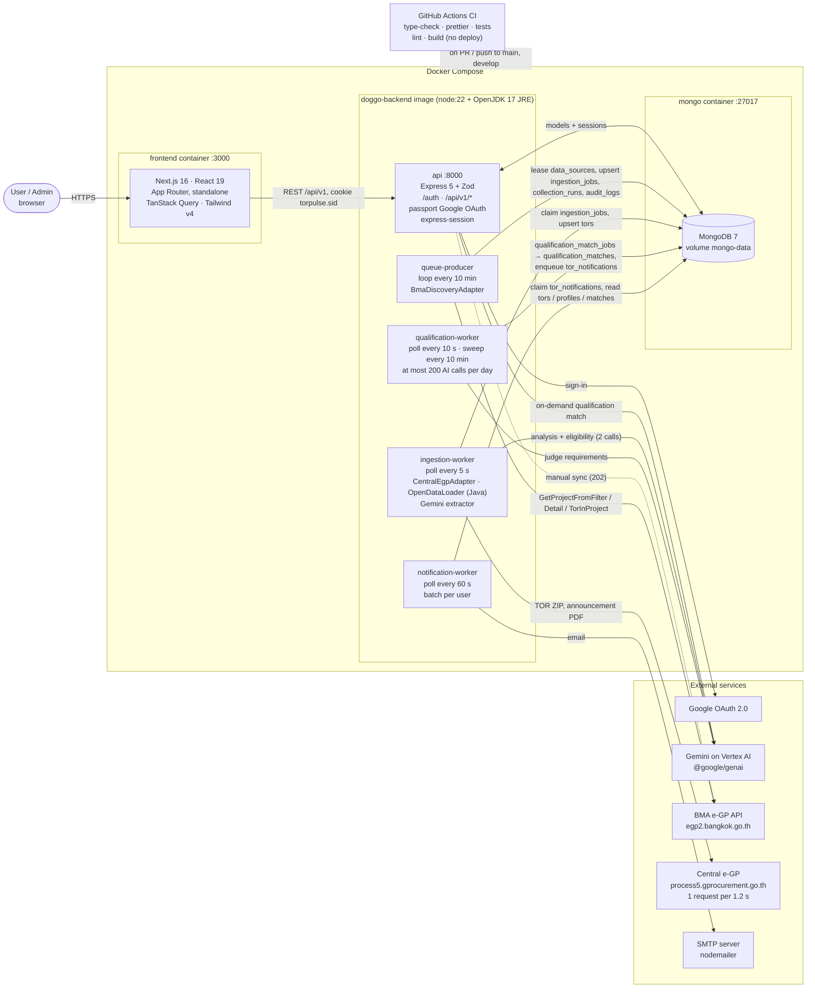

# Architecture diagram

TORPulse runs as 7 Docker Compose services (`docker-compose.yml`). The **API** and the **four workers** use the same `doggo-backend` image, each started with a different command. The processes communicate **only through MongoDB**: there is no message broker, and collections act as queues, claimed with lease fields.

## Notes

- **Backend modules** (`app/backend/src/modules`): auth, user, tor, homepage, report, admin, category, ingestion, notification, qualification.
- **Entry points** (`app/backend/src/apps`): `api`, `queue-producer`, `ingestion-worker`, `notification-worker`, `qualification-worker`.
- **Frontend pages:** `/`, `/homepage`, `/tor/[id]`, `/saved`, `/reports`, `/profile`, `/onboarding`, `/admin`, `/auth`, `/auth/signup`.
- **Not in the stack:** Redis, BullMQ, cron, S3 or other object storage, LINE, and a reverse proxy. PDFs are held only in a temporary directory while they are processed.
- **`NEXT_PUBLIC_API_URL`:** inlined into the frontend image at build time.
