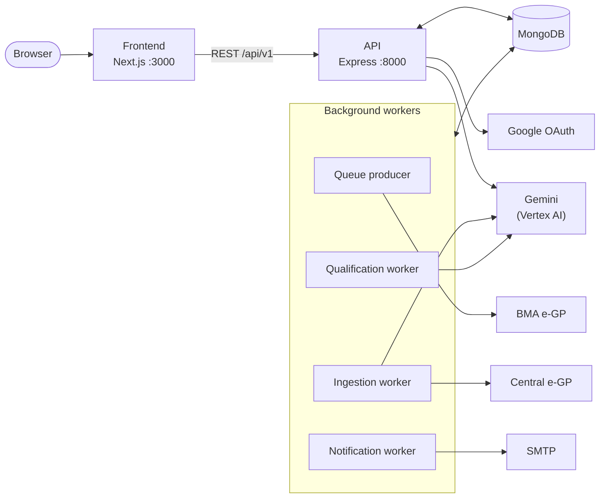

# Architecture diagram

TORPulse runs as Docker Compose services (`docker-compose.yml`): a Next.js frontend, an Express API, four background workers and MongoDB. The API and the workers use the same `doggo-backend` image, each started with a different command. The processes communicate **only through MongoDB**: there is no message broker, and collections act as queues.

## Notes

- **Workers:** the queue producer finds new BMA projects every 10 min; the ingestion worker turns each one into a TOR; the qualification worker scores TORs against bidder profiles; the notification worker emails 100% matches.
- **Entry points** (`app/backend/src/apps`): `api`, `queue-producer`, `ingestion-worker`, `notification-worker`, `qualification-worker`.
- **Not in the stack:** Redis, BullMQ, cron, object storage, or a reverse proxy. PDFs are held only in a temporary directory while they are processed.
- **CI:** GitHub Actions runs type-check, prettier, tests, lint and build. It does not deploy.
