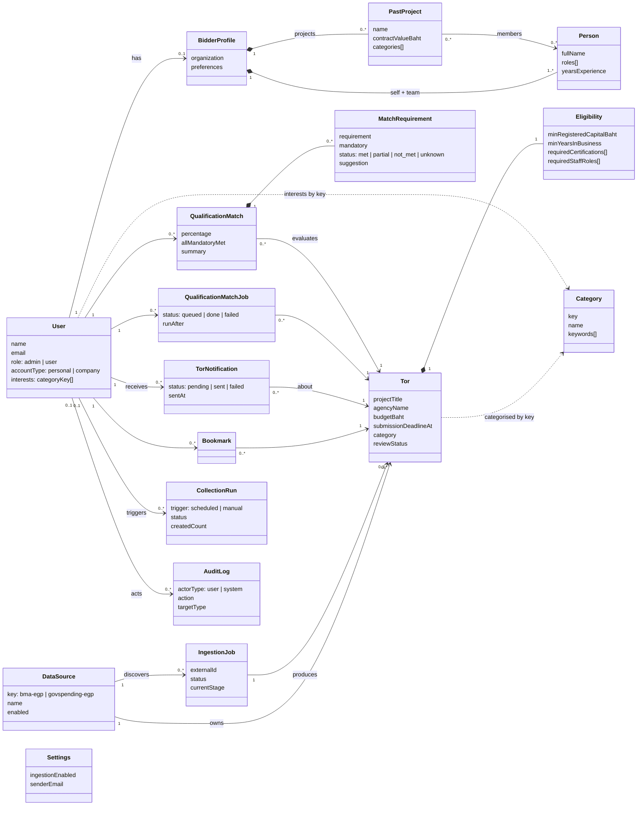

# Class diagram: domain model

This is a simplified view of the [ER diagram](er-diagram.md). It shows the main domain classes, the few attributes that explain what each one is for, and how the classes relate. Bookkeeping fields (`_id`, `createdAt`, `updatedAt`, lease fields such as `lockedBy` / `lockedUntil`, retry counters, error details) are left out. For every field, see [er-diagram.md](er-diagram.md).

Legend: `*--` composition (an embedded sub-document that cannot exist without its owner), `-->` association (a reference by ObjectId or by key), `..>` dependency (a weak link, such as a link by category key). Numbers on the lines are multiplicities.

## How to read it

- **User side.** A `User` can have one `BidderProfile`, which embeds the company details, its people (`Person`) and its past work (`PastProject`). The qualification matcher reads these to judge a TOR.
- **Ingestion side.** A `DataSource` discovers `IngestionJob`s. Each job that succeeds produces one `Tor`, which embeds the `Eligibility` rules the AI extracted.
- **User and TOR.** `Bookmark`, `TorNotification`, `QualificationMatchJob` and `QualificationMatch` each link one user to one TOR. Each pair (`userId`, `torId`) is unique per class.
- **Admin and system.** `CollectionRun` records ingestion runs, `AuditLog` records admin actions, and `Settings` is a single global document with no relations.
- **Left out:** `sessions` (written by `connect-mongo`, not part of the domain).
