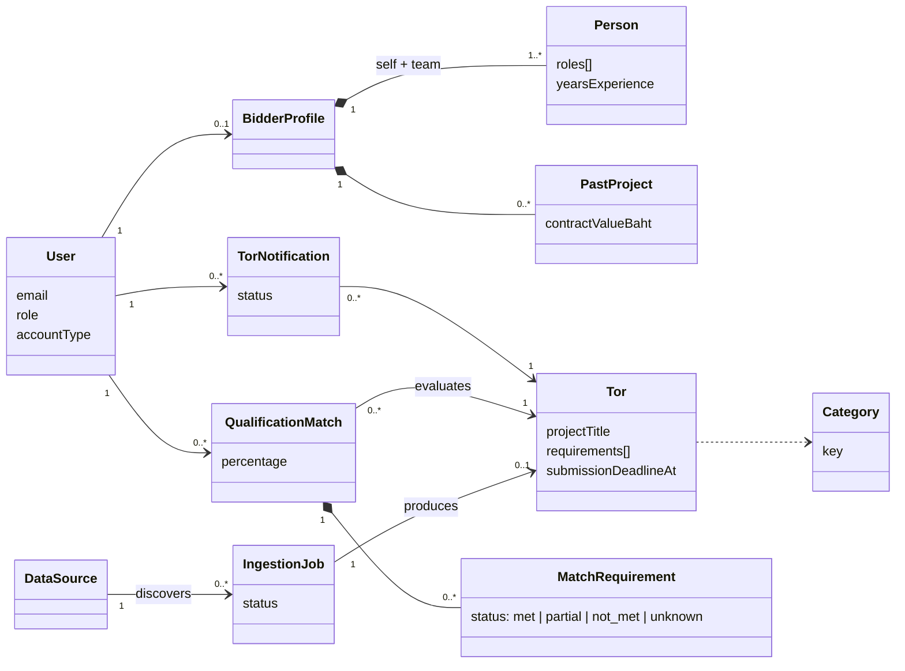

# Class diagram: domain model

This is the core domain model: the classes a bidder and a TOR are made of, and how they meet. Bookkeeping classes (`QualificationMatchJob`, `CollectionRun`, `AuditLog`, `Settings`, bookmarks, sessions) and bookkeeping fields are left out; see the [ER diagram](er-diagram.md) for every collection.

Legend: `*--` composition (an embedded sub-document that cannot exist without its owner), `-->` association (a reference by ObjectId), `..>` a link by category key. Numbers on the lines are multiplicities.

## How to read it

- **Bidder side.** A `User` can have one `BidderProfile`, which embeds its people (`Person`) and past work (`PastProject`).
- **TOR side.** A `DataSource` discovers `IngestionJob`s, and each successful job produces one `Tor`.
- **Where they meet.** A `QualificationMatch` scores one user against one TOR, requirement by requirement. A 100% match creates a `TorNotification`.
