# ER diagram: whole database

TORPulse stores everything in **MongoDB 7**, accessed through **Mongoose 9**. The schema is defined in code, in `app/backend/src/modules/**/*.model.ts`; there are no SQL migrations. The diagram shows all 14 collections with every top-level field. Embedded sub-documents are shown as one `object` or `object_arr` column, and their fields are listed in the column comment.

Legend: `PK` primary key (`_id`), `FK` a reference by ObjectId (Mongoose `ref`, **not enforced** by MongoDB), `UK` a unique index (compound unique indexes are listed under Notes). `ts` means the collection also gets `createdAt` and `updatedAt` automatically.

```mermaid
erDiagram
  users ||--o| bidder_profiles : "has profile (1-1)"
  users ||--o{ userbookmarks : "bookmarks"
  tors  ||--o{ userbookmarks : "bookmarked by"
  users ||--o{ tor_notifications : "receives"
  tors  ||--o{ tor_notifications : "notified about"
  users ||--o{ qualification_match_jobs : "queued for"
  tors  ||--o{ qualification_match_jobs : "queued for"
  users ||--o{ qualification_matches : "evaluated"
  tors  ||--o{ qualification_matches : "evaluated against"
  users |o--o{ collection_runs : "triggers (manual)"
  users |o--o{ audit_logs : "acts (actorId)"
  users ||--o{ sessions : "logged in"
  data_sources ||--o{ ingestion_jobs : "discovers"
  data_sources ||--o{ tors : "owns"
  ingestion_jobs |o--o| tors : "produces (torId / ingestionJobId)"
  categories |o..o{ tors : "category, categories[] (by key)"
  categories |o..o{ users : "interests[] (by key)"
  categories |o..o{ bidder_profiles : "projects.categories[] (by key)"

  users {
    ObjectId _id PK
    string googleId UK
    string name
    string email UK "lowercase"
    string image "nullable"
    enum role "admin | user"
    enum status "active | suspended"
    enum accountType "personal | company"
    string displayName
    string firstName
    string lastName
    string jobTitle
    string contactEmail
    string phone
    string address
    string about
    string website "nullable"
    string companyName
    string registrationNumber
    string businessType
    string_arr interests "category keys"
    enum onboardingStatus "completed | dismissed | null"
    object qualification "registeredCapitalBaht, yearsInBusiness, maxPastContractValueBaht, certifications[], isThaiJuristicPerson, isSme, hasPositiveNetWorth, pastContractAgeYears, hasBangkokOffice, staffRoles[] (derived from bidder_profiles)"
    object notificationPrefs "emailEnabled"
    date createdAt
    date updatedAt
  }

  bidder_profiles {
    ObjectId _id PK
    ObjectId userId FK,UK
    object organization "juristicType, registeredDate, registeredCapitalBaht, isSme, hasPositiveNetWorth, hasBangkokOffice, certifications[]"
    object preferences "budgetMinBaht, budgetMaxBaht, businessObjectives"
    object self "Person: fullName, positionTitle, roles[], yearsExperience, employmentType, joinedAt, education[], certifications[], skills[]"
    object_arr team "Person[] (max 100), each has _id"
    object_arr projects "PastProject[] (max 100): name, clientName, clientType, contractValueBaht, startDate, endDate, role, categories[], technologies[], description, hasCompletionCertificate, memberIds[] -> team._id"
    date createdAt
    date updatedAt
  }

  userbookmarks {
    ObjectId _id PK
    ObjectId userId FK
    ObjectId torId FK
    date createdAt
  }

  categories {
    ObjectId _id PK
    string key UK "immutable"
    string name UK
    string description
    string aiHint "nullable"
    string_arr keywords
    boolean isActive
    number sortOrder
    date createdAt
    date updatedAt
  }

  data_sources {
    ObjectId _id PK
    string key UK "bma-egp | govspending-egp"
    string name
    boolean enabled
    date enabledChangedAt
    string lockedBy "producer lease"
    date lockedUntil
    date lastStartedAt
    date lastSucceededAt
    object lastError "message, occurredAt"
    date createdAt
    date updatedAt
  }

  collection_runs {
    ObjectId _id PK
    enum trigger "scheduled | manual"
    ObjectId triggeredBy FK "users, nullable"
    enum status "running | success | failed"
    date startedAt
    date finishedAt
    number fetchedCount
    number createdCount
    number existingCount
    string errorMessage
    date createdAt
    date updatedAt
  }

  ingestion_jobs {
    ObjectId _id PK
    ObjectId dataSourceId FK
    enum sourceAdapter "gov_spending | central_egp | bma_egp"
    string externalId
    string sourceVersion "default latest"
    enum status "queued | processing | completed | failed | rejected | review_required | skipped"
    enum currentStage "queued | fetching_details | downloading | extracting_archive | extracting_text | classifying | extracting_fields | storing | completed"
    object sourceMetadata "title, departmentName, departmentSubName, projectStatus, sourceProjectId, contractStatus, contractStatusCode, fiscalYear, announceDate, budgetBaht, midPriceBaht, awardedPriceBaht, announcements[]"
    number attempCount "typo kept from the model"
    date nextRetryAt
    string lockedBy "worker lease"
    date lockedUntil
    ObjectId torId FK "nullable"
    object lastError "code, message, occurredAt"
    date createdAt
    date updatedAt
  }

  tors {
    ObjectId _id PK
    ObjectId dataSourceId FK
    ObjectId ingestionJobId FK
    string externalId
    string sourceVersion
    enum sourceAdapter "gov_spending | central_egp | bma_egp"
    string detailUrl
    string projectTitle
    string agencyName
    string departmentName
    string departmentSubName
    string projectStatus
    string sourceProjectId
    string contractStatus
    string contractStatusCode
    number fiscalYear
    date announceDate
    object_arr announcements "sourceId, title, hearingStartAt, hearingEndAt, fileName, fileUrl"
    string summary
    string scope
    string_arr objectives
    string_arr requirements
    string_arr bidderQualifications
    string_arr technologies
    string_arr deliverables
    string_arr timeline
    string_arr evaluationCriteria
    string_arr contactInformation
    object eligibility "minRegisteredCapitalBaht, minYearsInBusiness, minPastContractValueBaht, requiredCertifications[], requiresThaiJuristicPerson, smeOnly, requiresPositiveNetWorth, maxPastWorkAgeYears, requiresBangkokOffice, requiredStaffRoles[], unmappedQualifications[]"
    string category "category key"
    string_arr categories "category keys"
    number budgetBaht
    number midPriceBaht "alias referencePriceBaht"
    number awardedPriceBaht "alias winningPriceBaht"
    string submissionDeadline "raw text"
    date submissionDeadlineAt
    enum reviewStatus "unverified | verified | archived | deleted"
    boolean categoryOverridden
    date lastEditedAt
    date lastSeenAt
    string classificationReason
    number confidence "0-1"
    string analysisModel
    string analysisVersion
    date analyzedAt
    object_arr documents "fileName, mimeType, sourceUrl"
    date createdAt
    date updatedAt
  }

  tor_notifications {
    ObjectId _id PK
    ObjectId userId FK
    ObjectId torId FK
    enum status "pending | sending | sent | failed | skipped"
    number attemptCount
    date nextRetryAt
    string lockedBy
    date lockedUntil
    object lastError "code, message, occurredAt"
    string emailBatchId
    date sentAt
    date createdAt
    date updatedAt
  }

  qualification_match_jobs {
    ObjectId _id PK
    ObjectId userId FK
    ObjectId torId FK
    enum status "queued | processing | done | skipped | failed"
    date runAfter
    number attemptCount
    string lockedBy
    date lockedUntil
    string lastError
    date finishedAt
    date createdAt
    date updatedAt
  }

  qualification_matches {
    ObjectId _id PK
    ObjectId userId FK
    ObjectId torId FK
    string inputVersion "prompt version + sha256 of snapshots"
    number percentage "0-100, nullable"
    boolean allMandatoryMet
    object counts "met, partial, not_met, unknown"
    object_arr requirements "requirement, category (legal | financial | experience | personnel | certification | technical | other), mandatory, status (met | partial | not_met | unknown), reason, suggestion"
    string summary
    string aiModel
    date evaluatedAt
  }

  audit_logs {
    ObjectId _id PK
    enum actorType "user | system"
    ObjectId actorId FK "users, required unless system"
    string action
    string targetType
    ObjectId targetId "polymorphic, chosen by targetType"
    mixed before
    mixed after
    mixed metadata
    string actorName
    string targetLabel
    date createdAt
  }

  settings {
    ObjectId _id PK
    string key UK "always global (one document)"
    boolean ingestionEnabled
    string senderEmail "nullable"
    date createdAt
    date updatedAt
  }

  sessions {
    string _id PK "session id"
    json session "contains passport user id"
    date expires "TTL 7 days"
  }
```

## Notes

- **Compound unique indexes:**
  - `userbookmarks (userId, torId)`
  - `tor_notifications (userId, torId)`
  - `qualification_match_jobs (userId, torId)`
  - `qualification_matches (userId, torId)`
  - `ingestion_jobs (dataSourceId, externalId, sourceVersion)`
  - `tors (dataSourceId, externalId, sourceVersion)`
- **Collections used as queues:** `ingestion_jobs`, `tor_notifications` and `qualification_match_jobs` are claimed with lease fields (`lockedBy` / `lockedUntil`). There is no message broker.
- **Links by key:** the dotted links to `categories` are by its `key` string, not by ObjectId.
- **`sessions`:** written by `connect-mongo` (set up in `apps/api/app.ts`). It has no Mongoose model.
- **Staff-role enum** (`notification/qualification.ts`): project_manager, system_analyst, developer, database_admin, system_engineer, ux_ui_designer, it_support, coordinator, network_engineer, security_specialist.
- **`tors.scope` and `tors.evaluationCriteria`:** these exist in the schema, but ingestion does not fill them at the moment.
