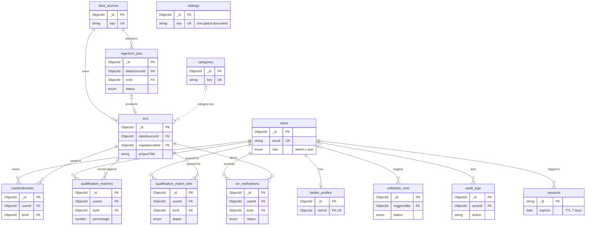

# ER diagram: whole database

TORPulse stores everything in **MongoDB 7**, accessed through **Mongoose 9**. The schema is defined in code, in `app/backend/src/modules/**/*.model.ts`. The diagram shows the 14 collections with their keys and the field that best explains each one. For all fields, read the model files.

Legend: `PK` primary key (`_id`), `FK` a reference by ObjectId (**not enforced** by MongoDB), `UK` a unique index. Dotted lines are links by category `key`, not by ObjectId.

## Notes

- **One row per (user, TOR) pair:** `userbookmarks`, `qualification_match_jobs`, `qualification_matches` and `tor_notifications` each have a unique index on `(userId, torId)`.
- **One TOR per source version:** `ingestion_jobs` and `tors` are unique on `(dataSourceId, externalId, sourceVersion)`.
- **Queues:** `ingestion_jobs`, `qualification_match_jobs` and `tor_notifications` are claimed with lease fields (`lockedBy` / `lockedUntil`).
- **`sessions`:** written by `connect-mongo`. It has no Mongoose model.
