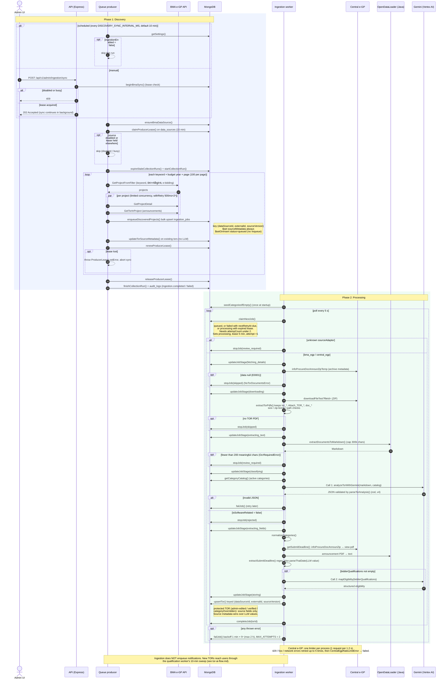

# Sequence diagram: ingestion pipeline

Ingestion happens in two phases that run in separate processes and share only MongoDB:

1. **Discovery** (queue-producer, or the admin "sync now" button). Finds BMA projects and upserts `ingestion_jobs`.
2. **Processing** (ingestion-worker). Claims each job, downloads the TOR PDFs, extracts text, calls Gemini twice, and upserts `tors`.

Code: `app/backend/src/apps/queue-producer/queue-producer.ts`, `apps/ingestion-worker/ingestion.worker.ts`, `modules/ingestion/ingestion.service.ts`, `modules/ingestion/ingestion-job.repository.ts`, `modules/tor/tor.repository.ts`.

