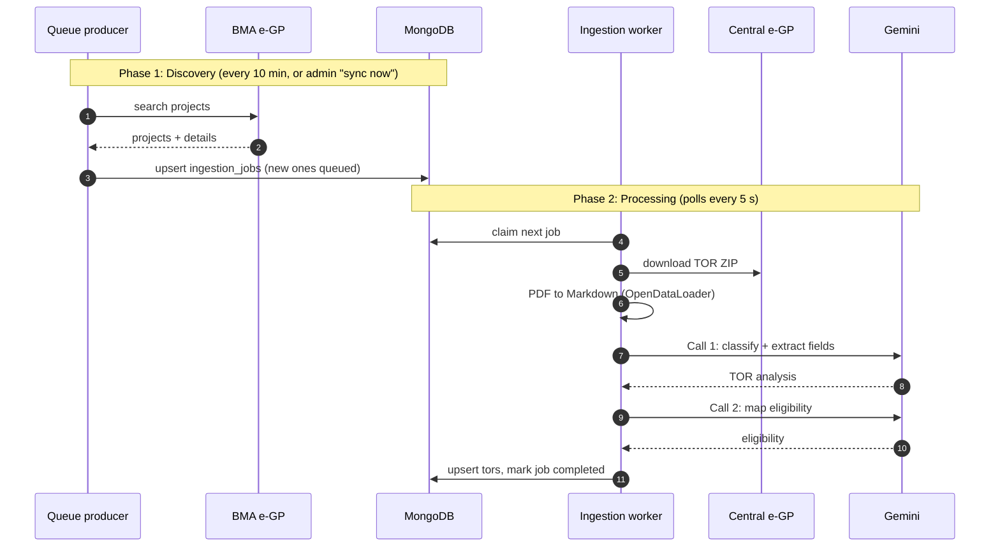

# Sequence diagram: ingestion pipeline

Ingestion happens in two phases that run in separate processes and share only MongoDB:

1. **Discovery** (queue producer, or the admin "sync now" button). Finds BMA projects and queues `ingestion_jobs`.
2. **Processing** (ingestion worker). Claims each job, turns the TOR PDFs into text, calls Gemini twice, and saves a `tors` document.

Code: `app/backend/src/apps/queue-producer/queue-producer.ts`, `apps/ingestion-worker/ingestion.worker.ts`, `modules/ingestion/ingestion.service.ts`.

## Notes

- **Other outcomes:** no TOR PDF → `skipped`; too little text → `review_required`; Gemini says not software → `rejected`; any error → `failed`, retried once after 1 min. See [state-machines.md](state-machines.md).
- **No requeue:** discovery never requeues an existing job. It only refreshes the source metadata on existing jobs and TORs.
- **Central e-GP rate limit:** one request per 1.2 s per process.
- **Notifications:** ingestion does not send any. New TORs reach users through the qualification worker (see [tor-ai-flow.md](tor-ai-flow.md)).
