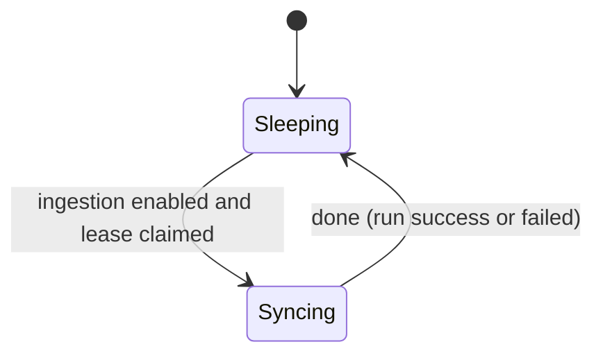
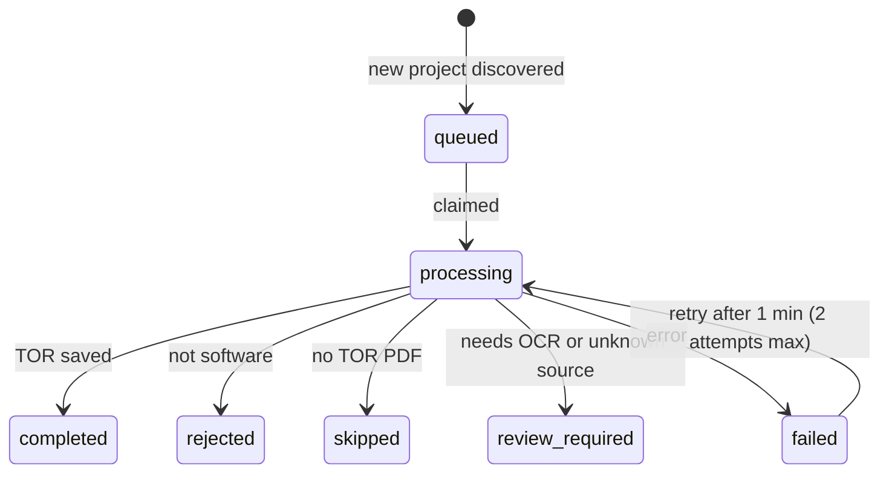
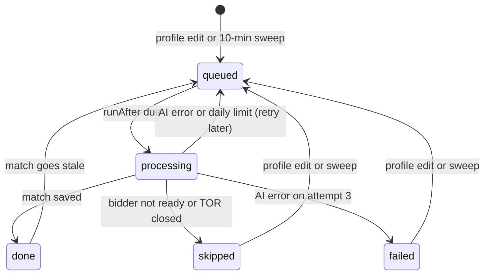
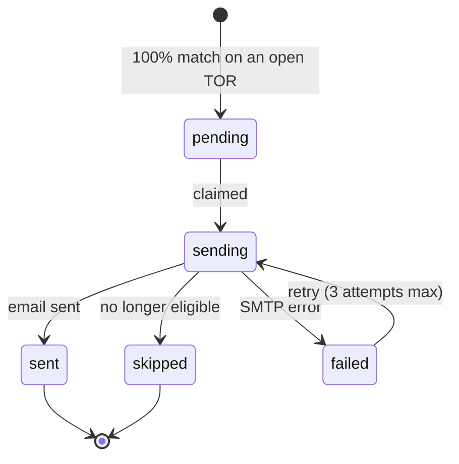

# State machines: workers

TORPulse has four background processes: the **queue producer** and three workers (**ingestion**, **qualification**, **notification**). None of them talk to each other directly. Each one moves documents through a `status` field in a MongoDB collection, and claims them with lease fields (`lockedBy`, `lockedUntil`) so two processes never work on the same document. If a worker dies, its lease expires after a few minutes and another worker can reclaim the document.

Traced from the code on 2026-11-15. Code paths are relative to `app/backend/src/`.

## Summary

| Process | Collection | States | Attempts | Lease | Retry delay |
|---|---|---|---|---|---|
| Queue producer | `data_sources` (lease), `collection_runs` (log) | running → success / failed | 1 | 15 min | next loop (10 min) |
| Ingestion worker | `ingestion_jobs` | queued, processing, completed, rejected, skipped, review_required, failed | 2 | 5 min | 1 min |
| Qualification worker | `qualification_match_jobs` | queued, processing, done, skipped, failed | 3 | 5 min | 1 min, then 10 min |
| Notification worker | `tor_notifications` | pending, sending, sent, skipped, failed | 3 | 5 min | 1 min, then 5 min |

## 1. Queue producer

Entry point: `apps/queue-producer/queue-producer.ts`. Each round claims the data-source lease, syncs every page from BMA, records a `collection_runs` document, then sleeps 10 min.

A manual sync (`POST /api/v1/admin/ingestion/sync`) claims the same lease. If it is held, the API returns `409`.

## 2. Ingestion worker (`ingestion_jobs`)

Entry point: `apps/ingestion-worker/ingestion.worker.ts`. Inside `processing`, `currentStage` moves through fetching_details → downloading → extracting_text → classifying → extracting_fields → storing.

Finished jobs return to `queued` only through `npm run requeue:jobs`.

## 3. Qualification worker (`qualification_match_jobs`)

Entry point: `apps/qualification-worker/qualification.worker.ts`. One row per (user, TOR) pair.

When a match scores 100%, the worker creates a `tor_notifications` row.

## 4. Notification worker (`tor_notifications`)

Entry point: `apps/notification-worker/notification.worker.ts`. One row per (user, TOR) pair, so a pair is emailed at most once, ever. All due rows of one user go in one email.

## 5. Gaps found while tracing

These are behaviours in the current code that the state machines expose. None are fixed yet.

1. **Jobs stuck in `processing` / `sending` after a crash on the last attempt.** Every claim query requires attempts below the limit, including the branch that reclaims an expired lease. If a worker dies during the final attempt, the document keeps `processing` (or `sending`) forever:
   - `ingestion_jobs`: `requeue:jobs` does not list `processing`, so even the script cannot reset it.
   - `qualification_match_jobs`: the sweep skips pairs that have a `processing` job, so only a profile edit resets it.
   - `tor_notifications`: nothing resets it, so the pair is never emailed.
2. **Ingestion backoff is effectively one step.** `failJob` computes `1 min x 5^n`, capped at 2 h, but with `MAX_ATTEMPTS = 2` only the first delay (1 min) is ever used.
3. **`extracting_archive` stage is unused.** It is in the `currentStage` enum but no code sets it.
4. **Skipped notifications are permanent.** A pair skipped for a temporary reason (for example, the score dropped for a while) is never emailed later.
