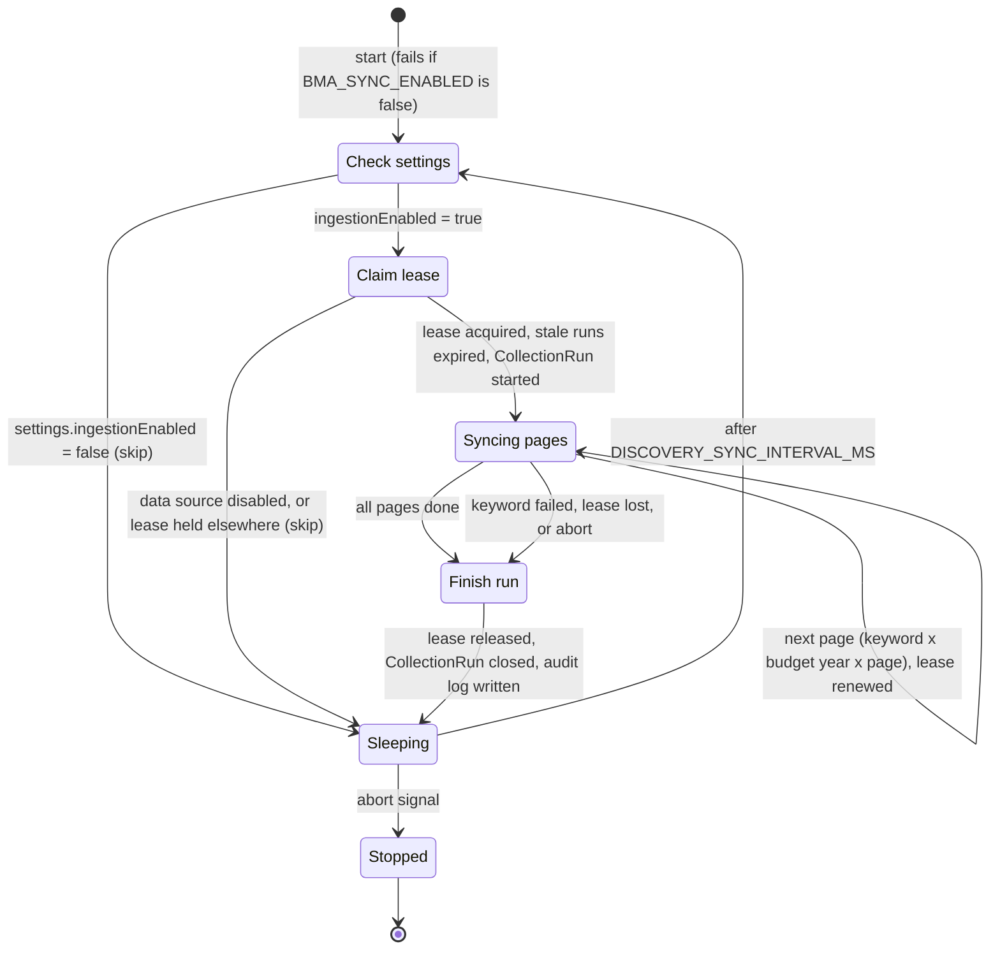
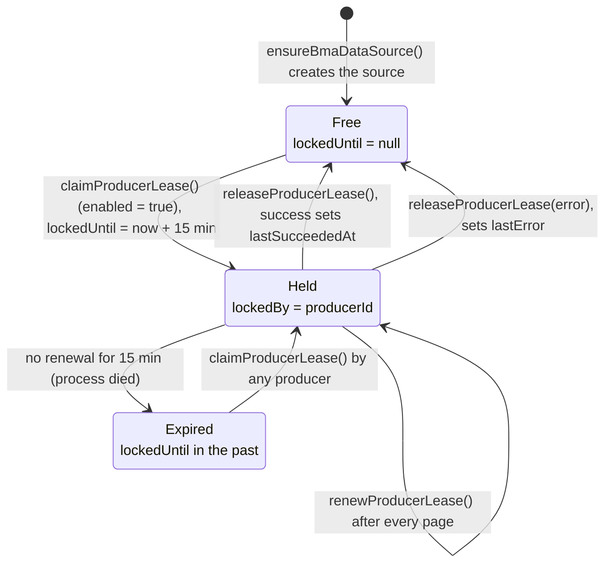
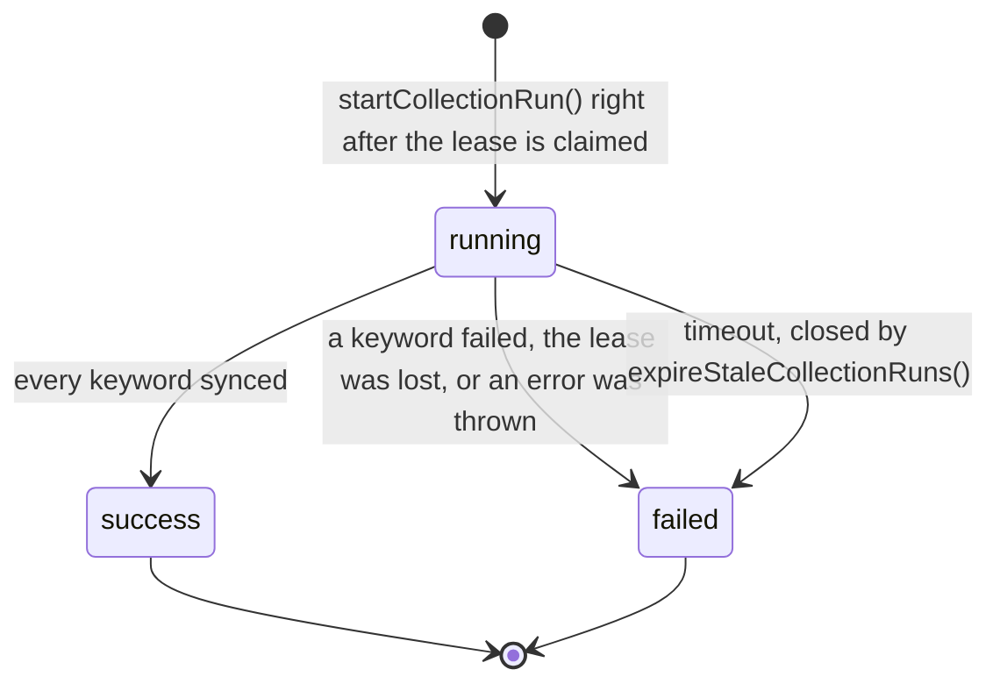
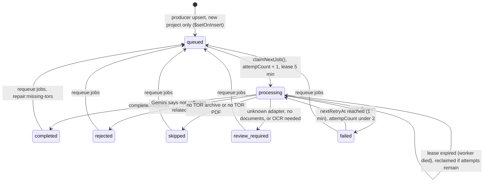
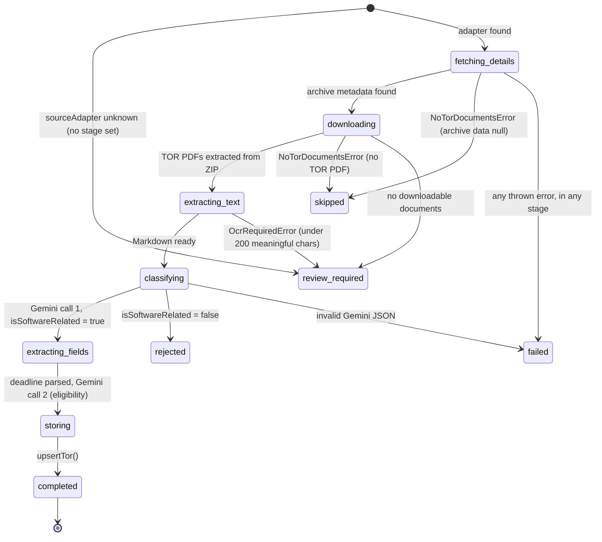
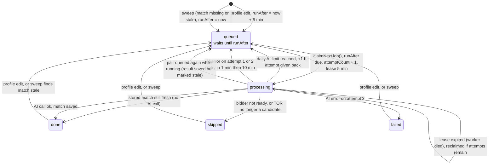
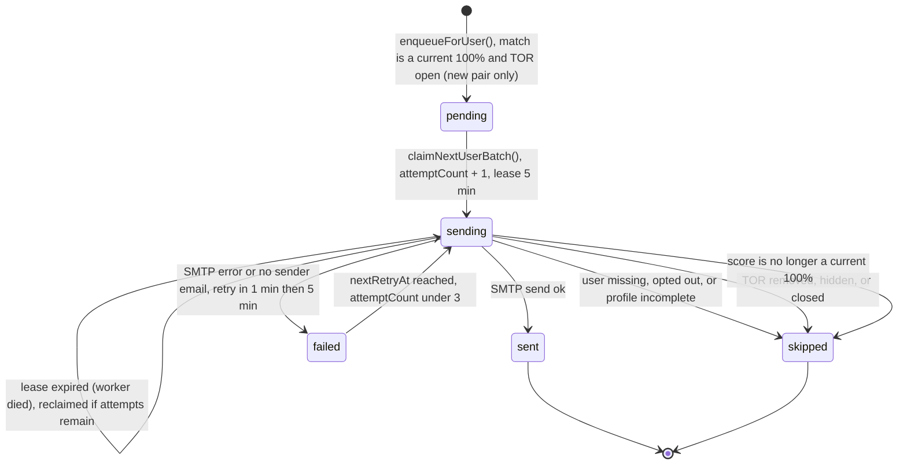

# State machines: workers

TORPulse has four background processes: the **queue producer** and three workers (**ingestion**, **qualification**, **notification**). None of them talk to each other directly. Each one moves documents through a `status` field in a MongoDB collection, and claims them with lease fields (`lockedBy`, `lockedUntil`) so two processes never work on the same document.

Traced from the code on 2026-11-15. Code paths are relative to `app/backend/src/`.

## Summary

| Process | Collection | State field | States | Final states | Attempts | Lease | Retry delay |
|---|---|---|---|---|---|---|---|
| Queue producer | `data_sources` | `lockedBy` / `lockedUntil` | free, held | (none, cycles) | n/a | 15 min, renewed every page | next loop (10 min) |
| Queue producer | `collection_runs` | `status` | running, success, failed | success, failed | 1 | n/a | n/a |
| Ingestion worker | `ingestion_jobs` | `status` (+ `currentStage`) | queued, processing, completed, rejected, skipped, review_required, failed | all except queued / processing (until requeued by a script) | 2 | 5 min, renewed every stage | 1 min |
| Qualification worker | `qualification_match_jobs` | `status` | queued, processing, done, skipped, failed | done, skipped, failed (until queued again) | 3 | 5 min | 1 min, then 10 min |
| Notification worker | `tor_notifications` | `status` | pending, sending, sent, skipped, failed | sent, skipped, failed (never requeued) | 3 | 5 min | 1 min, then 5 min |

## 1. Queue producer

Entry point: `apps/queue-producer/queue-producer.ts`. Repositories: `modules/ingestion/data-source.repository.ts`, `modules/ingestion/collection-run.repository.ts`.

### 1.1 Producer loop

The process loops forever. Each round runs one sync per configured source (only BMA today), then sleeps for `DISCOVERY_SYNC_INTERVAL_MS` (default 10 min).

- A failure on one keyword does not stop the sync. The other keywords keep going, and the run is marked `failed` at the end with the failed keywords listed.
- Losing the lease (`ProducerLeaseLostError`) or an abort stops the sync immediately.
- **Manual sync** (`POST /api/v1/admin/ingestion/sync`) uses the same states from "Claim lease" onwards, but it skips the `ingestionEnabled` check. If it cannot claim the lease, the API returns `409`. Otherwise it returns `202` and the sync carries on in the background.

### 1.2 Data source lease (`data_sources`)

One lease per data source, shared by every producer process and by the manual sync, so only one sync of a source runs at a time.

Switching a source off (`enabled = false`) blocks new claims. A sync that is already running finishes its current run.

### 1.3 Collection run (`collection_runs`)

One document per sync, scheduled or manual. It is a log record, not a queue.

`expireStaleCollectionRuns()` closes a run left `running` by a dead process, with `errorMessage: 'timeout'`. It runs in two places: right after a producer claims the lease (any run still `running` must be dead), and when the admin status is read, for runs older than 15 minutes, but only while no one holds the lease.

## 2. Ingestion worker (`ingestion_jobs`)

Entry point: `apps/ingestion-worker/ingestion.worker.ts`. Logic: `modules/ingestion/ingestion.service.ts`, `modules/ingestion/ingestion-job.repository.ts`. Polls every 5 s when the queue is empty.

### 2.1 Job status

- `MAX_ATTEMPTS = 2`. After the second failed attempt, `nextRetryAt` is null and the job stays `failed` until someone runs `npm run requeue:jobs`.
- Discovery refreshes `sourceMetadata` on existing jobs but never changes their status, so a finished job is not reprocessed automatically.
- `completeJob` and `updateJobStage` check the lease. If another worker took the job, they throw `Worker lost lease ...`, and the job goes through `failJob`.

### 2.2 Stages inside `processing`

`currentStage` shows where a running job is. Each stage update also renews the 5-minute lease.

`currentStage` is not reset when a job stops or fails, so it shows the stage where it stopped. It goes back to `queued` only when the job is requeued. The enum also has `extracting_archive`, but no code sets it.

## 3. Qualification worker (`qualification_match_jobs`)

Entry point: `apps/qualification-worker/qualification.worker.ts`. Logic: `modules/qualification/qualification-job.repository.ts`, `modules/qualification/qualification-precompute.service.ts`. Processes jobs back to back, polls every 10 s when the queue is empty, and runs a sweep every 10 min.

There is one row per (user, TOR) pair. Queueing a pair again reuses the same row.

- **Debounce:** every profile edit pushes `runAfter` 5 minutes later (`QUALIFICATION_PROFILE_DELAY_MS`), so a user editing field by field triggers one AI call per TOR once they stop.
- **Sweep** (`sweepMatches()`): queues every ready bidder × candidate TOR pair whose match is missing or stale and that has no `queued` or `processing` job.
- **Daily limit:** when `QUALIFICATION_DAILY_CALL_LIMIT` (default 200) AI calls were made in the last 24 hours (counted in `qualification_ai_calls`, one row per call, worker and on-demand together), `postponeJob()` puts the job back an hour later and gives back the attempt.
- **After `done`:** if the score is 100%, the worker calls `enqueueForUser()`, which creates a `tor_notifications` row (section 4).

## 4. Notification worker (`tor_notifications`)

Entry point: `apps/notification-worker/notification.worker.ts`. Logic: `modules/notification/tor-notification.repository.ts`, `modules/notification/notification.service.ts`. Sends batches back to back and polls every 60 s when the queue is empty.

There is one row per (user, TOR) pair, and the unique index means a pair is emailed at most once, ever. The worker claims **every due row of one user** together and sends them in one email.

- Rows are created with `$setOnInsert`, so a pair that is already `sent`, `skipped` or `failed` is never queued again. A TOR skipped once (for example because the score dropped) will not be emailed even if the score goes back to 100% later.
- After the third failed attempt, `nextRetryAt` is null and the row stays `failed`.
- The worker checks every row again before sending, because the profile or TOR may have changed since it was queued.

## 5. Gaps found while tracing

These are behaviours in the current code that the state machines above expose. None are fixed yet.

1. **Jobs stuck in `processing` / `sending` after a crash on the last attempt.** Every claim query requires attempts below the limit, including the branch that reclaims an expired lease. If a worker dies during the final attempt, the document keeps `processing` (or `sending`) forever:
   - `ingestion_jobs`: `requeue:jobs` does not list `processing`, so even the script cannot reset it.
   - `qualification_match_jobs`: the sweep skips pairs that have a `processing` job, so only a profile edit resets it.
   - `tor_notifications`: nothing resets it, so the pair is never emailed.
2. **Ingestion backoff is effectively one step.** `failJob` computes `1 min x 5^n`, capped at 2 h, but with `MAX_ATTEMPTS = 2` only the first delay (1 min) is ever used.
3. **`extracting_archive` stage is unused.** It is in the `currentStage` enum but no code sets it.
4. **Skipped notifications are permanent.** See section 4. This is by design ("one email per pair, ever"), but it means a pair skipped for a temporary reason is lost.
