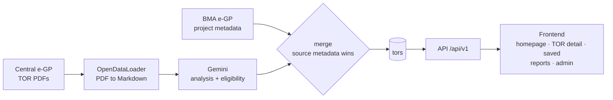
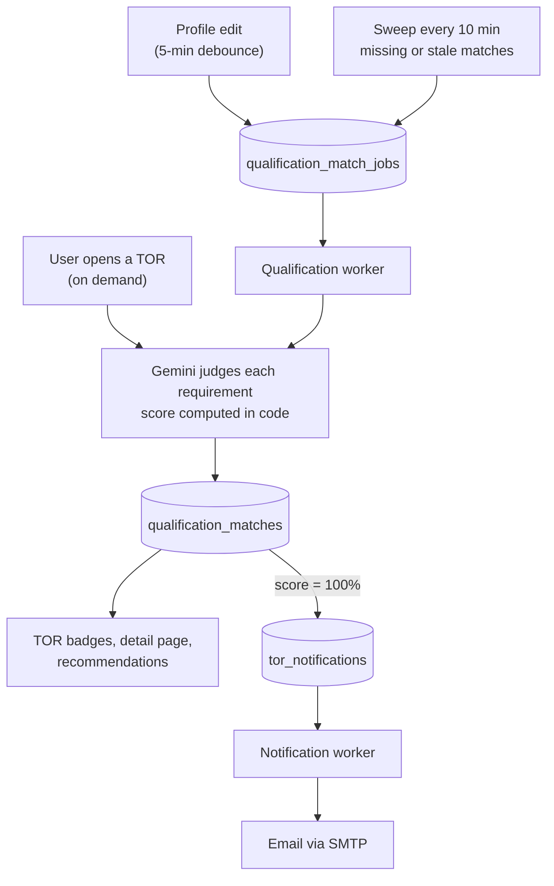

# Flowcharts: TOR data flow and AI recommendation workflow

## 1. TOR data flow

This flowchart follows a TOR from the government sources to the screen. The PDFs are **not stored**: they exist only in a temporary directory during extraction.

Where each group of `tors` fields comes from:

| Source | Fields |
|---|---|
| **BMA source metadata** (wins over the LLM) | department, project status, contract status, fiscal year, announcements, budget, mid price, awarded price |
| **Gemini call 1** | title, agency, summary, objectives, requirements, bidder qualifications, technologies, contacts, categories, confidence |
| **Gemini call 2** | eligibility |
| **Announcement PDF** | submission deadline |

## 2. AI recommendation / qualification matching workflow

The AI recommendation feature is the **qualification match**. One Gemini call judges each TOR requirement against the bidder profile, and the **score is computed in code**. No embeddings are used. Code: `app/backend/src/modules/qualification/`, `apps/qualification-worker/`, `modules/notification/`, `apps/notification-worker/`.

## Notes

- **Score:** met = 1, partial = 0.5, otherwise 0; percentage = points / requirements × 100. A match goes stale when the profile or TOR changes, or after 30 days.
- **Daily limit:** at most 200 AI calls per 24 h. Over the limit, worker jobs wait an hour.
- **Recommendations** (`GET /tors/recommendations`): top 5, open TORs first, ranked by 0.7 × match % + 0.3 × (TOR in an interest category ? 100 : 0).
- **Email:** one email per (user, TOR) pair, ever. The notification worker re-checks each row before sending.
