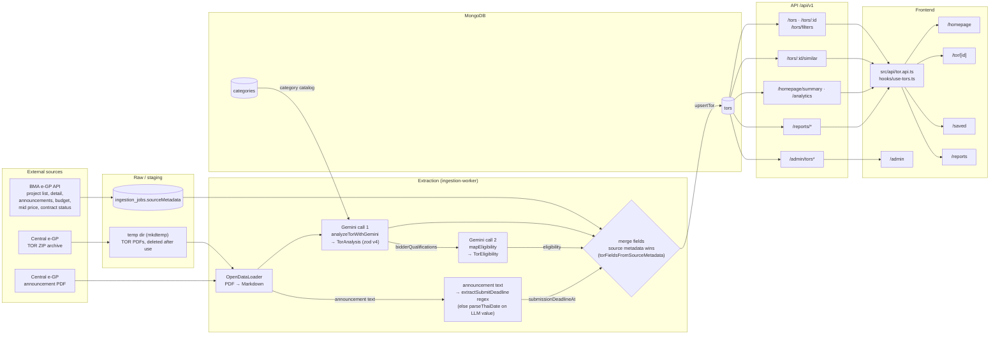
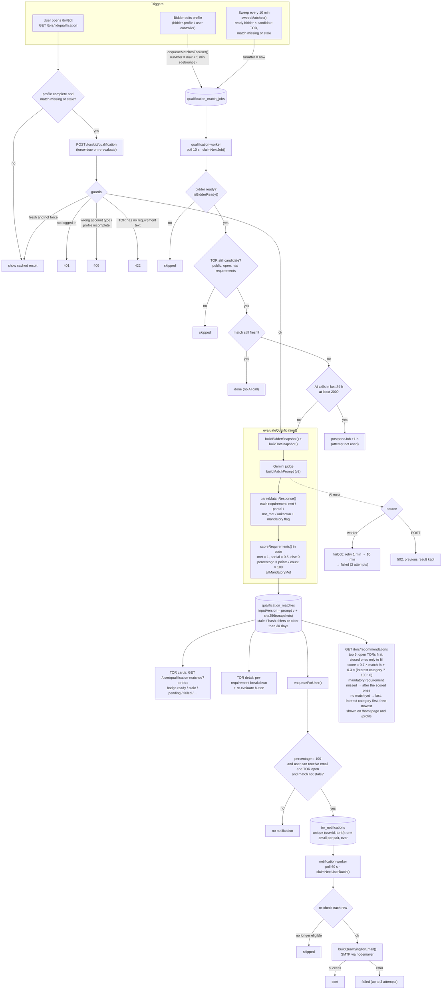

# Flowcharts: TOR data flow and AI recommendation workflow

## 1. TOR data flow

This flowchart follows a TOR from the government sources to the screen. The PDFs are **not persisted**: they exist only in memory or a temporary directory during extraction, and only `documents[]` (fileName, mimeType, sourceUrl) is stored on the TOR.

Where each group of `tors` fields comes from:

| Source | Fields |
|---|---|
| **BMA source metadata** (wins over the LLM) | departmentName, departmentSubName, projectStatus, sourceProjectId, contractStatus(Code), fiscalYear, announceDate, announcements, budgetBaht, midPriceBaht, awardedPriceBaht |
| **Gemini call 1** | projectTitle, agencyName, summary, objectives, requirements, bidderQualifications, technologies, contactInformation, category, categories, classificationReason, confidence, budgetBaht (only as a fallback) |
| **Gemini call 2** | eligibility |
| **Announcement PDF** | submissionDeadline, submissionDeadlineAt |
| **Audit** | analysisModel, analysisVersion, analyzedAt, ingestionJobId, lastSeenAt |

## 2. AI recommendation / qualification matching workflow

The AI recommendation feature is the **qualification match**. One Gemini call judges each TOR requirement against the bidder profile, and the **score is computed in code**. No embeddings are used. Code: `app/backend/src/modules/qualification/`, `apps/qualification-worker/`, `modules/notification/`, `apps/notification-worker/`.

## Notes

- **Ready bidder:** `isBidderReady()` passes when the account type is personal or company and `profileCompleteness().isComplete` is true. Every profile write also runs `deriveQualification()`, which rewrites the flat `users.qualification`.
- **Candidate TOR** (`findCandidateTors()`): public, deadline null or in the future, and `hasRequirementText()` is true.
- **Legacy path:** `isFullyQualified()` (rule-based, using `tors.eligibility`) is used only by `scripts/seed-notification-user.ts`. The `eligibility` produced by Gemini call 2 currently drives no live feature.
