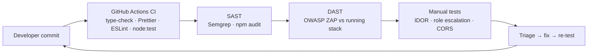

# TORPulse: Software Security Project Report

| | |
|---|---|
| **Application** | TORPulse: a platform for monitoring and analysing Thai government procurement (TOR) documents |
| **Repository** | `Doggo-CSP/TORPulse` |
| **Security standard** | OWASP ASVS v5.0 (requirement list: [`[SOFTWARE SEC] ASVS - ASVS (1).csv`](<[SOFTWARE SEC] ASVS - ASVS (1).csv>)) |
| **Report date** | 16 November 2026 |

### Team members

| Name | GitHub | Student ID |
|---|---|---|
| Chitiwat Phajan | Chitiwat Phajan | _TODO_ |
| Kantapon Hemmadhun | Kantapon Hemmadhun | _TODO_ |
| Earth | Xeei | _TODO_ |
| _TODO_ | negativeix | _TODO_ |

### How this report maps to the grading criteria

| # | Criterion | Section |
|---|---|---|
| 1 | OWASP ASVS requirements we follow | [§2](#2-security-requirements-owasp-asvs--criterion-1), [Appendix A](#appendix-a-full-asvs-requirement-list) |
| 2 | Threat model with priorities | [§3](#3-threat-model--criterion-2) |
| 3 | Security design principles | [§4](#4-security-design-principles--criterion-3) |
| 4–13 | Implementation controls | [§5](#5-security-implementation--criteria-413) |
| 14 | SAST report | [§7.2](#72-sast-semgrep--npm-audit--criterion-14) |
| 15 | DAST report | [§7.3](#73-dast-owasp-zap--criterion-15) |
| 16 | Threat model verification checklist | [§8](#8-threat-model-verification-checklist--criterion-16) |
| 17 | Mapping to ASVS and OWASP Top 10 | [§9](#9-mapping-to-owasp-top-10-2021-and-asvs--criterion-17) |
| 18 | Advanced security features | [§6](#6-advanced-security-features--criterion-18) |

Status legend used throughout: ✅ implemented · ⚠️ partial · ❌ not implemented. This report records what is actually in the code on the `develop` branch. Where a control is missing, we say so and list it in the [remediation roadmap](#10-known-gaps-and-remediation-roadmap).

### Implementation checklist (criteria 4–18)

| # | Criterion | Status | Done | Not done | Details |
|---|---|:-:|---|---|---|
| 4 | Password authentication | ❌ | Design written: argon2id, 12–128 chars, HIBP check, lockout | No password login. TORPulse uses Google sign-in only. | [§5.1](#51-password-authentication--criterion-4---not-implemented-by-design) |
| 5 | Social SSO (OAuth / OpenID) | ✅ | Google OpenID Connect: `state`, PKCE, nonce, ID-token signature, `email_verified` and `auth_time` checks; explicit account choice; emailed second factor. | — | [§5.2](#52-social-sso-with-oauth--openid--criterion-5---implemented), §11.1 |
| 6 | Authorization (roles) | ✅ | `admin` / `user` roles, each granting a fixed set of scopes. `requireRole` guards the admin router; `requireScope` checks each route's scope. Suspended accounts hold no scopes. Self role change and last-admin demotion blocked. Tested. | — | [§5.3](#53-authorisation-roles--criterion-6---implemented), M1–M3 |
| 7 | Access control (no access to other users' data) | ✅ | Every user query scoped to `req.user._id`. Sub-ids looked up inside the caller's own profile. Router-level `requireAuth` on `/user/*`. IDOR test returns 404. `/ingestion/report` needs admin and `ingestion:read`. | — | [§5.4](#54-access-control-no-access-to-another-users-data--criterion-7---implemented), M4, M14 |
| 8 | Input validation and SQL/NoSQL/ORM injection | ✅ | Zod allow-list validation on every write endpoint, with length limits and email/phone/URL formats. Express 5 simple query parser. ObjectId checks, including bookmarks. `escapeRegex`. `.strict()` blocks mass assignment. Rules documented in §5.5. ZAP raised 0 injection alerts. | Mongoose `sanitizeFilter` not enabled (it would also rewrite the code's own `$in`/`$gte` filters). | [§5.5](#55-input-validation-and-injection-protection-sql--nosql--orm--criterion-8---implemented), M6, M7 |
| 9 | Environment variables and credentials | ✅ | All secrets in env vars; in production, Docker secret files given only to the containers that use them. `.env` gitignored and dockerignored. Startup validation (`SESSION_SECRET` ≥ 32 chars). Production MongoDB requires authentication and TLS and is not published. | Test secret written literally in CI (R13). Local dev MongoDB has no authentication (dev data only). | [§5.6](#56-environment-variables-and-credentials--criterion-9---implemented-deployment-gaps) |
| 10 | CORS (no `*`) | ✅ | One allowed origin from `FRONTEND_URL`, `credentials: true`. Tested. Manual test with an `evil.example` origin got no CORS header. | — | [§5.7](#57-cors--criterion-10---implemented), M5 |
| 11 | Error handling | ✅ | Every 500 returns a generic message and a request id; details only in the log. Last-resort process handlers. AI failures fall back to cached results. | — | [§5.8](#58-error-handling--criterion-11---implemented), §11.12 |
| 12 | Logging (errors, auth events) | ✅ | Structured JSON logs (pino) with request ids; every sign-in, MFA, re-auth, logout, 401/403, CSRF, rate-limit and validation rejection logged; shipped to a separate Loki store; transactional audit log. | — | [§5.9](#59-logging--criterion-12---implemented), §11.11 |
| 13 | HTTP security headers | ✅ | Set in code: `helmet()` on the API, nonce CSP in `proxy.ts` and `headers()` in `next.config.ts`. CSP, HSTS, nosniff, X-Frame-Options, Referrer-Policy, no-store, no `X-Powered-By`. `__Host-` Secure cookie in production. Shown live in §5.10. | — | [§5.10](#510-http-security-headers--criterion-13---implemented), M12 |
| 14 | SAST | ✅ | Semgrep (261 rules: 24 findings, all triaged). npm audit: 19 advisories found, all fixed by upgrades (0 left on 21 Nov 2026). CI audit gate and Dependabot. | CodeQL not set up yet. | [§7.2](#72-sast-semgrep--npm-audit--criterion-14) |
| 15 | DAST | ✅ | OWASP ZAP API scan on an isolated stack: 5,762 attacks, 0 High / 2 Medium / 1 Low. ZAP frontend baseline scan: 0 High. 14 manual tests. | Report screenshot still TODO. | [§7.3](#73-dast-owasp-zap--criterion-15), [§7.4](#74-manual-security-tests) |
| 16 | Threat model verification checklist | ✅ | All 17 threats checked: 17 ✅ | — | [§8](#8-threat-model-verification-checklist--criterion-16) |
| 17 | Mapping to OWASP ASVS and Top 10 | ✅ | A01–A10 mapped to controls and ASVS v5 requirements | — | [§9](#9-mapping-to-owasp-top-10-2021-and-asvs--criterion-17), [Appendix A](#appendix-a-full-asvs-requirement-list) |
| 18 | 4 advanced features | ✅ | **5 delivered:** authorization with scope, login-attempt rate limit, API rate limit, login timeout (30-min idle + 7-day absolute), MFA (emailed code). | Compromised-password check (N/A, no passwords), JWT expiry (N/A, uses sessions). | [§6](#6-advanced-security-features--criterion-18) |

**Totals for criteria 4–18:** 14 ✅ · 1 ❌ (4, password login: not used by design).

#### Advanced features (criterion 18)

| Feature | Status | Where |
|---|:-:|---|
| ☑ Authorization with scope | ✅ | `modules/auth/scopes.ts`, `requireScope` in `middleware/admin.middleware.ts` |
| ☑ Rate limit for login attempts | ✅ | `createLoginLimiter` in `middleware/rate-limit.middleware.ts` |
| ☑ Rate limit for backend APIs | ✅ | `createApiLimiter` in `middleware/rate-limit.middleware.ts`, plus the daily AI quota (system-wide and per user) |
| ☑ Login timeout | ✅ | `middleware/session-timeout.middleware.ts`, `rolling: true` in `apps/api/app.ts` |
| ☑ MFA (email OTP) | ✅ | `modules/auth/mfa.ts`, §11.1 |
| ☐ Compromised-password check | N/A | No password login |
| ☐ JWT expiration | N/A | Server-side sessions, not JWTs |

Details in [§6](#6-advanced-security-features--criterion-18).

---

## 1. Application overview and functional features

TORPulse collects procurement announcements from Central e-GP and BMA e-GP. It downloads the TOR PDF files, uses Gemini (Vertex AI) to extract and classify their contents, and shows the results to bidders. Bidders can search TORs, see recommendations and get an AI estimate of whether their company qualifies.

### 1.1 Architecture


- **Frontend:** Next.js 16 / React 19 (`app/frontend`)
- **Backend:** Node.js 22, Express 5, Mongoose 9, Zod 4, Passport (`app/backend`)
- The background workers share only MongoDB. The `ingestion_jobs`, `qualification_match_jobs` and `tor_notifications` collections act as their queues. Full diagrams: [diagrams/architecture.md](diagrams/architecture.md), [diagrams/er-diagram.md](diagrams/er-diagram.md).

### 1.2 Features for bidders (role `user`)

| Feature | API |
|---|---|
| Sign in with Google | `GET /auth/google`, `GET /auth/google/callback`, `GET /auth/me`, `POST /auth/logout` |
| Search and filter TORs (keyword, category, budget, department, status) | `GET /api/v1/tors`, `GET /api/v1/tors/filter-options` |
| TOR detail and similar finished TORs | `GET /api/v1/tors/:id`, `GET /api/v1/tors/:id/similar` |
| Personal top-5 recommendations | `GET /api/v1/tors/recommendations` |
| Onboarding wizard and interest categories | `PUT /api/v1/user/onboarding`, `PUT /api/v1/user/interests` |
| Profile and notification preferences | `GET/PUT /api/v1/user/profile` |
| Bookmarks (saved TORs) | `GET /api/v1/user/bookmarks`, `POST /api/v1/user/bookmarks/:torId` |
| Bidder profile: organisation, team, past projects, preferences | `/api/v1/user/bidder-profile/*` |
| AI qualification match ("do I qualify for this TOR?") | `GET/POST /api/v1/tors/:id/qualification`, `GET /api/v1/user/qualification-matches` |
| Email alerts for new TORs the user qualifies for | notification-worker |
| Dashboard and price reports | `/api/v1/homepage/*`, `/api/v1/reports/*` |

### 1.3 Features for administrators (role `admin`)

| Feature | API (all under `/api/v1/admin`, all behind `requireAdmin`) |
|---|---|
| System statistics | `GET /stats` |
| User management: edit, change role, suspend or reactivate | `GET /users`, `GET/PATCH /users/:userId`, `PATCH /users/:userId/role`, `PATCH /users/:userId/status` |
| TOR moderation: edit, verify, archive, delete | `GET /tors`, `GET/PATCH/DELETE /tors/:torId`, `POST /tors/:torId/verify`, `POST /tors/:torId/archive` |
| Category management | `GET/POST /categories`, `PATCH/DELETE /categories/:categoryId`, `PATCH /categories/:categoryId/status` |
| System settings, e-GP sync, data sources | `GET/PATCH /settings`, `GET /ingestion/status`, `POST /ingestion/sync`, `PATCH /ingestion/sources/:key` |
| Audit log viewer | `GET /activity` |

---

## 2. Security requirements (OWASP ASVS) · Criterion 1

We use **OWASP ASVS v5.0**. We went through all 345 requirements and marked each one as *planned* or *not related* to TORPulse. Requirements were marked not related for features we do not have, such as passwords, file uploads, GraphQL, WebSockets and self-issued JWTs. We aim for **Level 1 plus selected Level 2** requirements.

| | Count |
|---|---:|
| Total ASVS v5 requirements | 345 |
| Not related to TORPulse | 180 |
| **Planned** | **165** (L1: 47 · L2: 100 · L3: 18) |
| ✅ Implemented | 164 |
| ⚠️ Partial | 0 |
| ❌ Not implemented | 0 |
| ➖ N/A after review | 1 |

### 2.1 Planned requirements by chapter

The table below is generated from the CSV, using the report's status legend after code review (see Appendix A).

| Chapter | Planned | ✅ | ⚠️ | ❌ | ➖ |
|---|---:|---:|---:|---:|---:|
| V1 Encoding and Sanitization | 13 | 10 | 3 | 0 | 0 |
| V2 Validation and Business Logic | 10 | 6 | 3 | 1 | 0 |
| V3 Web Frontend Security | 19 | 16 | 2 | 1 | 0 |
| V4 API and Web Service | 5 | 1 | 4 | 0 | 0 |
| V5 File Handling | 8 | 7 | 0 | 1 | 0 |
| V6 Authentication | 6 | 2 | 3 | 1 | 0 |
| V7 Session Management | 15 | 11 | 1 | 2 | 1 |
| V8 Authorization | 6 | 4 | 0 | 2 | 0 |
| V9 Self-contained Tokens | 1 | 1 | 0 | 0 | 0 |
| V10 OAuth and OIDC | 5 | 2 | 0 | 3 | 0 |
| V11 Cryptography | 9 | 8 | 0 | 1 | 0 |
| V12 Secure Communication | 6 | 4 | 1 | 1 | 0 |
| V13 Configuration | 16 | 5 | 7 | 4 | 0 |
| V14 Data Protection | 11 | 2 | 3 | 6 | 0 |
| V15 Secure Coding and Architecture | 18 | 7 | 8 | 3 | 0 |
| V16 Security Logging and Error Handling | 17 | 2 | 7 | 8 | 0 |
| V17 WebRTC | 0 | 0 | 0 | 0 | 0 |
| **Total** | **165** | **88** | **42** | **34** | **1** |

[Appendix A](#appendix-a-full-asvs-requirement-list) lists all 345 requirements with code evidence. Statuses use the report legend (✅ / ⚠️ / ❌ / ➖). Where the code review differs from the team's CSV self-assessment (34 rows), the Note column gives the CSV value and the reason.

### 2.2 Key requirements by area

| Area | Key ASVS requirements |
|---|---|
| Injection and encoding | V1.2.4 (parameterised DB queries), V1.2.9 (regex escaping), V1.3.2 (no `eval`), V1.5.2 (safe deserialisation) |
| Validation and business logic | V2.2.1–V2.2.3, V2.3.3 (transactions), V2.4.1 (anti-automation) |
| Browser security | V3.3.1–V3.3.4 (cookie flags), V3.4.1–V3.4.6 (security headers, CORS), V3.5.3 (safe HTTP methods) |
| Files | V5.2.3 (archive bombs), V5.3.2 (path traversal / zip slip) |
| Authentication and OAuth | V6.3.1, V6.8.4, V10.1.2 (OAuth `state`), V10.5.1 |
| Sessions | V7.2.1–V7.2.4, V7.3.1–V7.3.2, V7.4.1–V7.4.3 |
| Authorisation | V8.2.1 (function level), V8.2.2 (data level / IDOR), V8.3.1 (enforced server-side) |
| Configuration and secrets | V13.3.1, V13.4.1–V13.4.7 |
| Logging and errors | V16.3.1–V16.3.4, V16.5.1–V16.5.4 |

---

## 3. Threat model · Criterion 2

**Method:** STRIDE applied to a data-flow diagram (DFD) with trust boundaries. Each threat gets a risk score of **Likelihood (1–3) × Impact (1–3)**:

| Score | Priority | Meaning |
|---|---|---|
| 6–9 | **P1 High** | Implement first |
| 3–5 | **P2 Medium** | Implement after P1 |
| 1–2 | **P3 Low** | Best effort |

### 3.1 Data-flow diagram and trust boundaries


### 3.2 Assets

| Asset | Why it matters |
|---|---|
| User accounts and sessions (`users`, `sessions`) | Account takeover. A stolen admin session controls the whole system. |
| Bidder profiles (company, team members, past projects) | Business-confidential data and personal data of team members |
| Admin functions (role changes, TOR delete, settings) | Integrity of the whole platform |
| TOR data and AI results | Core product. Bad data misleads bidders. |
| Secrets (Google client secret, session secret, Gemini/Vertex credentials, SMTP password) | A leak leads to impersonation or cloud cost abuse |
| AI budget (Gemini calls) | Direct financial cost |
| Audit log | Non-repudiation of admin actions |

### 3.3 Threat register (STRIDE, prioritised)

| ID | STRIDE | Threat | L | I | Score | Priority | Planned mitigation |
|---|---|---|:-:|:-:|:-:|:-:|---|
| T1 | S | **OAuth login CSRF**: the attacker logs the victim into the attacker's account because no OAuth `state` is checked | 2 | 3 | 6 | **P1** | Enable `state: true` (or PKCE) in the Google strategy |
| T2 | S/D | **Account brute force and API abuse**: scripted requests flood the API or the AI endpoints | 2 | 3 | 6 | **P1** | Login is delegated to Google. Per-IP and per-user rate limits. Daily AI quota. |
| T3 | I | **IDOR**: reading or changing another user's profile, bookmarks or bidder-profile team/projects by changing ids | 3 | 3 | 9 | **P1** | All user data is scoped by `req.user._id`. No user id is accepted from the client. |
| T4 | E | **Privilege escalation**: a user sets `role: admin` through mass assignment or calls admin endpoints | 3 | 3 | 9 | **P1** | `requireAdmin` on the admin router, Zod strips unknown keys, separate role endpoint, last-admin guard |
| T5 | T | **NoSQL / regex injection**: `$` operators or regex metacharacters in query or body | 2 | 3 | 6 | **P1** | Express 5 simple query parser, Zod types, ObjectId checks, `escapeRegex`, Mongoose casting |
| T6 | S/E | **Session hijacking or fixation** | 2 | 3 | 6 | **P1** | `httpOnly`, `SameSite=Lax`, `Secure` in production, server-side store, session regenerated at login, logout destroys the session |
| T7 | I | **Secrets leakage** (committed `.env`, secrets in logs or images) | 2 | 3 | 6 | **P1** | Env vars only, `.env` gitignored and dockerignored, startup validation (`SESSION_SECRET` ≥ 32 chars) |
| T8 | T/D | **Malicious upstream archive**: zip bomb, zip slip or fake PDF from e-GP | 2 | 3 | 6 | **P1** | Size, entry-count and ratio limits, path checks, magic-byte checks, temp directory removed after use |
| T9 | I/T | **Exposed database**: MongoDB published on the host with no authentication | 2 | 3 | 6 | **P1** | Do not publish 27017. Enable Mongo authentication and TLS. |
| T10 | T/I | **XSS and clickjacking** | 1 | 3 | 3 | P2 | React auto-escaping, no `dangerouslySetInnerHTML`, CSP, `frame-ancestors` |
| T11 | I | **Information disclosure through errors** (stack traces, internal messages) | 2 | 2 | 4 | P2 | Generic error handler, no stack traces to the client |
| T12 | I | **Unauthenticated ops endpoint**: `/api/v1/ingestion/report` shows pipeline statistics | 2 | 1 | 2 | P3 | Put the endpoint behind `requireAdmin` |
| T13 | T | **SSRF** through server-side fetches | 1 | 2 | 2 | P3 | Hard-coded upstream hosts, no user-supplied URL is fetched, timeouts on every fetch |
| T14 | R | **Repudiation**: an admin denies changing a role or deleting a TOR. Login activity cannot be traced. | 2 | 2 | 4 | P2 | Transactional audit log for admin actions. Log authentication events. |
| T15 | T/E | **Vulnerable dependencies** (supply chain) | 2 | 3 | 6 | **P1** | `npm audit`, Semgrep, lockfiles, dependency updates |
| T16 | I | **Missing transport security**: HTTP in deployment, no HSTS | 2 | 2 | 4 | P2 | TLS-terminating reverse proxy, HSTS, `Secure` cookie |
| T17 | D | **AI cost exhaustion**: repeated "re-evaluate" calls run up the Gemini bill | 3 | 2 | 6 | **P1** | Every AI call logged; `QUALIFICATION_DAILY_CALL_LIMIT` (default 200 per rolling 24 h, all users) and `QUALIFICATION_USER_DAILY_CALL_LIMIT` (default 20 per user); cached results returned |

**Implementation order:** P1 (T1–T9, T15, T17) first, then P2 (T10, T11, T14, T16), then P3 (T12, T13). [§8](#8-threat-model-verification-checklist--criterion-16) shows which ones are done.

---

## 4. Security design principles · Criterion 3

We follow the eight design principles of Saltzer and Schroeder, plus four widely used additions: defense in depth, minimise attack surface, secure defaults and accountability. For each principle, this section shows:

- how the code follows it, with file and line evidence checked at commit `5adaf3c` (OIDC with PKCE, email OTP, security headers, structured logging, outbound allowlist and the production deployment included)
- which **OWASP Top 10 (2021)** categories it addresses, using the same version as [§9](#9-mapping-to-owasp-top-10-2021-and-asvs--criterion-17)
- which threats from [§3.3](#33-threat-register-stride-prioritised) it mitigates
- which ASVS requirements from the team CSV it supports
- where we do not fully follow it yet

Backend paths are relative to `app/backend/src/`. ✅ means followed. ⚠️ means followed with known gaps.

### 4.1 Principles at a glance

| # | Principle | Status | OWASP Top 10 2021 | Threats | ASVS |
|---|---|:-:|---|---|---|
| P1 | Least privilege | ⚠️ | A01, A05, A08 | T4, T7, T9 | V8.2.1, V13.2.2, V13.3.2 |
| P2 | Fail-safe defaults | ✅ | A01, A02, A07 | T1, T4, T6, T17 | V8.3.1, V7.3.1, V10.1.2, V16.5.3 |
| P3 | Complete mediation | ✅ | A01, A07 | T3, T4, T6 | V8.2.1, V8.2.2, V8.3.1, V7.4.2 |
| P4 | Separation of privilege | ✅ | A01, A04, A07 | T4 | V2.3.3, V8.2.1, V6.3.3 |
| P5 | Least common mechanism | ⚠️ | A04 | T2, T17 | V2.4.1, V13.3.2 |
| P6 | Defense in depth | ✅ | A01, A03, A04, A07, A08 | T2, T3, T5, T8, T10 | V1.2.4, V1.2.9, V2.4.1, V3.4.3, V5.2.3 |
| P7 | Economy of mechanism | ✅ | A02, A06, A07 | T2, T15 | V6.3.1, V15.2.4 |
| P8 | Open design | ✅ | A02 | T7 | V11.3.2, V13.3.1 |
| P9 | Minimise attack surface | ✅ | A01, A05, A10 | T9, T12, T13 | V1.3.6, V13.4.5, V13.4.6, V15.2.3 |
| P10 | Secure defaults and failing securely | ⚠️ | A04, A05 | T6, T7, T11 | V13.2.3, V16.5.1, V16.5.3 |
| P11 | Psychological acceptability | ✅ | A07 | T2, T6 | V7.3.1, V7.3.2, V14.3.1 |
| P12 | Accountability | ✅ | A09 | T14 | V16.2.1, V16.3.1, V16.3.2, V16.4.2 |

**Summary:** 9 principles are fully followed and 3 are followed with gaps (P1, P5, P10). All three gaps are small. Two of them come from one shared MongoDB account for every service.

### 4.2 How each principle is applied

#### P1 Least privilege ⚠️

*Every user, process and token gets only the access it needs.*

- **Users:** there are only two roles, and every new account starts as `user`. The role is set with `$setOnInsert`, so a later login cannot change it (`modules/auth/passport.ts:140-144`).
- **Scopes:** each role grants a fixed list of scopes, and each route asks only for the one it needs (`modules/auth/scopes.ts:7-41`). Reading the user list needs `users:read`; changing a role needs `users:manage` (`modules/admin/admin.routes.ts:40`, `:43`). A suspended account holds no scopes at all (`scopes.ts:49-55`).
- **Admin functions:** one guard covers every admin route: `router.use(requireAdmin)` (`admin.routes.ts:34`).
- **Secrets:** in production every secret is a Docker secret file, and each container gets only the ones it uses (`config/secrets.ts:7-21`, `docker-compose.prod.yml:120-158`). The queue producer, for example, gets only the database URI and the internal CA, and no worker gets the session secret or the Google client secret.
- **Processes:** both container images run as the non-root `node` user (`app/backend/Dockerfile:30`, `app/frontend/Dockerfile:35`).
- **CI:** the GitHub Actions token is read-only, `permissions: contents: read` (`.github/workflows/ci.yml:13-14`).
- **Gap:** production MongoDB has a least-privilege application account, but the API and all four workers share it. The ingestion worker could therefore read the `sessions` collection, which it never needs. One account per service would close this (V13.2.2).

#### P2 Fail-safe defaults ✅

*Access is denied unless it is explicitly granted. An error or missing value ends in "no".*

- `requireRole` returns 401 without a session and 403 unless the role matches **and** the account is active (`middleware/admin.middleware.ts:9-24`). `requireScope` returns 403 with the list of missing scopes unless the account holds every scope the route asks for (`:44-63`).
- Google sign-in is refused unless the `state`, PKCE verifier and ID-token `nonce` all match, and unless Google says the email is verified (`modules/auth/passport.ts:60-61`, `:92-93`). Login also fails with no email address (`:126-129`) or a suspended account (`:149-151`).
- A session that is idle for 30 minutes, or older than 7 days, is destroyed. The request then carries on as a guest, so it gets the route's normal 401 (`middleware/session-timeout.middleware.ts:44-64`).
- The production image sets `NODE_ENV=production` (`app/backend/Dockerfile:22`), so the session cookie is `Secure` and uses the `__Host-` prefix unless someone deliberately runs a development build (`modules/auth/auth.config.ts`, `sessionCookieName`).
- When either daily AI quota is used up, the system-wide one or the user's own, the API returns the cached result or HTTP 429. It never calls the AI past the limit (`modules/qualification/qualification-match.controller.ts:127-148`).
- When the AI answers an item with a value we cannot read, that requirement counts as `unknown` and scores 0 points (`modules/qualification/qualification-match.service.ts:231`, `:271`). A bad answer can only lower a score, never raise it.

#### P3 Complete mediation ✅

*Every request is checked against the current permissions. Earlier decisions are not cached.*

- The session stores only the user id. Role and status are read again from MongoDB on every request, and a suspended account is dropped at that point (`modules/auth/passport.ts:174-180`). A role change or suspension therefore applies to the user's very next request.
- Suspending an account also deletes all of its stored sessions at once (`modules/auth/session-revocation.ts`, called from `modules/admin/admin.controller.ts:528`).
- Scopes are worked out from that fresh role and status on every request (`modules/auth/scopes.ts:49-55`). They are never stored in the session or trusted from the client. `/auth/me` sends them to the frontend only so it can hide buttons.
- Session age is checked on every request against `lastSeenAt` and `authAt` kept on the server (`middleware/session-timeout.middleware.ts:40-69`), so an old cookie cannot be replayed.
- No user-data endpoint takes a user id from the client. Every query is keyed on `req.user._id` (§5.4). Team members and past projects are looked up inside the caller's own profile, so another user's sub-document id returns 404 (`modules/user/bidder-profile.controller.ts:287-292`).
- Every `/api/v1/user/*` route passes a router-level `requireAuth` (`modules/user/user.routes.ts:29`), so a new handler cannot forget the login check.

#### P4 Separation of privilege ✅

*No single action, even by an admin, can remove the system's own safeguards.*

- An admin cannot change their own role or status (`modules/admin/admin.controller.ts:402`, `:509`).
- The last active admin cannot be demoted or suspended (`:407`, `:515`).
- Both checks run inside a MongoDB transaction (`:348`, `:453`), so two admins demoting each other at the same moment cannot remove every admin.
- Sensitive admin actions need a **fresh sign-in** as well as the admin role: changing a role or status, changing settings and deleting a TOR all pass `requireRecentAuth` (`admin.routes.ts:43`, `:47`, `:52`, `:58`).
- Every sign-in also needs a one-time code sent to the account's email (§6). Until the code is entered, the session is treated as logged out (`modules/auth/mfa.ts`). The code goes to the same Google address, so this mainly protects against a stolen session cookie or a sign-in from someone else's browser, not against a fully compromised Google account.

#### P5 Least common mechanism ⚠️

*Users and components should share as little as possible, so one cannot affect another.*

- The API and the four workers run as separate containers and share only MongoDB. There are no shared in-process queues (`docs/system-architecture.md` §1).
- Each service now gets its own set of secret files instead of one shared `.env` (see P1).
- Each user's data lives in their own documents (`bidder_profiles` is unique on `userId`), and each login has its own server-side session.
- The API rate limit gives each logged-in user their own bucket, keyed on the user id rather than the IP (`middleware/rate-limit.middleware.ts:42`). One heavy user does not slow down others, even behind the same NAT.
- **The AI quota is split per user.** Every Gemini call writes one row to `qualification_ai_calls` before the call is made (`modules/qualification/ai-call.model.ts`, `qualification-precompute.service.ts:131-170`). A user who presses evaluate is limited to 20 calls a day of their own (`QUALIFICATION_USER_DAILY_CALL_LIMIT`), so one account cannot use up the system-wide 200 for everyone (T17). Background precompute counts only towards the system-wide limit.
  - Earlier the quota counted `qualification_matches` documents. Each user–TOR pair has only one, overwritten on every run, so repeating `?force=true` on the same TOR was never counted. The test "repeated runs on the same TOR count against the per-user limit" in `qualification-match.routes.test.ts` covers this.
- **Gap:** all services share one MongoDB account (see P1).

#### P6 Defense in depth ✅

*Several independent layers protect each asset, so one failure is not enough for an attack.*

- **Admin actions:** `requireAdmin` on the router → `requireScope` on the route → fresh sign-in for sensitive actions → the handler's own self-change and last-admin checks (`modules/admin/admin.routes.ts:34-58`, §5.3).
- **User data:** router-level `requireAuth` → `requireScope` → handler scoped to `req.user._id` → Zod allow-list validation → Mongoose schema casting (`modules/user/user.routes.ts:29-34`, §5.4, §5.5).
- **Cross-site attacks:** `SameSite=Lax` cookie → `Origin` check on state-changing requests (`apps/api/app.ts:89`) → single-origin CORS → a strict `default-src 'none'` CSP on the API and a nonce-based CSP on the frontend, with `frame-ancestors 'none'` and HSTS on both (`middleware/security.middleware.ts`, `app/frontend/src/proxy.ts`, `app/frontend/next.config.ts`).
- **Injection:** Express 5's simple query parser stops `?x[$ne]=` objects, Zod enforces types and lengths, and user search text goes through `escapeRegex` before it becomes a regex (`modules/tor/tor.controller.ts:276`, `:335`). We chose not to turn on Mongoose `sanitizeFilter`, because it would also rewrite the `$in` and `$gte` filters our own code builds (§5.5).
- **Abuse and cost:** per-IP login limit (10 per 15 minutes) → per-user API limit (300 per 15 minutes) → daily AI quota per user and for the whole system (`apps/api/app.ts:117-141`, `qualification-precompute.service.ts:161-170`).
- **Untrusted ZIP and PDF files from e-GP**, checked in order:
  1. the host must be on the outbound allowlist (`lib/outbound.ts`)
  2. download size (`modules/ingestion/adapters/central-egp.adapters.ts:352-356`)
  3. entry and total uncompressed size, and compression ratio (`:874-885`)
  4. entry path, against zip slip (`:910-912`)
  5. `%PDF-` magic bytes (`:893`)
  6. the temporary directory is always deleted afterwards (`modules/ingestion/extraction/opendataloader-text-extractor.ts:72`)
- **Note:** the rate-limit counters live in memory, so they reset when the API restarts. That is fine for the single API container in production, but several replicas would need a shared store.

#### P7 Economy of mechanism ✅

*Keep security mechanisms small, simple and few, so they can be checked.*

- We store no passwords. Login is delegated to Google OIDC through Passport, so password storage, reset and breach handling are not ours to build (§5.1).
- Proven libraries do the hard parts: express-session with connect-mongo for sessions, `helmet` for headers, `express-rate-limit` for limits, `pino` for logs.
- One validation library, Zod, is used for every write endpoint. Scopes are one fixed table in one file (`modules/auth/scopes.ts`).
- **Note:** `escapeRegex` is still copied in three files (`modules/admin/admin.controller.ts:63`, `modules/category/category.repository.ts:8`, `modules/tor/tor.controller.ts:276`). The copies are identical today. One shared helper would make sure they stay that way.

#### P8 Open design ✅

*Security must not depend on keeping the design secret. It rests on keys and standard protocols.*

- Our security relies on secrets kept outside the code (session secret, OAuth client secret, API keys) and on standard mechanisms: OpenID Connect with PKCE, HMAC-signed session cookies and TLS.
- The full design is documented in the repository (`docs/system-architecture.md`, §11 of this report). Publishing it gives an attacker nothing, because no security control depends on it being hidden.
- **Example of the opposite:** e-GP's public client encrypts requests with a hard-coded passphrase, `RDCrypto` (`modules/ingestion/adapters/central-egp.adapters.ts:721-757`). We have to match that protocol, but we do not rely on it to protect our own data. This is recorded as an exception (V11.3.2).

#### P9 Minimise attack surface ✅

*Expose as few entry points, features and details as possible.*

- Users cannot upload files. The only files we process come from fixed e-GP and BMA hosts.
- Outbound HTTP goes through one allowlist: three e-GP and BMA hosts plus Google's signing keys, HTTPS only, with redirects followed only to listed hosts. Anything else is refused and logged (`lib/outbound.ts`). Gemini, Google sign-in and SMTP use their own fixed hosts. No URL supplied by a user is ever fetched (T13).
- In production only Caddy is published to the network, on ports 80 and 443. Grafana is bound to `127.0.0.1` on the host only. MongoDB, the API and the frontend have no host ports (`docker-compose.prod.yml:50-53`, `:83`, `:114`, `:164`, `:210`).
- `/api/v1/ingestion/report` now needs `requireAdmin` and the `ingestion:read` scope (`modules/ingestion/ingestion-report.routes.ts:14`).
- `/auth/me` returns only seven fields: id, name, email, image, role, status and scopes (`modules/auth/auth.routes.ts:262-283`).
- Neither the API nor Next.js sends `X-Powered-By` (`apps/api/app.ts:71`, `app/frontend/next.config.ts:19`).
- The JSON body limit is 1 MB (`apps/api/app.ts:91-92`), and the production build leaves out tests and development scripts (`app/backend/tsconfig.build.json:5-13`).

#### P10 Secure defaults and failing securely ⚠️

*The system starts in a safe state, refuses unsafe configurations, and errors do not open a way in.*

- The API refuses to start without the OAuth settings or with a `SESSION_SECRET` shorter than 32 characters (`modules/auth/auth.config.ts:52-56`). The session timeouts must be positive numbers (`:65-66`). `config/env.ts` checks 16 more settings at startup (`config/env.ts:60-132`).
- The development session-token tool refuses to run when `NODE_ENV=production` (`scripts/dev-session-token.ts:22-23`).
- The production Docker image sets `NODE_ENV=production` (`app/backend/Dockerfile:22`).
- Errors fail closed. A 500 returns a generic message and a request id, and the full error goes only to the log. Malformed JSON and oversized bodies get a 400 (`middleware/error.middleware.ts:16-40`). An uncaught exception is logged and the process restarts (`:45-53`).
- **Gap:** the placeholder `SESSION_SECRET` in `app/backend/.env.example:19` is 42 characters long, so it passes the 32-character check. A copied example file would start without an error, signing every session with a publicly known secret. The startup check should also reject this placeholder (V13.2.3).

#### P11 Psychological acceptability ✅

*Security should be easy to use correctly, or people will work around it.*

- Users sign in with Google. There is no password to remember or reuse.
- The idle timeout is *rolling* (`rolling: true`, `apps/api/app.ts:107`). Every request moves the 30-minute expiry forward, so someone who is working is never logged out mid-task. Only an abandoned session expires.
- When the login limit is hit, the user goes back to the sign-in page with a Thai "too many attempts" message instead of a raw error (`middleware/rate-limit.middleware.ts:29-31`, `app/frontend/src/app/auth/page.tsx`).
- Logging out does what users expect: the browser's saved drafts and session data are cleared as well as the server session (`app/frontend/src/hooks/use-auth.ts:61-69`). Profile drafts are now kept in memory only and never written to browser storage (`app/frontend/src/hooks/use-local-draft.ts`).

#### P12 Accountability ✅

*Every important action can be traced to who did it and when.*

- Every admin change writes an audit-log entry with actor, action, target, and before and after values. The entry is written **in the same transaction** as the change, so a change cannot happen without its record: 11 call sites in `modules/admin/admin.controller.ts`, plus system ingestion runs in `apps/queue-producer/queue-producer.ts:247`. There is no API to edit or delete audit entries.
- Security events go to structured JSON logs with a request id (`lib/logger.ts`, `middleware/request-log.middleware.ts`), stored in a separate Loki instance: sign-in success and failure, MFA, logout, new devices, 401/403 denials, CSRF blocks, rate-limit blocks, session expiry and revocation, and blocked outbound requests.

### 4.3 OWASP Top 10 coverage by principle

This table reads §4.1 from the other direction. [§9](#9-mapping-to-owasp-top-10-2021-and-asvs--criterion-17) lists the concrete controls for each category. This table shows which principles those controls come from.

| OWASP Top 10 2021 | Principles applied | Status | Weakest point today |
|---|---|:-:|---|
| A01 Broken Access Control | P1, P2, P3, P4, P6, P9 | ✅ | All services share one MongoDB account (P1) |
| A02 Cryptographic Failures | P2, P7, P8 | ✅ | e-GP's hard-coded `RDCrypto` key, which we must use but do not rely on (P8) |
| A03 Injection | P6 | ✅ | `sanitizeFilter` is off by design, so input checks happen before the query layer (P6) |
| A04 Insecure Design | P4, P5, P6, P10 | ✅ | AI quota check and call log are not atomic, so parallel requests can go a few calls over (P5) |
| A05 Security Misconfiguration | P1, P9, P10 | ✅ | `.env.example` secret passes the startup check (P10) |
| A06 Vulnerable and Outdated Components | P7 | ✅ | CodeQL not set up yet (R3) |
| A07 Identification and Authentication Failures | P2, P3, P4, P6, P7, P11 | ✅ | Rate-limit counters reset on restart (P6) |
| A08 Software and Data Integrity Failures | P1, P6 | ✅ | CI test secret not yet in GitHub Secrets (R13) |
| A09 Security Logging and Monitoring Failures | P12 | ✅ | — |
| A10 Server-Side Request Forgery | P6, P9 | ✅ | — |

---

## 5. Security implementation · Criteria 4–13

All backend paths below are relative to `app/backend/src/`.

### 5.1 Password authentication · Criterion 4 · ❌ Not implemented (by design)

TORPulse has **no password login**. The `User` schema has no password field (`modules/auth/user.model.ts:59-106`), and `/auth/signup` redirects to the Google sign-in page. We made this choice to avoid storing credentials: password storage, password reset and breach handling become Google's responsibility (economy of mechanism).

**If password login is added**, the design is:
- argon2id hashing (memory 19 MiB, t=2, p=1), with a unique salt per hash
- Minimum length 12, maximum 128, no composition rules (ASVS V6.2)
- Check new passwords against HaveIBeenPwned using k-anonymity (only the first 5 hex characters of the SHA-1 hash are sent)
- Rate-limit and lock out failed logins (see §6)
- Generic "invalid credentials" message, so attackers cannot tell which accounts exist

### 5.2 Social SSO with OAuth / OpenID · Criterion 5 · ✅ Implemented

- **Library:** `passport@0.7` + `passport-google-oauth20`, extended for OpenID Connect (`modules/auth/oidc.ts`, `passport.ts`).
- **Flow:** OpenID Connect authorization code with `scope=openid email profile` and `prompt=select_account`. Every request carries:
  - `state`, kept in the session
  - a PKCE challenge (S256)
  - a random `nonce`
- **ID token verified:**
  - signature against Google's keys (`jose`), issuer, audience, expiry
  - `nonce` matches the session; `sub` matches the profile; `email_verified` is `true`
  - for re-authentication, `auth_time` must be after the request
- **Account provisioning:** upsert by `googleId`. A new account gets `role:'user', status:'active'` through `$setOnInsert`. Suspended accounts are refused.
- **Second factor:** after Google, a 6-digit code is emailed. Until it is entered, the session is treated as logged out (§11.1).
- **Configuration validated at startup:** `GOOGLE_CLIENT_ID`, `GOOGLE_CLIENT_SECRET`, `GOOGLE_CALLBACK_URL` and `FRONTEND_URL` are required. In production SMTP is required too.
- **Tests:** `auth.flow.test.ts` (forged state refused, PKCE verifier sent, MFA, re-auth) and `auth.routes.test.ts` (bad nonce, unverified email, wrong subject, bad signature).

### 5.3 Authorisation (roles) · Criterion 6 · ✅ Implemented

- Roles are stored as an enum on `User`: `role: 'admin' | 'user'`, plus `status: 'active' | 'suspended'` (`modules/auth/user.model.ts:65-66`).
- `requireRole(...roles)` middleware returns **401** with no session and **403** for a wrong role or a suspended account (`middleware/admin.middleware.ts:7-26`).
- The admin router applies the guard once to every route: `router.use(requireAdmin)` (`modules/admin/admin.routes.ts`).
- **Scopes on top of roles:** each role grants a fixed list of scopes (`modules/auth/scopes.ts`). Every admin route, every `/user/*` route and the qualification routes also call `requireScope(...)`, e.g. `DELETE /admin/tors/:torId` needs `tors:delete`, and `PATCH /admin/users/:userId/role` needs `users:manage`. Details in §6.
- The frontend admin page also hides itself from non-admins, but that is only for usability. The server enforces the rule.
- **Tests:** `admin.routes.test.ts`: "rejects a guest with 401", "rejects a regular user with 403", "a regular user is rejected on every admin route group", "rejects a suspended admin with 403", "an admin cannot change their own role or status", "the last active admin cannot be demoted or suspended".

### 5.4 Access control: no access to another user's data · Criterion 7 · ✅ Implemented

- No user-data endpoint accepts a user id from the client. Every query is keyed on the session user:
  - Profile: `findUserById(req.user._id)` / `updateUserProfile(req.user._id, …)` (`modules/user/user.controller.ts`)
  - Bookmarks: `{ userId, torId }` with a unique compound index (`modules/user/user.repository.ts`, `user-bookmark.model.ts`)
  - Bidder profile: `findOne({ userId })`, unique on `userId`. Team-member and project sub-ids are looked up **inside the caller's own profile**, so another user's id returns 404 (`modules/user/bidder-profile.controller.ts:287-292`).
  - Qualification matches and recommendations are filtered by `userId: req.user._id`.
- Admin-only data (users, audit log, settings) sits behind `requireAdmin`.
- `/api/v1/user/*` has a router-level `requireAuth` and a per-route `requireScope`, so a new handler cannot forget the login check. Handlers keep their own `req.user` check as well.

### 5.5 Input validation and injection protection (SQL / NoSQL / ORM) · Criterion 8 · ✅ Implemented

| Control | Evidence |
|---|---|
| Zod schemas with `safeParse` for every write endpoint: user profile, interests, onboarding, bidder profile (max lengths, enums, ObjectId regex), admin (`.strict()`), reports | `modules/user/user.validation.ts`, `modules/user/bidder-profile.validation.ts`, `modules/admin/admin.validation.ts`, `modules/report/report.validation.ts` |
| **NoSQL operator injection:** Express 5 uses the `simple` query parser, so `?role[$ne]=x` does not become an object. Handlers coerce query values to strings or numbers. Zod rejects non-string types in bodies. | `modules/tor/tor.controller.ts:279-287` |
| ObjectId validation before queries (`isObjectIdOrHexString`) | `tor.controller.ts:397`, `admin.controller.ts`, `qualification-match.controller.ts` |
| **Regex injection / ReDoS:** user search text goes through `escapeRegex` before `new RegExp` | `tor.controller.ts:276`, `admin.controller.ts:63,184`, `category/category.repository.ts:8,48` (test: "GET /admin/users treats regex characters in q as plain text") |
| **Mass assignment:** Zod drops unknown keys. Admin schemas are `.strict()` and reject `email`/`role`/`status`. Role and status have their own endpoints. | `admin.validation.ts:64-72` (test: "PATCH /admin/users/:userId refuses email, role, and status") |
| No SQL database. Mongoose queries are built from objects, not strings, so classic SQL injection does not apply. | — |

#### Input validation rules (ASVS V2.1.1)

Every rule is enforced on the server. The frontend repeats some of them only for usability.

| Input | Rule | Where |
|---|---|---|
| Any id in a path or body (`:torId`, `:userId`, `:memberId`, ...) | 24-hex MongoDB ObjectId, else 400 | `isObjectIdOrHexString` in each controller |
| Profile names, job title, business type | trimmed text, ≤ 100 chars | `user.validation.ts` |
| Company name / address / about | ≤ 200 / ≤ 500 / ≤ 2,000 chars | `user.validation.ts` |
| Contact email | empty or a valid email, ≤ 254 chars | `user.validation.ts` |
| Phone | empty or 6–30 of `0-9 + ( ) -` and spaces | `user.validation.ts` |
| Registration number | ≤ 30 letters, digits, dashes, spaces (Thai juristic id is 13 digits) | `user.validation.ts` |
| Website, image | empty or an `http(s)` URL with a dotted host, ≤ 2,048 chars; a bare domain is stored as `https://…` | `user.validation.ts` |
| Interests | ≤ 50 items, each 1–100 chars; must be active category keys | `user.validation.ts`, `user.controller.ts` |
| Bidder profile | enums for certifications and staff roles; lengths 100–5,000; numbers within ranges; list sizes capped | `bidder-profile.validation.ts` |
| Admin edits | `.strict()` schemas: unknown keys rejected, `email`/`role`/`status` refused | `admin.validation.ts` |
| List queries (`page_size`, `limit`, `confidence_*`) | coerced numbers with min/max | `admin.validation.ts`, `tor.controller.ts` |
| Search text | regex metacharacters escaped (`escapeRegex`) | `tor.controller.ts`, `admin.controller.ts`, `category.repository.ts` |
| Request bodies | JSON or URL-encoded only, ≤ 1 MB | `apps/api/app.ts` |

**Remaining gap:** Mongoose `sanitizeFilter` is not enabled globally, because it would also rewrite the operators the code builds itself (`$in`, `$gte`). Operator injection is blocked earlier instead: the simple query parser cannot produce objects, and Zod rejects non-string types.

### 5.6 Environment variables and credentials · Criterion 9 · ✅ Implemented (deployment gaps)

- All secrets come from environment variables loaded by `dotenv` (`config/env.ts:1`). Nothing is hard-coded in source. Semgrep's secrets ruleset found only the CI test value (see §7.2).
- **Startup validation:** `MONGODB_URI`/`MONGODB_DATABASE` and the numeric limits are required (`config/env.ts:60-132`). The OAuth settings and `SESSION_SECRET` are required, and the secret must be **≥ 32 characters** (`modules/auth/auth.config.ts:52-56`). The test `auth.config.test.ts` checks this.
- `.env`, `.env.*` are gitignored (`/.gitignore:14-16`, `app/backend/.gitignore`, `app/frontend/.gitignore`) and excluded from Docker images (`app/backend/.dockerignore`). Git history contains only `.env.example`, with blank values.
- **Production:** secrets are Docker secrets (files) loaded through `NAME_FILE`, and each container gets only its own. MongoDB requires authentication and TLS; the app has its own least-privilege account (§11.7).
- **Gap:** the local development `docker-compose.yml` still runs MongoDB without authentication on port 27017, and CI contains a literal test-only `SESSION_SECRET`.

### 5.7 CORS · Criterion 10 · ✅ Implemented

`app/backend/src/apps/api/app.ts:81-88`:

```ts
cors({
  origin: (requestOrigin, callback) => {
    callback(null, !requestOrigin || requestOrigin === frontendOrigin)
  },
  credentials: true,
})
```

- Exactly one allowed origin, taken from `FRONTEND_URL` and normalised with `new URL(...).origin`. **No `*`.**
- `credentials: true`, so the session cookie is sent only for that origin.
- Requests with no `Origin` header (curl, server-to-server) pass CORS but still need a valid session cookie.
- **Test:** `auth.routes.test.ts` "GET /auth/me returns 401 for a guest and allows only the configured frontend origin" ✅ (passed in our local run, §7.1).

**Cross-site request forgery (ASVS V3.5.1, V3.5.2).** CORS alone does not stop "simple" requests (a form post or a `text/plain` fetch), which skip the preflight. `createOriginCheck` (`middleware/security.middleware.ts`) therefore checks every POST, PUT, PATCH and DELETE:

- a browser request whose `Origin` is not the frontend gets 403
- a cross-site request with no `Origin` (`Sec-Fetch-Site: cross-site`) gets 403
- non-browser clients, which send neither header and cannot carry a victim's cookie, continue to the normal session checks

`SameSite=Lax` on the session cookie is a second layer. Checked on 21 Nov 2026: a `POST /auth/logout` with `Origin: https://evil.example` got 403; from the frontend origin it got 204.

### 5.8 Error handling · Criterion 11 · ✅ Implemented

- A global `notFoundHandler` and `errorHandler` are registered last (`middleware/error.middleware.ts`). Express 5 forwards rejected async handlers to them automatically.
- **Generic responses:** every unexpected error returns `500 { success: false, message: "เกิดข้อผิดพลาดภายในระบบ…", requestId }`. The full error and stack are logged under the same request id. The 19 admin handlers that used to return `error.message` now use `respondServerError`.
- Body-parser errors (bad JSON, body too large) return a generic 400. Unknown routes return a fixed 404 without echoing the path.
- **Last-resort handlers** in the API and all workers log unhandled rejections; an uncaught exception is logged and the process restarts (§11.12).
- Validation errors return 400 with a structured Zod error. Authorisation errors return 401/403 with generic messages.
- The AI path fails safely: when Gemini fails or the quota is reached, the cached result is returned.

### 5.9 Logging · Criterion 12 · ✅ Implemented

- **Application logs:** structured JSON (pino, `lib/logger.ts`) with UTC timestamps, service name and request id. There is one access line per request, plus security events: sign-in success and failure, MFA, re-authentication, logout, 401/403, CSRF blocks, 429s, rejected input, blocked outbound requests, and expired or revoked sessions. Secrets, tokens, codes and cookies are redacted. The full inventory is in §11.11.
- **Central and tamper-resistant:** in production, Grafana Alloy ships every container's logs to **Loki**, a separate service the application containers cannot reach. Logs are kept for 90 days.
- **Audit log (implemented):** the `audit_logs` collection records `actorType`, `actorId`, `action`, `target`, `before`/`after` and `metadata` (`modules/admin/audit-log.model.ts`). Entries are written **in the same MongoDB transaction** as the change, so a change cannot happen without its log entry. Admins read the log through `GET /api/v1/admin/activity`. Events logged:
  - `user.updated`, `user.role_changed`, `user.suspended`, `user.reactivated`
  - `tor.updated`, `tor.verified`, `tor.archived`, `tor.deleted`
  - `category.created`, `category.updated`, `category.shown`, `category.hidden`, `category.deleted`
  - `settings.updated`, `ingestion.source_enabled`, `ingestion.source_disabled`, `ingestion.completed`, `ingestion.failed`
- **Errors:** logged with stack and request id (§5.8). Worker failures are also stored on the job document.

### 5.10 HTTP security headers · Criterion 13 · ✅ Implemented

Neither Express nor Next.js sets these headers by default, so we set them in code: `helmet()` in `app/backend/src/middleware/security.middleware.ts`, and `headers()` in `app/frontend/next.config.ts`.

| Header | Backend (Express, helmet) | Frontend (Next.js) |
|---|---|---|
| `X-Powered-By` removed | ✅ `app.disable('x-powered-by')` | ✅ `poweredByHeader: false` |
| `Content-Security-Policy` | ✅ `default-src 'none'; style-src 'unsafe-inline'; base-uri 'none'; form-action 'none'; frame-ancestors 'none'; sandbox` | ✅ per request in `src/proxy.ts`: `script-src 'self' 'nonce-…' 'strict-dynamic'`, `object-src 'none'`, `base-uri 'none'`, `frame-ancestors 'none'`, `connect-src` limited to the API |
| `Strict-Transport-Security` | ✅ `max-age=31536000; includeSubDomains` (production) | ✅ same |
| `X-Content-Type-Options: nosniff` | ✅ | ✅ |
| `X-Frame-Options: DENY` | ✅ | ✅ |
| `Referrer-Policy` | ✅ `no-referrer` | ✅ `strict-origin-when-cross-origin` |
| `Cross-Origin-Resource-Policy` | ✅ `same-site` | — |
| `Permissions-Policy` | — | ✅ camera, microphone, geolocation off |
| Session cookie | ✅ `HttpOnly`, `SameSite=Lax`; in production `__Host-torpulse.sid` with `Secure` (`modules/auth/auth.config.ts`) | n/a |
| `Clear-Site-Data` on logout | ✅ `"cache", "storage"` | n/a |

**Live check (21 Nov 2026)**, production stack behind Caddy (`APP_DOMAIN=localhost`); the frontend CSP was re-checked after the nonce change:

```
GET https://api.localhost/auth/me
content-security-policy: default-src 'none';style-src 'unsafe-inline';base-uri 'none';form-action 'none';frame-ancestors 'none';sandbox
referrer-policy: no-referrer
strict-transport-security: max-age=31536000; includeSubDomains
x-content-type-options: nosniff
x-frame-options: DENY

GET https://localhost/auth          (production build, NEXT_PUBLIC_API_URL=https://api.localhost)
content-security-policy: default-src 'self'; script-src 'self' 'nonce-MmRiZWZj…' 'strict-dynamic'; style-src 'self' 'unsafe-inline'; img-src 'self' data: blob: https://lh3.googleusercontent.com; font-src 'self'; connect-src 'self' https://api.localhost; object-src 'none'; base-uri 'none'; form-action 'self'; frame-ancestors 'none'; upgrade-insecure-requests
strict-transport-security: max-age=31536000; includeSubDomains
x-content-type-options: nosniff
x-frame-options: DENY
referrer-policy: strict-origin-when-cross-origin
permissions-policy: camera=(), microphone=(), geolocation=()
```

Tests: `middleware/security.test.ts` (headers, HSTS only in production, origin check) and `auth.routes.test.ts` (`__Host-` cookie, `Clear-Site-Data`).

> 📷 _TODO: browser DevTools → Network → response headers for `GET /auth/me` and the frontend `/` page, for the presentation._

### 5.11 Transport security (TLS)

`docker-compose.prod.yml` puts **Caddy** (`deploy/Caddyfile`) in front of the app:

- `https://APP_DOMAIN` goes to the frontend; `https://api.APP_DOMAIN` goes to the API.
- Caddy gets and renews publicly trusted Let's Encrypt certificates and answers `http://` with a 308 redirect to HTTPS.
- Only TLS 1.2 and 1.3 are accepted.
- Only ports 80 and 443 are published. The API, frontend and MongoDB are reachable only on the internal compose network, which has no internet access (§11.6).
- Inside the stack, every hop is TLS too: Caddy → API and Caddy → frontend use certificates from an internal CA, and so do app → MongoDB and Alloy/Grafana → Loki gateway.
- The API runs with `NODE_ENV=production`, which turns on `trust proxy`, the `Secure` + `__Host-` cookie and HSTS.

| Check (21 Nov 2026, `APP_DOMAIN=localhost`) | Result |
|---|---|
| `http://api.localhost/` | 308 → `https://api.localhost/` |
| TLS 1.0 / 1.1 handshake | refused |
| TLS 1.2 | `ECDHE-ECDSA-AES128-GCM-SHA256` |
| TLS 1.3 | `TLS_AES_128_GCM_SHA256` |
| Published ports | Caddy 80/443 only |

With `APP_DOMAIN=localhost`, Caddy uses its own local CA instead of Let's Encrypt. A real deployment needs DNS for both names, and the Google OAuth redirect URI `https://api.APP_DOMAIN/auth/google/callback`.

---

## 6. Advanced security features · Criterion 18

All backend paths are relative to `app/backend/src/`. Five features are implemented, one more than the four required. Each has unit tests in `npm run test:auth` (48 tests passing on 22 Nov 2026) and was checked end to end against a running API.

| Feature | Status | Details |
|---|---|---|
| **Authorization with scope** | ✅ | See 6.1. |
| **Rate limit for login attempts** | ✅ | See 6.2. |
| **Rate limit for backend APIs** | ✅ | See 6.2. The daily AI quota remains as an extra cost limit: 200 calls system-wide (`QUALIFICATION_DAILY_CALL_LIMIT`) and 20 per user (`QUALIFICATION_USER_DAILY_CALL_LIMIT`), counted per call in `qualification_ai_calls`; HTTP 429 from `POST /tors/:id/qualification`. |
| **Login timeout** | ✅ | See 6.3. |
| **Multi-factor authentication (email OTP)** | ✅ | After Google sign-in, a 6-digit code is sent to the verified Google email: 10-minute expiry, 5 attempts, HMAC-stored, constant-time comparison. Lockout emails the owner, and a new device triggers an alert. Details in §11.1. |
| Compromised-password check | N/A | There are no passwords to check: sign-in is Google only. Design in §5.1. |
| JWT expiration checking | N/A | We use server-side sessions, not JWTs. Session expiry is covered by the login timeout (6.3). |

### 6.1 Authorization with scope

Roles stay as they are (`admin`, `user`), but each role now grants a fixed set of **scopes**, and every protected route asks for the scope it needs (`modules/auth/scopes.ts`).

| Role | Scopes |
|---|---|
| `user` | `profile:read`, `profile:write`, `bookmarks:read`, `bookmarks:write`, `qualification:read`, `qualification:run` |
| `admin` | all user scopes, plus `stats:read`, `users:read`, `users:write`, `users:manage`, `activity:read`, `settings:read`, `settings:write`, `tors:read`, `tors:write`, `tors:delete`, `categories:read`, `categories:write`, `ingestion:read`, `ingestion:write` |
| suspended (any role) | none |

- `requireScope(...scopes)` (`middleware/admin.middleware.ts`) returns 401 for guests. It returns 403 with `missingScopes` when the account lacks a scope or is suspended.
- Applied per route in `modules/admin/admin.routes.ts`, `modules/user/user.routes.ts` and `modules/tor/tor.routes.ts` (qualification). Examples: `DELETE /admin/tors/:torId` needs `tors:delete`; `PATCH /admin/users/:userId/role` needs `users:manage`.
- Layers on the admin side: `router.use(requireAdmin)`, then the route's `requireScope`, then the handler's own checks.
- `/user/*` now has a router-level `requireAuth`.
- `GET /auth/me` returns the account's `scopes`, so the frontend can hide actions the user cannot perform. The server still enforces every check.

### 6.2 Rate limits (`middleware/rate-limit.middleware.ts`, `express-rate-limit` 8.7.3)

| Limiter | Applies to | Key | Default | When exceeded |
|---|---|---|---|---|
| Login attempts | `GET /auth/google`, `GET /auth/google/callback` | client IP (IPv6 normalised with `ipKeyGenerator`) | 10 per 15 min (`RATE_LIMIT_LOGIN_MAX`) | 302 to `/auth?error=rate_limited`; the sign-in page shows "too many attempts" |
| Backend API | every `/api/v1/*` request | `user:<id>` when logged in, else client IP | 300 per 15 min (`RATE_LIMIT_API_MAX`) | 429 JSON with a `Retry-After` header |

- Both limiters send standard `RateLimit` / `RateLimit-Policy` headers (draft-7).
- The window is set with `RATE_LIMIT_WINDOW_MS`. All values are validated at startup (`config/env.ts`).
- Keying the API limiter on the user id means one account cannot dodge the limit by changing IP, and users behind a shared NAT do not share a bucket.
- The store is in memory, which is correct for the single API container in docker-compose. Running several replicas would need a shared store such as Redis.

### 6.3 Login timeout (`middleware/session-timeout.middleware.ts`)

- **Idle timeout, 30 min** (`SESSION_IDLE_TIMEOUT_MS`):
  - The session cookie uses `rolling: true` with `maxAge` set to the idle limit, so the cookie and the stored MongoDB session expire after 30 min without requests.
  - The middleware also checks the session's own `lastSeenAt` on the server, so an old cookie cannot be replayed.
- **Absolute timeout, 7 days** (`SESSION_ABSOLUTE_TIMEOUT_MS`): `authAt` is stored at login. A session ends 7 days after login however active the user is.
- When either limit is passed, the server-side session is destroyed and the cookie cleared. The request continues as a guest, so the route answers 401, which the frontend already treats as logged out.
- Unchanged from before: Passport 0.7 issues a new session id at login, and logout destroys the session.

**End-to-end check (21 Nov 2026):** local API with `RATE_LIMIT_LOGIN_MAX=3`, `RATE_LIMIT_API_MAX=5` and `SESSION_IDLE_TIMEOUT_MS=5000`.

| Check | Result |
|---|---|
| `/auth/me` scopes | user: 6 scopes; admin: 20 |
| User calls `/admin/stats` | 403 |
| 4th `/auth/google` request | 302 to `/auth?error=rate_limited` |
| User's `/api/v1` requests | 429 after the 5th in the window |
| Admin request after the user hit the limit | 200 (separate bucket) |
| `/auth/me` after 7 s idle | 401, and the cookie stays rejected |

---

## 7. Security testing process · Criteria 14, 15



### 7.1 Automated security tests (unit / integration)

- **Framework:** Node's built-in `node:test` (run with `tsx --test`) + `supertest`. The tests start the real Express app, using a memory session store and test MongoDB data.
- **CI:** `.github/workflows/ci.yml` runs on every push and PR to `main` and `develop`. It runs backend type-check, Prettier and the full test suite against a MongoDB 7 service container, then frontend ESLint and `next build`. The workflow has `permissions: contents: read`.

| Test file | Security behaviour tested |
|---|---|
| `modules/auth/auth.routes.test.ts` | Guest gets 401. CORS allows only the frontend origin. `/auth/me` returns only public fields. Logout clears the cookie. Suspended accounts are treated as logged out. New Google accounts start as `user`/`active`. Suspended accounts cannot log in. |
| `modules/auth/auth.config.test.ts` | Required env vars. `SESSION_SECRET` ≥ 32 chars. URL validation. |
| `scripts/dev-session-token.test.ts` | Dev token tool refuses to run when `NODE_ENV=production` |
| `modules/admin/admin.routes.test.ts` | `requireAdmin` (401/403/suspended admin). Every admin route group rejects regular users. Invalid ids give 400. Regex text in search is treated as plain text. Email/role/status mass assignment refused. Self role change blocked. Last-admin guard. Concurrent demotions. Audit log written. |
| `modules/user/user.routes.test.ts`, `bidder-profile.routes.test.ts` | Input validation rejects bad payloads. Company-only routes are refused for personal accounts. Unknown team members are rejected. |
| `modules/qualification/qualification-match.routes.test.ts` | Login required. Daily AI limit behaviour. |

**Local run (16 Nov 2026), auth suite:** `npx tsx --test src/modules/auth/auth.routes.test.ts src/modules/auth/auth.config.test.ts src/scripts/dev-session-token.test.ts` gave **10 tests, 10 passed, 0 failed**. The full suite needs MongoDB and runs in CI.

### 7.2 SAST (Semgrep + npm audit) · Criterion 14

#### Semgrep

```bash
uvx semgrep scan --metrics=off \
  --config p/default --config p/javascript --config p/react --config p/nextjs \
  --config p/security-audit --config p/owasp-top-ten --config p/nodejs \
  --config p/typescript --config p/secrets --config p/docker-compose \
  --config p/dockerfile --config p/github-actions \
  --exclude node_modules --exclude dist --exclude sandbox-output \
  app/backend/src app/frontend/src docker-compose.yml \
  app/backend/Dockerfile app/frontend/Dockerfile .github
```

**Result (16 Nov 2026):** 261 rules on 217 files, **24 findings**: 1 ERROR, 10 WARNING, 13 INFO. A first run using only `p/owasp-top-ten`, `p/nodejs`, `p/typescript` and `p/secrets` (114 rules, 171 files) found **0**.

| Severity | Rule | Location | Count | Triage |
|---|---|---|:-:|---|
| ERROR | `detected-generic-secret` | `.github/workflows/ci.yml:40` | 1 | **False positive.** A random `SESSION_SECRET` that only the CI test run uses. It signs nothing in production. We will move it to a GitHub Actions secret to keep the scanner clean. |
| WARNING | `github-actions-mutable-action-tag` | `ci.yml` (4 places at scan time) | 4 | **Valid (low). Fixed on 22 Nov 2026:** every action is now pinned to a commit SHA (`ci.yml:43,44,54,71,72,80`). |
| WARNING | `detect-non-literal-regexp` | `admin.controller.ts:184`, `category.repository.ts:48` | 2 | **False positive.** The input goes through `escapeRegex` first, and a test covers this. |
| WARNING | `express-data-exfiltration` (`Object.assign` with user data) | `bidder-profile.controller.ts:202,250,294,372` | 4 | **False positive.** The data is Zod-parsed with a fixed set of fields before `Object.assign`. |
| INFO | `unsafe-formatstring` (string concat in `console.log`) | workers, ingestion, notification, qualification (13 places) | 13 | **Valid (low).** Log injection or format confusion. Fix by moving to a structured logger. |

#### npm audit (dependency scan)

```bash
cd app/backend && npm audit
cd app/frontend && npm audit
```

| Project | Critical | High | Moderate | Low | Total |
|---|:-:|:-:|:-:|:-:|:-:|
| Backend (16 Nov) | 1 | 3 | 2 | 0 | **6** |
| Frontend (16 Nov) | 1 | 4 | 8 | 0 | **13** |
| **Backend (21 Nov, after upgrades)** | 0 | 0 | 0 | 0 | **0** |
| **Frontend (21 Nov, after upgrades)** | 0 | 0 | 0 | 0 | **0** |

| Package (installed) | Severity | Direct? | Advisory | Action |
|---|---|---|---|---|
| `proxy-addr` 2.0.7 (via express) | Critical | transitive | IP spoofing through an IPv4-mapped IPv6 trusted subnet | `npm audit fix`. Affects `trust proxy` in production. |
| `mongoose` 9.9.4 | High | direct | Connection-level `sanitizeFilter` not applied. Discriminator key bypasses casting. | Upgrade mongoose |
| `zod` 4.4.3 | High | direct | Memory exhaustion validating oversized constrained collections | Upgrade zod. Also lower the 8 MB body limit. |
| `body-parser` 2.3.0 | High | transitive | DoS through trailing bytes after a compressed body | `npm audit fix` |
| `nodemailer` 10.1.0 | Moderate | direct | Address-parser comment/group bugs can add recipients | Upgrade. Recipients come from the DB, not user input. |
| `qs` 6.15.3 | Moderate | transitive | arrayLimit bypass; DoS | `npm audit fix` |
| `next` 16.3.0 | **Critical** | direct | Unauthenticated RCE (Windows hosts; Image Optimisation with AVIF) | **Upgrade to next ≥ 16.4.6** (we deploy on Linux, but upgrade anyway) |
| `sharp`, `source-map-js`, `brace-expansion`, `zod` | High | transitive | librsvg CVE; DoS issues | `npm audit fix` |
| `eslint-config-next` / `typescript-eslint` / `minimatch` | Moderate | dev only | ReDoS in build tooling | Upgrade (dev only, not shipped) |

**Fixed on 21 Nov 2026:** `next` 16.3.0 → 16.4.6, `eslint-config-next` 16.4.6, `mongoose` → 9.12.3, `zod` → 4.6.7, `nodemailer` → 10.6.1, plus `npm audit fix` for the transitive packages (`proxy-addr`, `body-parser`, `qs`, `sharp`, ...). After the upgrades: backend and frontend type-check, every backend test suite and `next build` pass.

#### Dependency remediation policy (ASVS V15.1.1, V15.2.1)

| Advisory severity (shipped dependency) | Fix within |
|---|---|
| Critical | 7 days |
| High | 14 days |
| Moderate | 30 days |
| Low, or dev-only tooling | next planned update |
| No advisory | reviewed monthly; stay within the current major version, majors planned on purpose |

How it is enforced:

- **Dependabot** (`.github/dependabot.yml`) opens security updates as soon as an advisory is published, plus weekly grouped minor and patch updates for npm, Docker base images and GitHub Actions.
- **CI** runs `npm audit --omit=dev --audit-level=high` in both jobs, so a build fails while a high or critical advisory is open.
- An advisory that cannot be fixed in time (no patched version) is recorded in §10 with the reason and a mitigation.

#### CodeQL (GitHub code scanning). Recommended setup.

Repository → **Settings → Code security → Code scanning → Set up → Default**, with language *JavaScript/TypeScript*. Alternatively, add `.github/workflows/codeql.yml` using `github/codeql-action/init@v3` + `analyze@v3` with `languages: javascript-typescript`. Results appear under **Security → Code scanning alerts**.

> 📷 _TODO: screenshot of the CodeQL alerts page after the first run._

### 7.3 DAST (OWASP ZAP) · Criterion 15

Step-by-step instructions: **[zap-pentest-manual.md](zap-pentest-manual.md)**.

**Test environment:** an isolated Docker Compose project ([`pentest/`](../pentest)) with its own throwaway MongoDB (`torpulse_pentest`), loaded with mock data (23 TORs, 3 test users). It never loads the real `app/backend/.env`. The Docker network is `internal`, so the stack cannot reach MongoDB Atlas, Gemini, e-GP or SMTP. We confirmed this before scanning: an outbound request from the API container fails with `EAI_AGAIN`. No workers run, AI calls are disabled (`QUALIFICATION_DAILY_CALL_LIMIT=0`) and BMA sync is off.

**Authentication:** ZAP cannot do Google login, so [`pentest/scripts/prepare.ts`](../pentest/scripts/prepare.ts) creates an admin and two users and signs a real `torpulse.sid` session cookie for each, in the same format express-session writes. ZAP sends the admin cookie on every request through a replacer rule.

**Scan:** ZAP 2.x Automation Framework plan [`pentest/zap/api-scan.yaml`](../pentest/zap/api-scan.yaml). The plan sends all 41 API endpoints (public, user and admin, including JSON bodies for PUT/PATCH/POST), runs a passive scan, then runs the default active scan policy (52 rules, medium strength). `/auth/logout` and `/auth/google*` are excluded.

```bash
docker compose -f pentest/docker-compose.yml run --rm zap zap.sh -cmd -autorun /zap/wrk/api-scan.yaml
```

**Results (16 Nov 2026, `develop`):** 52 active rules sent **5,762 attack requests**. That includes SQL injection with 508 payloads, command injection 418, path traversal 387, remote file include 220, code injection 176, XPath, XXE and persistent/DOM XSS. The API did not crash, and the mock database stayed consistent.

| Risk | Alerts |
|---|:-:|
| High | **0** |
| Medium | 2 |
| Low | 1 |
| Informational | 1 |

| ZAP alert | Risk | Where | Valid? | Fix |
|---|---|---|---|---|
| Content Security Policy (CSP) Header Not Set (10038) | Medium | `GET /api/v1/ingestion/report` (the only HTML response) | **Valid.** Also, this endpoint should not be public (T12). | `helmet()` CSP (R7). Put the endpoint behind `requireAdmin` (R12). |
| Missing Anti-clickjacking Header (10020) | Medium | `GET /api/v1/ingestion/report` | **Valid** | `helmet()` `frame-ancestors 'none'` / `X-Frame-Options: DENY` (R7) |
| X-Content-Type-Options Header Missing (10021) | Low | Systemic: every JSON endpoint | **Valid** | `helmet()` `nosniff` (R7) |
| User Agent Fuzzer (10104) | Info | Systemic | Informational. Responses do not change with User-Agent. | — |

**No injection, XSS, path-traversal or access-control alert was raised.** This matches the code review: Mongoose object queries, the Express 5 simple query parser, Zod validation, `escapeRegex` and JSON-only responses. ZAP's log contained only "check for updates" / telemetry failures, which are expected because the network has no internet.

**Limits of the automated scan:** ZAP does not detect business-logic issues such as IDOR or the missing OAuth `state`, and it does not flag error-message leaks in JSON. We covered those with the manual tests in §7.4. 

**Frontend baseline scan (16 Nov 2026):** `zap-baseline.py -t http://frontend:3000` on the same isolated stack. Result: 0 High, 56 checks passed, and these warnings:

| ZAP alert | Risk | Where | Valid? | Fix |
|---|---|---|---|---|
| Content Security Policy (CSP) Header Not Set (10038) | Medium | 4 pages | **Valid** | `headers()` in `next.config.ts` with a CSP (R7) |
| Missing Anti-clickjacking Header (10020) | Medium | 4 pages | **Valid** | CSP `frame-ancestors 'none'` / `X-Frame-Options: DENY` (R7) |
| X-Content-Type-Options Header Missing (10021) | Low | 5 responses | **Valid** | `nosniff` header (R7) |
| Server Leaks Information via `X-Powered-By` (10037) | Low | 5 responses | **Valid** | `poweredByHeader: false` (R7) |
| Big Redirect Detected (10044) | Low | `/` (307 redirect) | False positive. The redirect body is Next.js's own page shell with no user data. | — |
| Modern Web Application (10109) | Info | 4 pages | Informational. Tells ZAP to use the AJAX spider. | — |

Full reports: `pentest/zap/reports/zap-api-report.{html,md}` and `zap-frontend-baseline.{html,md}` (generated, gitignored).

> 📷 _TODO: screenshot of the ZAP HTML report summary for the presentation._

### 7.4 Manual security tests

We ran these on the same isolated pentest stack, as admin, user A, user B and guest. The exact commands are in [zap-pentest-manual.md §8](zap-pentest-manual.md#8-manual-penetration-tests).

| # | Test | Expected | Result (16 Nov 2026) | Threat |
|---|---|---|---|---|
| M1 | User A → `GET /api/v1/admin/users` | 403 | ✅ 403 | T4 |
| M2 | Guest → `GET /api/v1/admin/stats` | 401 | ✅ 401 | T4 |
| M3 | User A `PUT /user/profile {"role":"admin"}`, then `/auth/me` | role stays `user` | ✅ `user` | T4 |
| M4 | **IDOR:** user A `PATCH` and `DELETE` user B's bidder-profile team member | 404 | ✅ 404 / 404 | T3 |
| M5 | `Origin: https://evil.example` → `/auth/me` | no `Access-Control-Allow-Origin` | ✅ none (frontend origin is echoed) | A05 |
| M6 | `?q[$ne]=x`, and body `{"interests":{"$gt":""}}` | operator not executed | ✅ 200 (treated as text) / 400 | T5 |
| M7 | Admin `GET /admin/users?q=.*` | `.*` taken literally | ✅ 0 results | T5 |
| M8 | Logout, then reuse the cookie | 401 | ✅ | T6 |
| M9 | `GET /auth/google`: `state=` in the redirect | present | ❌ **missing** | T1 |
| M10 | `POST /user/bookmarks/not-an-id` | generic 400 | ❌ **500 `Cast to ObjectId failed … model "UserBookmark"`** (fixed 21 Nov: bookmark id validated, returns 400) | T11 |
| M11 | 100 rapid requests | some 429 | ❌ **0 × 429** (before R4; the local re-test on 21 Nov returned 429 once over the limit, §6.3) | T2 |
| M12 | Response headers | CSP, HSTS, nosniff | ❌ **only Content-Type + CORS** (before R7; all present in the 21 Nov re-check, §5.10) | T10 |
| M13 | `POST /tors/:id/qualification` | no AI call | ✅ 409 (incomplete profile) / 429 (limit) | T17 |
| M14 | Guest → `GET /ingestion/report` | 401 | ❌ **200** (fixed 21 Nov: admin only, tested) | T12 |

---

## 8. Threat model verification checklist · Criterion 16

| ID | Priority | Threat | Mitigation implemented | Status | Evidence / remaining work |
|---|:-:|---|---|:-:|---|
| T3 | P1 | IDOR | Every user query scoped by `req.user._id`. Sub-documents looked up inside the caller's profile. | ✅ | `bidder-profile.controller.ts:287-292`, `user.repository.ts` |
| T4 | P1 | Privilege escalation | `requireAdmin`, Zod strip / `.strict()`, separate role endpoint, last-admin and self guards, transactions | ✅ | `admin.routes.ts:34`, `admin.controller.ts:348-420`, tests |
| T7 | P1 | Secrets leakage | Env vars, gitignore and dockerignore, startup validation | ✅ | `config/secrets.ts`, `auth.config.ts:52-56`. Remaining: move the CI secret into GitHub Secrets. |
| T8 | P1 | Malicious ZIP/PDF | Size, entry, total and ratio limits; zip-slip guard; `%PDF-` magic bytes; temp directory cleanup | ✅ | `central-egp.adapters.ts:64-68,893,901-912` |
| T17 | P1 | AI cost exhaustion | Every AI call logged; daily rolling quota system-wide and per user; 429 or cached result | ✅ | `qualification-match.controller.ts:127-151`, `qualification-precompute.service.ts:131-170`; test "repeated runs on the same TOR count against the per-user limit" |
| T6 | P1 | Session hijack / fixation | httpOnly, SameSite, server-side store, regenerate at login, destroy at logout, 30-min idle and 7-day absolute timeout, sessions deleted on suspension, `__Host-` + `Secure` in the production compose | ✅ | §6.3, §5.10 |
| T5 | P1 | NoSQL / regex injection | Simple query parser, Zod allow-list validation with length limits, ObjectId checks (bookmarks included), `escapeRegex`; ZAP 0 injection alerts | ✅ | §5.5. `sanitizeFilter` deliberately not enabled. |
| T2 | P1 | Brute force / API abuse | Login delegated to Google. Login-attempt limiter per IP, API limiter per user/IP, daily AI quota. | ✅ | `middleware/rate-limit.middleware.ts` |
| T15 | P1 | Vulnerable dependencies | Upgrades: npm audit 0 in both apps; remediation policy; Dependabot; CI audit gate | ✅ | §7.2. CodeQL still to add. |
| T1 | P1 | OAuth login CSRF | `state` in the session, PKCE (S256), ID-token nonce | ✅ | §5.2; forged state refused in `auth.flow.test.ts` |
| T9 | P1 | Exposed MongoDB | Production: not published, authentication required, TLS required, least-privilege app account | ✅ | §11.7; local dev compose still has no auth (dev data only) |
| T11 | P2 | Error message disclosure | Generic 500 with request id; no stack traces or internal messages | ✅ | §5.8 |
| T14 | P2 | Repudiation | Transactional audit log; sign-in, MFA, logout and denial events in a separate log store | ✅ | §5.9, §11.11 |
| T10 | P2 | XSS / clickjacking | React escaping, no `dangerouslySetInnerHTML`, nonce-based frontend CSP (`strict-dynamic`), strict API CSP, `frame-ancestors 'none'` + `X-Frame-Options`, http(s)-only external links | ✅ | §5.10; all scripts carry the per-request nonce |
| T16 | P2 | No transport security | Caddy TLS 1.2/1.3 with Let's Encrypt, HTTP→HTTPS redirect, HSTS, `Secure` `__Host-` cookie | ✅ | §5.11 |
| T13 | P3 | SSRF | Hard-coded hosts, `AbortSignal.timeout`, no user URLs fetched | ✅ | `bma-discovery.adapter.ts`, `central-egp.adapters.ts` |
| T12 | P3 | Unauthenticated ops report | `requireAdmin` + `ingestion:read` scope | ✅ | Tested in `ingestion-report.test.ts` |

**Summary:** all 17 threats ✅ done, including all 11 P1 threats.

---

## 9. Mapping to OWASP Top 10 (2021) and ASVS · Criterion 17

| OWASP Top 10 2021 | TORPulse controls | Status | ASVS v5 | Gaps |
|---|---|:-:|---|---|
| **A01 Broken Access Control** | `requireAdmin` + per-route `requireScope`; router-level `requireAuth` on `/user`; per-user data scoping; last-admin and self guards; single-origin CORS; Origin check against CSRF | ✅ | V8.2.1, V8.2.2, V8.3.1, V3.4.2, V3.5.1 | — |
| **A02 Cryptographic Failures** | Sessions signed with a ≥ 32-char secret; CSPRNG session ids; no passwords stored; Caddy TLS 1.2/1.3 with Let's Encrypt; HSTS; `__Host-` Secure cookie; MongoDB and SMTP over TLS; TLS to Google, e-GP and Gemini | ✅ | V11.1.1, V11.5.1, V12.1.1, V12.1.2, V12.2.1, V12.2.2, V12.3.1, V12.3.2, V3.3.1 | — |
| **A03 Injection** | Mongoose object queries; Express 5 simple parser; Zod allow-list validation; `escapeRegex`; ObjectId checks; React escaping and nonce CSP; email output encoding; no `eval`; ZAP found 0 injection issues | ✅ | V1.2.4, V1.2.9, V1.3.2, V1.3.3, V1.3.11, V2.2.1 | `sanitizeFilter` deliberately not enabled (§5.5) |
| **A04 Insecure Design** | Threat model (§3); SSO-only design; documented business limits and data classification (§11); transactional admin changes; AI quota per call, system-wide and per user; rate limits | ✅ | V2.1.3, V2.3.2, V2.3.3, V14.1.1, V15.1.3 | — |
| **A05 Security Misconfiguration** | Security headers on API and frontend (nonce CSP); MongoDB auth + TLS; secrets as files per service; no `X-Powered-By`; production compose with `NODE_ENV=production` and only 80/443 published; non-root containers; production dev-token guard; env validation | ✅ | V13.2.2, V13.3.1, V13.4.1–V13.4.6, V3.4.1–V3.4.6 | — |
| **A06 Vulnerable and Outdated Components** | Lockfiles; `npm audit` 0 in both apps; remediation policy; Dependabot; CI audit gate; Semgrep | ✅ | V15.1.1, V15.2.1, V15.2.4 | — |
| **A07 Identification and Authentication Failures** | Google OIDC with state, PKCE and nonce; emailed second factor; re-authentication for sensitive changes; new-device alerts; session regenerated at login and after MFA; 30-min idle / 7-day absolute timeout; sessions bound to the device; login rate limit | ✅ | V6.3.1, V6.3.3, V6.3.5, V6.8.4, V7.2.4, V7.3.1, V7.3.2, V7.4.1, V7.4.2, V7.5.1, V10.1.2 | — |
| **A08 Software and Data Integrity Failures** | Lockfiles; CI with least-privilege token; GitHub Actions pinned to commit SHAs; SBOM; upstream files checked (magic bytes, limits) | ✅ | V15.1.2, V15.2.4, V5.2.3 | — |
| **A09 Security Logging and Monitoring Failures** | Structured JSON logs with request ids; authentication, authorization, CSRF, rate-limit and validation events; separate Loki store; transactional audit log | ✅ | V16.1.1, V16.2.1–V16.2.5, V16.3.1–V16.3.4, V16.4.1–V16.4.3 | — |
| **A10 Server-Side Request Forgery** | Outbound allowlist in code (`lib/outbound.ts`: HTTPS only, listed hosts only, redirects checked, blocks logged); network-level egress proxy; no user URL fetched; timeouts | ✅ | V1.3.6, V13.2.4, V13.2.5, V15.3.2 | — |

---

## 10. Known gaps and remediation roadmap

Ordered by threat priority. Each item names the threat it closes.

| # | Priority | Action | Closes | Effort |
|---|:-:|---|---|---|
| ~~R1~~ | P1 | ✅ **Done (21 Nov 2026).** OIDC with `state`, PKCE, nonce, `email_verified` | T1, V10.1.2 | S |
| ~~R2~~ | P1 | ✅ **Done (21 Nov 2026).** Production MongoDB with authentication, TLS and a least-privilege app account | T9 | S |
| ~~R3~~ | P1 | ✅ **Done (21 Nov 2026), except CodeQL.** Upgraded `next` 16.4.6, `mongoose`, `zod`, `nodemailer`; `npm audit fix`; Dependabot; CI audit gate (§7.2) | T15 | S |
| ~~R4~~ | P1 | ✅ **Done (21 Nov 2026).** `express-rate-limit`: `/auth/google*` 10 per 15 min per IP; `/api/v1/*` 300 per 15 min per user or IP (§6.2) | T2 (advanced features) | S |
| ~~R5~~ | P1 | ✅ **Done (21 Nov 2026).** `torId` validated; profile strings have length and format rules (§5.5). `sanitizeFilter` deliberately not enabled. | T5 | S |
| ~~R6~~ | P1 | ✅ **Done (21 Nov 2026).** `docker-compose.prod.yml` with `NODE_ENV=production`: `Secure` `__Host-` cookie | T6 | S |
| ~~R7~~ | P2 | ✅ **Done (21 Nov 2026).** `helmet()` in Express; nonce-based `script-src` with `strict-dynamic` in `proxy.ts`; `headers()` + `poweredByHeader: false` in Next.js (§5.10) | T10, T16 | M |
| ~~R8~~ | P2 | ✅ **Done (21 Nov 2026).** Generic 500 with request id | T11 | S |
| ~~R9~~ | P2 | ✅ **Done (21 Nov 2026).** pino with redaction, security events, Loki | T14 | M |
| ~~R10~~ | P2 | ✅ **Done (21 Nov 2026).** Idle session timeout (`rolling: true`, 30 min) on top of the 7-day absolute lifetime (§6.3) | T6 (advanced features) | S |
| ~~R11~~ | P2 | ✅ **Done (21 Nov 2026).** Caddy with Let's Encrypt, TLS 1.2/1.3 (§5.11) | T16 | M |
| ~~R12~~ | P3 | ✅ **Done (21 Nov 2026).** `requireAdmin` on `/api/v1/ingestion/report`; router-level `requireAuth` on `/api/v1/user` | T12 | S |
| R13 | P3 | Move the CI test secret into GitHub Secrets (needs repository admin; Actions pinned to commit SHAs on 22 Nov 2026) | T7 | S |
| ~~R14~~ | P3 | ✅ **Done (21 Nov 2026).** Email OTP second factor for all users | advanced features | M |
| ~~R15~~ | P2 | ✅ **Done (22 Nov 2026).** TLS on every internal hop, authenticated Loki gateway, network-level egress proxy (§11.6) | — | M |

---

## 11. Security architecture documentation (ASVS Level 2 and 3)

This section holds the documentation that ASVS Level 2 and 3 ask for, and describes the controls added on 21 Nov 2026. Backend paths are relative to `app/backend/src/`. Every control below has automated tests, and the infrastructure was checked on a running production stack (§11.12).

### 11.1 Authentication pathways (V6.1.3, V6.3.3, V6.8.4, V7.6.2, V10.1.1, V10.1.2, V10.7.3)

| Pathway | Who | Strength | Controls |
|---|---|---|---|
| **Google OpenID Connect + emailed code** | Every user and admin | Two factors: the Google account (which may have its own 2-Step Verification) plus a 6-digit code sent to the verified Google email | See below |
| `dev:token` script | Developers only | Signs a session directly | Refuses to run with `NODE_ENV=production`; excluded from the production build (`tsconfig.build.json`); tested |

No other way to create a session exists. There are no passwords, API keys or service tokens for users.

**Sign-in flow** (`modules/auth/auth.routes.ts`, `passport.ts`, `oidc.ts`, `mfa.ts`):

1. `GET /auth/google` sends the browser to Google with `scope=openid email profile` and `prompt=select_account`, so a session is never created without the user choosing an account (V7.6.2). It also sends:
   - `state`, stored in the session (V10.1.2)
   - a PKCE `code_challenge` (S256)
   - a random `nonce`
2. On the callback, the authorization code is exchanged together with the PKCE verifier. The **ID token is verified**:
   - signature against Google's published keys, with issuer `accounts.google.com`, audience equal to our client id, and expiry
   - `nonce` must match the session
   - `sub` must match the profile
   - `email_verified` must be `true`
   
   Google's access token is never stored or sent to the browser (V10.1.1).
3. `req.logIn` issues a new session id. The session is **MFA-pending**: the session gate (`middleware/session-context.middleware.ts`) treats it as logged out on every route.
4. A 6-digit code is emailed. The code:
   - comes from a CSPRNG (`crypto.randomInt`)
   - is stored only as an HMAC-SHA256
   - is valid for 10 minutes
   - allows 5 attempts, compared in constant time
   - can be resent at most once a minute and 5 times in total
5. `POST /auth/mfa/verify` with the right code issues another new session id and marks the session verified. Five wrong codes destroy the session and email the account owner (V6.3.5).
6. The device is compared with the account's known devices; a sign-in from a new device sends an email alert (§11.3).

**Re-authentication** (V7.5.1, V6.8.4): a sensitive action answers 403 `REAUTH_REQUIRED`. The frontend then sends the user to `GET /auth/google/reauth`, which asks Google for `prompt=login&max_age=0`. The callback accepts the result only if:

- the ID token's **`auth_time` is later than the start of that request**, which proves the user just signed in to Google again
- `sub` is the current user

The session then records `reauthAt`, valid for 5 minutes. `returnTo` must be a same-site relative path, so the flow cannot be used as an open redirect.

| Needs re-authentication within 5 minutes | Where |
|---|---|
| Change a user's role or status | `admin.routes.ts` (`requireRecentAuth`) |
| Change system settings | `admin.routes.ts` |
| Delete a TOR or a category | `admin.routes.ts` |
| Change your own contact (notification) email | `user.controller.ts` |

**Consent** (V10.7.3): the account menu links to Google's "Third-party apps & services" page (`myaccount.google.com/connections`). There the user can see the access granted to TORPulse and revoke it.

### 11.2 Sessions (V3.3.3, V7.4.2, V7.4.4)

- Cookie `__Host-torpulse.sid` in production: `Secure`, `HttpOnly`, `SameSite=Lax`, `Path=/`, no `Domain`. It isn't shared with other hosts, so the `__Host-` prefix always applies there. Plain-HTTP local development uses `torpulse.sid`.
- Session lifetime: 30-minute idle timeout and 7-day absolute lifetime (§6.3).
- Suspending an account deletes all of its stored sessions (`modules/auth/session-revocation.ts`). Suspended accounts are also refused on every request.
- Every signed-in page shows a logout control: the account menu on all pages, and a button on onboarding.

### 11.3 Contextual (adaptive) authorization decisions (V8.1.4, V8.2.4, V6.3.5)

Besides role, scope and data ownership (§5.3, §5.4, §6.1), these attributes of the request affect decisions:

| Attribute | Decision | Where |
|---|---|---|
| Browser/OS family of the session | A session is bound to the family it was created with. The same cookie from a different family is treated as a stolen cookie: the session is destroyed and `session.context_changed` is logged. | `createSessionGate` |
| Device (browser/OS family + /24 network) | Not in the account's last 10 devices → email "new sign-in" and log `auth.new_device`. Only a keyed hash is stored. | `mfa.ts`, `User.knownDevices` |
| Time since last Google sign-in | Sensitive changes need ≤ 5 minutes (§11.1) | `requireRecentAuth` |
| Time since last request / since login | 30 minutes idle, 7 days absolute | `session-timeout.middleware.ts` |
| Request rate per user or IP | Login 10 per 15 min per IP; API 300 per 15 min | `rate-limit.middleware.ts` |
| Request origin | State-changing requests from another origin are refused | `createOriginCheck` |

### 11.4 Business rules and limits (V2.1.2, V2.1.3, V2.2.3, V2.3.2)

Format rules per field are in §5.5. Rules about **combinations** of values, all enforced in Zod schemas:

| Rule | Where |
|---|---|
| Preferred budget: minimum ≤ maximum | `bidder-profile.validation.ts` |
| Past project: end date ≥ start date; start date not in the future | `bidder-profile.validation.ts` |
| Certificate: expiry ≥ issue date; issue date not in the future | `bidder-profile.validation.ts` |
| Registration date, join date: not in the future | `bidder-profile.validation.ts` |
| Graduation year: 1950 – next year | `bidder-profile.validation.ts` |
| Team members referenced by a project must belong to the same profile | `bidder-profile.controller.ts` |
| Admin cannot change their own role or status; the last active admin cannot be demoted | `admin.controller.ts` (transaction) |

**Limits, per user and global:**

| Limit | Scope | Value | Where |
|---|---|---|---|
| API requests | per user (per IP for guests) | 300 / 15 min | `rate-limit.middleware.ts` |
| Sign-in attempts | per IP | 10 / 15 min | `rate-limit.middleware.ts` |
| MFA code | per sign-in | 5 attempts, 5 sends, 1 send per minute | `mfa.ts` |
| AI qualification calls | global | 200 / rolling 24 h (`QUALIFICATION_DAILY_CALL_LIMIT`), one `qualification_ai_calls` row per call | `qualification-match.controller.ts`, worker |
| AI qualification calls (on demand) | user | 20 / rolling 24 h (`QUALIFICATION_USER_DAILY_CALL_LIMIT`) | `qualification-match.controller.ts` |
| Interests | per user | 50 | `user.validation.ts` |
| Team, education, certifications, projects | per profile | 10 education, 30 certifications, 100 members per project | `bidder-profile.validation.ts` |
| List page size | per request | 100 | `admin.validation.ts`, `tor.controller.ts` |
| Request body | per request | 1 MB | `apps/api/app.ts` |

### 11.5 Files (V5.1.1)

TORPulse has **no user upload feature**. The certificate uploader in the profile form posts to an endpoint that does not exist, so no file can be uploaded. The only files the system accepts are ones it downloads itself from e-GP:

| Source | Permitted | Limits | Made safe by |
|---|---|---|---|
| Central e-GP project ZIP | `.zip` from `process5.gprocurement.go.th` only | ≤ 100 MB download, ≤ 500 entries, ≤ 100 MB per entry, ≤ 500 MB unpacked, compression ratio ≤ 500 | Path checks (no `..`, absolute or drive paths); only `.pdf` entries with known TOR prefixes are extracted; `%PDF-` magic bytes checked; processed in a temp directory that is deleted |
| BMA e-GP TOR PDF | `.pdf` from the two BMA hosts | Same download limits | Magic bytes; temp directory |

PDF text is extracted by `@opendataloader/pdf` in a child process (§11.10). The files are never served back to users.

### 11.6 Communications inventory and outbound allowlist (V13.1.1, V13.2.4, V13.2.5, V1.3.6, V15.3.2, V12.3.1)

| From | To | Protocol | Authentication |
|---|---|---|---|
| Browser | Caddy (`APP_DOMAIN`, `api.APP_DOMAIN`) | HTTPS, TLS 1.2/1.3 | Session cookie |
| Caddy | frontend:3000, api:8000 | **HTTPS** (certificates from the internal CA, verified by service name) | — |
| API, workers | MongoDB (`mongo:27017`) | **TLS required** (internal CA) | User `torpulse_app`, readWrite on one database |
| API | `accounts.google.com`, `oauth2.googleapis.com`, `www.googleapis.com` | HTTPS through the egress proxy | OAuth client id/secret, PKCE |
| Ingestion worker, producer | `process5.gprocurement.go.th`, `egp2.bangkok.go.th`, `adminapiegp.bangkok.go.th` | HTTPS through the egress proxy | none (public data) |
| Ingestion and qualification workers | Gemini (`generativelanguage.googleapis.com` / Vertex AI) | HTTPS through the egress proxy | API key / service account |
| API, notification worker | SMTP server (`SMTP_HOST`) | SMTPS or STARTTLS, **TLS required** (`requireTLS`, TLS ≥ 1.2), through the egress proxy | SMTP user/password |
| Alloy | Docker socket (read-only) | local socket | — |
| Alloy, Grafana | Loki gateway (`loki-gateway:3100`) → Loki | **HTTPS** (internal CA) to the gateway; gateway → Loki on a network only they share | Separate accounts: `alloy` push-only, `grafana` read-only |

Users can never supply a URL that the server fetches.

**Network-level egress allowlist** (`deploy/egress/`): the application containers are on an `internal` Docker network with no route to the internet; a direct connection fails with `EAI_AGAIN`. Their only way out is the **egress proxy** (Squid). It allows only `CONNECT` tunnels (TLS stays end to end) on ports 443, 465 and 587 to the hosts in `allowlist.txt`, and logs every allow and deny decision to Loki.

- Node's `fetch` and `https.request` use the proxy through `NODE_USE_ENV_PROXY` and `HTTPS_PROXY`; nodemailer uses `SMTP_PROXY`.
- Caddy (for ACME and clients) and the proxy are the only containers on the internet-facing `edge` network.

**Application-level outbound allowlist** (`lib/outbound.ts`) is a second layer: every e-GP request goes through `allowlistedFetch`. It allows only HTTPS on port 443 to the hosts above, with no credentials in the URL. Automatic redirects are off: a redirect is followed only if its target is also on the list, at most 3 times. Anything else is refused and logged as `outbound.blocked`. The Google, Gemini and SMTP clients use fixed hosts set in code or configuration, and the egress proxy enforces the list for them at the network level.

### 11.7 Secrets and key management (V11.1.1, V13.1.4, V13.2.1–V13.2.3, V13.3.1, V13.3.2)

| Secret / key | Purpose | Created by | Held by (Docker secret) | Rotation |
|---|---|---|---|---|
| `session_secret` | Signs session cookies (HMAC-SHA256), keys MFA code and device hashes | `init-secrets.sh` (48 random bytes) | api | Every 6 months, or immediately if exposed (logs everyone out) |
| `google_client_secret` | OAuth client | Google Cloud console | api | Yearly, or if exposed |
| `google_api_key` | Gemini | Google Cloud console | ingestion and qualification workers | Yearly, or if exposed; restricted to the Gemini API |
| `smtp_pass` | Sending email | Mail provider | api, notification worker | Yearly |
| `mongo_app_password` / `mongodb_uri` | App database account (readWrite on `torpulse` only) | `init-secrets.sh` | api, all workers | Yearly |
| `mongo_root_password` | Database administration only; never used by the app | `init-secrets.sh` | mongo | Yearly |
| `internal_ca.pem` / `internal_ca.key` | Internal CA for every TLS hop inside the stack (MongoDB, API, frontend, Loki gateway) | `init-secrets.sh` (RSA-3072, 5 years) | CA certificate: each client that verifies; CA key: deployer only, never in a container | CA every 5 years |
| `mongo_server.pem`, `api.crt/.key`, `frontend.crt/.key`, `loki_gateway.crt/.key` | Service certificates (RSA-3072, SAN = service name) | `init-secrets.sh` | Only the service itself | Every 825 days |
| `loki_writer_password` / `loki_reader_password` (+ bcrypt hashes) | Push-only (Alloy) and read-only (Grafana) accounts on the Loki gateway | `init-secrets.sh` (hash with `caddy hash-password`) | Password: Alloy or Grafana; hash: the gateway | Yearly |
| `grafana_admin_password` | Log viewer | `init-secrets.sh` | grafana | Yearly |

Rules:

- Secrets are never in source code, images or environment files. They live in `deploy/secrets/` (gitignored, directory mode 700) and are mounted read-only at `/run/secrets/<name>`. The app reads them through `NAME_FILE` (`config/secrets.ts`).
- A container gets only the secrets it uses. For example, workers do not have the session secret, and only the API has the Google client secret.
- Database users are not default accounts: random root and app passwords, and the app account has only `readWrite` on its own database.
- Algorithms: HMAC-SHA256, CSPRNG (`crypto.randomBytes`, `randomInt`), TLS 1.2/1.3 with ECDHE + AEAD suites, RSA-3072 certificates.
- **Exception:** `encryptAnnouncementData` uses MD5-based key derivation and AES-CBC with a public passphrase. It only reproduces the public e-GP client's request encoding and protects nothing.

### 11.8 Sensitive data: classification and protection (V14.1.1, V14.1.2, V14.2.2–V14.2.7, V14.3.2, V14.3.3)

| Level | Data | Encryption and integrity | Access | Logging | Retention |
|---|---|---|---|---|---|
| **Secret** | Secrets in §11.7, session ids, MFA codes | TLS in transit; codes stored as HMAC; secrets as files | Only the service that needs them | Never logged (pino `redact` on `password`, `secret`, `token`, `code`, `otp`, `cookie`, `authorization`) | Sessions: 30 min idle / 7 days; codes: 10 min |
| **Personal (confidential)** | Name, email, contact email, phone, address, company registration, bidder profile (team members' names, education, certifications), bookmarks, AI match results | TLS in transit (browser, DB); DB volume on the server's disk | Owner (session-scoped queries); admins see name, email, role and status only | User id only, never field values | While the account exists; AI results 180 days |
| **Internal** | Audit log, ingestion jobs, device hashes, security logs | TLS in transit | Admins (audit log); operators (Grafana) | — | Audit log 1 year; logs 90 days; finished jobs 30 days |
| **Public** | TOR documents and metadata from e-GP | TLS in transit | Everyone | — | Kept |

**Requirements, and how they are met:**

- **No caching of personal data:** API responses send `Cache-Control: no-store` and `Pragma: no-cache`. Caddy does not cache. Logout sends `Clear-Site-Data` (V14.2.2, V14.3.2).
- **Not sent to untrusted parties:** the frontend has no analytics, trackers or third-party scripts, and the CSP only allows its own origin, the API and Google avatars.
  - The one third party that receives personal data is **Gemini**: the bidder profile and TOR text are sent to compute the qualification match. That means company name and qualifications, past projects, and team members' roles, education and certifications, with team members labelled "person 1, 2…" and never named. The user's name, email, phone and address are not sent (`qualification-match.service.ts`, `buildBidderSnapshot`).
  - Google is the identity provider.
- **Minimum data returned:** every response is built field by field (V14.2.6). Admin user lists show only name, email, role, status and company fields. `knownDevices` is excluded from queries by default (`select: false`).
- **Browser storage:** no personal data in localStorage, sessionStorage or IndexedDB. Form drafts are kept in memory only, and drafts saved by older versions are deleted. sessionStorage holds one UI flag ("banner hidden"). The only cookie is the session cookie (V14.3.3).
- **Retention:** enforced automatically by MongoDB TTL indexes (`config/retention.ts`): audit log 1 year, AI match results 180 days, the AI call log 2 days, finished AI jobs 30 days, finished notification rows 1 year. Loki deletes logs after 90 days (V14.2.7).

### 11.9 Resource-demanding functionality (V15.1.3, V15.2.2)

| Functionality | Cost | Protection |
|---|---|---|
| AI qualification match (Gemini) | Money and quota | Global 24 h quota; cached results returned when over quota; per-user API limit; precompute worker waits 1 h when over budget |
| TOR PDF/ZIP processing | CPU, memory, disk | Only in workers, never in the API request path; size, entry and ratio limits (§11.5); one job at a time per worker with leases |
| e-GP scraping | Upstream rate limits | One process-wide limiter (1.2 s apart), timeouts, retries with backoff |
| TOR search with regex | DB CPU | `escapeRegex`, page size ≤ 100, indexed fields |
| Sign-in and MFA emails | Mail quota, abuse | Login limiter; at most 5 codes per sign-in, 1 per minute |
| JSON parsing | Memory | 1 MB body limit |

### 11.10 Risky components and dangerous functionality (V15.1.4, V15.1.5, V15.2.5)

| Item | Why it is risky | Extra protection |
|---|---|---|
| `@opendataloader/pdf` (Java PDF parser, child process) | Parses untrusted PDFs from e-GP | Only in workers; only files that passed the ZIP limits and `%PDF-` check; temp directory deleted; container runs as non-root `node` |
| `fflate` ZIP extraction | Zip bombs, path traversal | Limits checked in the `filter` callback before inflating (§11.5) |
| Gemini (LLM) output | Prompt injection through TOR text; untrusted output | Output parsed against a schema; stored as data; HTML-escaped in emails; React escapes it in the UI |
| `encryptAnnouncementData` (MD5 / AES-CBC) | Weak algorithms | Interoperability only, no secret protected (§11.7) |
| Regex built from user text | ReDoS / regex injection | `escapeRegex` everywhere `new RegExp` takes input (tested) |
| `dev:token` session forging | Would bypass login | Refuses `NODE_ENV=production`; not in the production build |
| Email sending | Header injection, unwanted recipients | Single plain recipient only, subject reduced to one line (`lib/html.ts`, `mailer.ts`); bodies HTML-escaped |

### 11.11 Logging inventory (V16.1.1, V16.2.1–V16.2.5, V16.3.1–V16.3.4, V16.4.1–V16.4.3)

| Layer | What is logged | Format | Where it goes |
|---|---|---|---|
| API (Express) | One access line per request: method, path (no query string), status, duration, user id, IP, user agent, request id | JSON (pino), UTC ISO-8601 time | stdout → Docker → Alloy → Loki |
| API: security events | `auth.login.success/failure`, `auth.mfa.sent/success/failure/locked`, `auth.reauth.*`, `auth.new_device`, `auth.logout`, `session.expired/revoked/context_changed`, `authz.denied` (401/403), `csrf.blocked`, `ratelimit.blocked` (429), `input.rejected` (400/413/415), `outbound.blocked` | JSON with `category: "security"`, `event` | Same |
| API, workers: errors | Unexpected errors with stack and request id; unhandled rejections; uncaught exceptions (fatal, then restart) | JSON | Same |
| Admin actions | `audit_logs` collection: actor, action, target, before/after, in the same transaction as the change | MongoDB documents | Database, shown in `/admin/activity` |
| Caddy | Access and TLS errors | JSON | stdout → Loki |
| MongoDB | Server log | JSON | stdout → Loki |

- **Time:** all entries use UTC ISO-8601 timestamps from the host clock. Containers share the host's NTP-synchronised clock.
- **Injection:** JSON encoding escapes CR, LF and quotes in every value, so user text cannot forge log lines (V16.4.1).
- **Sensitive data:** pino `redact` removes the secret fields in §11.8. Personal field values are never logged, only user ids (V16.2.5).
- **Protection:** logs are stored in **Loki, a separate service on its own internal network** that only the Loki gateway joins.
  - The gateway requires TLS and a separate account per client: Alloy may only push; Grafana may only read and cannot push or call the delete API.
  - Application containers have no network path to the gateway or to Loki, so a compromised app cannot alter stored logs.
  - Grafana is bound to the host's loopback interface and protected by an admin password from a secret.
  - Docker's own log files are rotated (5 × 10 MB per container).
  - Logs are kept for 90 days (V16.4.2, V16.4.3).
- **Only documented destinations:** stdout (→ Docker → Loki) and the audit-log collection. The app writes no log files and sends logs nowhere else (V16.2.3).

### 11.12 Errors (V16.5.1, V16.5.4)

- **Generic error responses:** every unexpected error answers `500 { success: false, message: "…ภายในระบบ…", requestId }`. The error and its stack go only to the log, under the same request id. Before this change, 19 admin handlers returned `error.message`.
- **Error formats:** body-parser errors return a generic 400. Unknown routes return a fixed 404 that does not echo the path.
- **Last-resort handlers** (`installProcessErrorHandlers`) run in the API and all four workers:
  - unhandled rejections are logged and the process keeps running
  - an uncaught exception is logged as fatal and the process exits, and Docker restarts it

### 11.13 Verification (21 Nov 2026)

**Automated tests:**

- `auth.flow.test.ts` runs the whole sign-in with Google simulated, checking:
  - state, PKCE and nonce; a forged state is refused
  - the MFA-pending gate; wrong and right codes; lockout with the email alert
  - re-authentication (a stale `auth_time` is refused, a fresh one accepted); an off-site `returnTo` is neutralised
  - a stolen cookie used from another browser family is rejected
- `auth.routes.test.ts`: ID token refused on a bad nonce, an unverified email, another subject, or a failed signature.
- `outbound.test.ts`: allowlist and redirects.
- `security.test.ts`: headers, no-store, TRACE.
- `user.validation.test.ts`: cross-field rules.
- `admin.routes.test.ts`: sessions deleted on suspension.

**Production stack** (`docker-compose.prod.yml`, `APP_DOMAIN=localhost`):

| Check | Result |
|---|---|
| MongoDB without TLS | connection closed |
| MongoDB with TLS, no credentials | `requires authentication` |
| App user reading the `admin` database | `not authorized` |
| App user on its own database | allowed |
| API container reaching Loki | `ENOTFOUND` (not on the network) |
| Secrets in the API container | files in `/run/secrets` only; none in the environment |
| `http://api.localhost/` | 403, no redirect |
| `TRACE https://api.localhost/` | 405 |
| API response headers | `Cache-Control: no-store`, `X-Request-Id` |
| Google sign-in redirect | `prompt`, `nonce`, `state`, `code_challenge_method=S256`, `scope` with `openid` |
| Security events in Loki | `csrf.blocked` and `authz.denied` queried by label from Loki |
| Frontend CSP | a fresh nonce per request; all 12 `<script>` tags carry it |
| Caddy → API / frontend | HTTPS with internal-CA certificates; plain HTTP to the API fails; Next.js listens only on its container's loopback |
| App container with no proxy settings | `EAI_AGAIN`: no route to the internet |
| Through the egress proxy | `www.googleapis.com` and `oauth2.googleapis.com` allowed (both `fetch` and `https.request`); `github.com` refused (`TCP_DENIED/403` in the proxy log) |
| Loki directly, from the logging network | unreachable |
| Loki gateway | plain HTTP 400; no credentials 401; reader can query (200) but not push (401) or delete (403); writer cannot read (401); app network cannot reach it |
| Log pipeline | Alloy pushes through the gateway (`csrf.blocked` found in Loki); Grafana datasource health "successfully connected" |

---

## Appendix A. Full ASVS requirement list

Generated from [`[SOFTWARE SEC] ASVS - ASVS (1).csv`](<[SOFTWARE SEC] ASVS - ASVS (1).csv>): all 345 OWASP ASVS v5.0 requirements. Descriptions are shortened; the CSV has the full text.

**Status** uses the same legend as the rest of this report: ✅ implemented · ⚠️ partial · ❌ not implemented · ➖ N/A (not related to TORPulse). It starts from the team's CSV self-assessment (Done → ✅, In progress → ⚠️, To do → ❌, Not related → ➖) and is corrected where the code review for this report found something different. Each corrected row says so in the **Note** column ("CSV: …"); 103 planned rows were corrected.

| Chapter | Planned | ✅ | ⚠️ | ❌ | ➖ N/A | Not related |
|---|---:|---:|---:|---:|---:|---:|
| V1 Encoding and Sanitization | 13 | 13 | 0 | 0 | 0 | 17 |
| V2 Validation and Business Logic | 10 | 10 | 0 | 0 | 0 | 3 |
| V3 Web Frontend Security | 19 | 19 | 0 | 0 | 0 | 12 |
| V4 API and Web Service | 5 | 5 | 0 | 0 | 0 | 11 |
| V5 File Handling | 8 | 8 | 0 | 0 | 0 | 5 |
| V6 Authentication | 6 | 6 | 0 | 0 | 0 | 41 |
| V7 Session Management | 15 | 14 | 0 | 0 | 1 | 4 |
| V8 Authorization | 6 | 6 | 0 | 0 | 0 | 7 |
| V9 Self-contained Tokens | 1 | 1 | 0 | 0 | 0 | 6 |
| V10 OAuth and OIDC | 5 | 5 | 0 | 0 | 0 | 31 |
| V11 Cryptography | 9 | 9 | 0 | 0 | 0 | 15 |
| V12 Secure Communication | 6 | 6 | 0 | 0 | 0 | 6 |
| V13 Configuration | 16 | 16 | 0 | 0 | 0 | 5 |
| V14 Data Protection | 11 | 11 | 0 | 0 | 0 | 2 |
| V15 Secure Coding and Architecture | 18 | 18 | 0 | 0 | 0 | 3 |
| V16 Security Logging and Error Handling | 17 | 17 | 0 | 0 | 0 | 0 |
| V17 WebRTC | 0 | 0 | 0 | 0 | 0 | 12 |
| **Total** | **165** | **164** | **0** | **0** | **1** | **180** |

#### V1 Encoding and Sanitization

| Req | Requirement (short) | L | Status | Evidence | Note |
|---|---|:-:|---|---|---|
| V1.1.1 | Input is decoded or unescaped into a canonical form only once, it is only decoded when encoded data in that form is… | 2 | ✅ | — | — |
| V1.1.2 | The application performs output encoding and escaping either as a final step before being used by the interpreter for which… | 2 | ✅ | — | — |
| V1.2.1 | Output encoding for an HTTP response, HTML document, or XML document is relevant for the context required, such as encoding… | 1 | ✅ | — | — |
| V1.2.2 | When dynamically building URLs, untrusted data is encoded according to its context (e.g., URL encoding or base64url encoding… | 1 | ✅ | Frontend encodes path ids with `encodeURIComponent` (`app/frontend/src/api/*.ts`); external links pass `safeExternalUrl` (http/https only, `app/frontend/src/lib/safe-url.ts`); the API stores only http(s) profile URLs (`user.validation.ts`) | CSV: In progress. Implemented 21 Nov 2026 |
| V1.2.3 | Output encoding or escaping is used when dynamically building JavaScript content (including JSON), to avoid changing the… | 1 | ✅ | — | — |
| V1.2.4 | Data selection or database queries (e.g., SQL, HQL, NoSQL, Cypher) use parameterized queries, ORMs, entity frameworks, or… | 1 | ✅ | Mongoose queries with typed values; ObjectId checks (`app/backend/src/modules/tor/tor.controller.ts:397`) | — |
| V1.2.5 | The application protects against OS command injection and that operating system calls use parameterized OS queries or use… | 1 | ✅ | No shell exec of user input; PDF extraction runs on files the server downloads itself | — |
| V1.2.9 | The application escapes special characters in regular expressions (typically using a backslash) to prevent them from being… | 2 | ✅ | `escapeRegex` in `app/backend/src/modules/tor/tor.controller.ts:276`, `admin.controller.ts:63`, `category.repository.ts:8` | — |
| V1.3.2 | The application avoids the use of eval() or other dynamic code execution features such as Spring Expression Language (SpEL).… | 1 | ✅ | No `eval`/`new Function`; Semgrep found none | — |
| V1.3.3 | Data being passed to a potentially dangerous context is sanitized beforehand to enforce safety measures, such as only… | 2 | ✅ | Untrusted text is encoded for each context: HTML email bodies (`escapeHtml`), email headers (`headerSafe`), regex (`escapeRegex`); lengths capped by Zod (`lib/html.ts`) | CSV: In progress. §11.10 |
| V1.3.6 | The application protects against Server-side Request Forgery (SSRF) attacks, by validating untrusted data against an… | 2 | ✅ | All e-GP requests go through `allowlistedFetch`: https, port 443, allowlisted hosts, no URL credentials; users never supply URLs (`lib/outbound.ts`) | CSV: In progress. §11.6 |
| V1.3.11 | The application sanitizes user input before passing to mail systems to protect against SMTP or IMAP injection. | 2 | ✅ | Mailer accepts one plain recipient only and reduces the subject to one line without control characters (`mailer.ts`, `lib/html.ts`) | CSV: In progress. |
| V1.5.2 | Deserialization of untrusted data enforces safe input handling, such as using an allowlist of object types or restricting… | 2 | ✅ | JSON only, via `express.json`; Zod parses request bodies | — |

<details>
<summary>17 requirements not related to TORPulse (➖ N/A)</summary>

| Req | Requirement (short) | L | Status |
|---|---|:-:|---|
| V1.2.6 | The application protects against LDAP injection vulnerabilities, or that specific security controls to prevent LDAP… | 2 | ➖ N/A |
| V1.2.7 | The application is protected against XPath injection attacks by using query parameterization or precompiled queries. | 2 | ➖ N/A |
| V1.2.8 | LaTeX processors are configured securely (such as not using the "--shell-escape" flag) and an allowlist of commands is used… | 2 | ➖ N/A |
| V1.2.10 | The application is protected against CSV and Formula Injection. The application must follow the escaping rules defined in… | 3 | ➖ N/A |
| V1.3.1 | All untrusted HTML input from WYSIWYG editors or similar is sanitized using a well-known and secure HTML sanitization… | 1 | ➖ N/A |
| V1.3.4 | User-supplied Scalable Vector Graphics (SVG) scriptable content is validated or sanitized to contain only tags and… | 2 | ➖ N/A |
| V1.3.5 | The application sanitizes or disables user-supplied scriptable or expression template language content, such as Markdown… | 2 | ➖ N/A |
| V1.3.7 | The application protects against template injection attacks by not allowing templates to be built based on untrusted input.… | 2 | ➖ N/A |
| V1.3.8 | The application appropriately sanitizes untrusted input before use in Java Naming and Directory Interface (JNDI) queries and… | 2 | ➖ N/A |
| V1.3.9 | The application sanitizes content before it is sent to memcache to prevent injection attacks. | 2 | ➖ N/A |
| V1.3.10 | Format strings which might resolve in an unexpected or malicious way when used are sanitized before being processed. | 2 | ➖ N/A |
| V1.3.12 | Regular expressions are free from elements causing exponential backtracking, and ensure untrusted input is sanitized to… | 3 | ➖ N/A |
| V1.4.1 | The application uses memory-safe string, safer memory copy and pointer arithmetic to detect or prevent stack, buffer, or… | 2 | ➖ N/A |
| V1.4.2 | Sign, range, and input validation techniques are used to prevent integer overflows. | 2 | ➖ N/A |
| V1.4.3 | Dynamically allocated memory and resources are released, and that references or pointers to freed memory are removed or set… | 2 | ➖ N/A |
| V1.5.1 | The application configures XML parsers to use a restrictive configuration and that unsafe features such as resolving… | 1 | ➖ N/A |
| V1.5.3 | Different parsers used in the application for the same data type (e.g., JSON parsers, XML parsers, URL parsers), perform… | 3 | ➖ N/A |

</details>

#### V2 Validation and Business Logic

| Req | Requirement (short) | L | Status | Evidence | Note |
|---|---|:-:|---|---|---|
| V2.1.1 | The application's documentation defines input validation rules for how to check the validity of data items against an… | 1 | ✅ | Validation rules per input documented in §5.5 | CSV: To do. Documented 21 Nov 2026 |
| V2.1.2 | The application's documentation defines how to validate the logical and contextual consistency of combined data items, such… | 2 | ✅ | Cross-field rules documented in §11.4 | CSV: To do. |
| V2.1.3 | Expectations for business logic limits and validations are documented, including both per-user and globally across the… | 2 | ✅ | Per-user and global limits documented in §11.4 | CSV: In progress. |
| V2.2.1 | Input is validated to enforce business or functional expectations for that input. This should either use positive validation… | 1 | ✅ | Zod allow-list validation: enums, length limits, email/phone/URL formats, ObjectId checks (`user.validation.ts`, `bidder-profile.validation.ts`, `admin.validation.ts`) | CSV: In progress. Profile limits and bookmark id check added 21 Nov 2026 |
| V2.2.2 | The application is designed to enforce input validation at a trusted service layer. While client-side validation improves… | 1 | ✅ | All validation runs server-side (Zod in `*.validation.ts`) | — |
| V2.2.3 | The application ensures that combinations of related data items are reasonable according to the pre-defined rules. | 2 | ✅ | Zod refinements: budget min ≤ max, end ≥ start, expiry ≥ issue, no future dates (`bidder-profile.validation.ts`) | CSV: In progress. Tested in `user.validation.test.ts` |
| V2.3.1 | The application will only process business logic flows for the same user in the expected sequential step order and without… | 1 | ✅ | — | — |
| V2.3.2 | Business logic limits are implemented per the application's documentation to avoid business logic flaws being exploited. | 2 | ✅ | Limits in §11.4 enforced in code (rate limits, MFA attempts, AI quota, list sizes) | CSV: In progress. |
| V2.3.3 | Transactions are being used at the business logic level such that either a business logic operation succeeds in its entirety… | 2 | ✅ | Mongo transactions for role/status changes (`app/backend/src/modules/admin/admin.controller.ts:348`) | — |
| V2.4.1 | Anti-automation controls are in place to protect against excessive calls to application functions that could lead to data… | 2 | ✅ | Per-user `/api/v1` limiter, per-IP login limiter (`app/backend/src/middleware/rate-limit.middleware.ts`), daily AI quota | CSV: To do. Implemented 21 Nov 2026 (§6.2) |

<details>
<summary>3 requirements not related to TORPulse (➖ N/A)</summary>

| Req | Requirement (short) | L | Status |
|---|---|:-:|---|
| V2.3.4 | Business logic level locking mechanisms are used to ensure that limited quantity resources (such as theater seats or… | 2 | ➖ N/A |
| V2.3.5 | High-value business logic flows require multi-user approval to prevent unauthorized or accidental actions. This could… | 3 | ➖ N/A |
| V2.4.2 | Business logic flows require realistic human timing, preventing excessively rapid transaction submissions. | 3 | ➖ N/A |

</details>

#### V3 Web Frontend Security

| Req | Requirement (short) | L | Status | Evidence | Note |
|---|---|:-:|---|---|---|
| V3.2.1 | Security controls are in place to prevent browsers from rendering content or functionality in HTTP responses in an incorrect… | 1 | ✅ | API CSP `default-src 'none'; sandbox` + `nosniff` on every response (`app/backend/src/middleware/security.middleware.ts`); JSON-only API | CSV: In progress. Implemented 21 Nov 2026 |
| V3.2.2 | Content intended to be displayed as text, rather than rendered as HTML, is handled using safe rendering functions (such as… | 1 | ✅ | React escapes output; no `dangerouslySetInnerHTML` in frontend | — |
| V3.3.1 | Cookies have the 'Secure' attribute set, and if the '\__Host-' prefix is not used for the cookie name, the '__Secure-'… | 1 | ✅ | Production cookie `__Host-torpulse.sid` with `Secure` (`app/backend/src/modules/auth/auth.config.ts`); `docker-compose.prod.yml` runs `NODE_ENV=production` behind HTTPS | CSV: In progress. Plain-HTTP local dev keeps the bare name |
| V3.3.2 | Each cookie's 'SameSite' attribute value is set according to the purpose of the cookie, to limit exposure to user interface… | 2 | ✅ | `sameSite: lax` (`app/backend/src/apps/api/app.ts:95`) | — |
| V3.3.3 | Cookies have the '__Host-' prefix for the cookie name unless they are explicitly designed to be shared with other hosts. | 2 | ✅ | Production cookie `__Host-torpulse.sid` (not shared with other hosts) | CSV: To do. Plain-HTTP local dev keeps the bare name |
| V3.3.4 | If the value of a cookie is not meant to be accessible to client-side scripts (such as a session token), the cookie must… | 2 | ✅ | `httpOnly: true` (`app/backend/src/apps/api/app.ts:94`) | — |
| V3.3.5 | When the application writes a cookie, the cookie name and value length combined are not over 4096 bytes. Overly large… | 3 | ✅ | — | — |
| V3.4.1 | A Strict-Transport-Security header field is included on all responses to enforce an HTTP Strict Transport Security (HSTS)… | 1 | ✅ | HSTS `max-age=31536000; includeSubDomains` on API (production) and frontend (`security.middleware.ts`, `app/frontend/next.config.ts`) | CSV: To do. Implemented 21 Nov 2026 |
| V3.4.2 | The Cross-Origin Resource Sharing (CORS) Access-Control-Allow-Origin header field is a fixed value by the application, or if… | 1 | ✅ | Single-origin CORS callback (`app/backend/src/apps/api/app.ts:81-88`) | — |
| V3.4.3 | HTTP responses include a Content-Security-Policy response header field which defines directives to ensure the browser only… | 2 | ✅ | Frontend: per-request nonce CSP with `strict-dynamic`, `object-src 'none'`, `base-uri 'none'` (`app/frontend/src/proxy.ts`); API: `default-src 'none'; sandbox` | CSV: To do. Styles allow `'unsafe-inline'` (React style attributes); scripts are nonce-only |
| V3.4.4 | All HTTP responses contain an 'X-Content-Type-Options: nosniff' header field. This instructs browsers not to use content… | 2 | ✅ | `X-Content-Type-Options: nosniff` on API and frontend | CSV: To do. Implemented 21 Nov 2026 |
| V3.4.5 | The application sets a referrer policy to prevent leakage of technically sensitive data to third-party services via the… | 2 | ✅ | `Referrer-Policy: no-referrer` (API) and `strict-origin-when-cross-origin` (frontend) | CSV: In progress. |
| V3.4.6 | The web application uses the frame-ancestors directive of the Content-Security-Policy header field for every HTTP response… | 2 | ✅ | CSP `frame-ancestors 'none'` + `X-Frame-Options: DENY` on API and frontend | CSV: To do. Implemented 21 Nov 2026 |
| V3.5.1 | Verify that, if the application does not rely on the CORS preflight mechanism to prevent disallowed cross-origin requests to… | 1 | ✅ | Origin check on every POST/PUT/PATCH/DELETE (`createOriginCheck` in `security.middleware.ts`) + `SameSite=Lax` cookie | CSV: In progress. Implemented 21 Nov 2026 |
| V3.5.2 | Verify that, if the application relies on the CORS preflight mechanism to prevent disallowed cross-origin use of sensitive… | 1 | ✅ | Simple (non-preflighted) cross-origin requests are refused by the Origin check, not only by CORS | CSV: In progress. Implemented 21 Nov 2026 |
| V3.5.3 | HTTP requests to sensitive functionality use appropriate HTTP methods such as POST, PUT, PATCH, or DELETE, and not methods… | 1 | ✅ | State changes use POST/PUT/PATCH/DELETE | — |
| V3.5.4 | Separate applications are hosted on different hostnames to leverage the restrictions provided by same-origin policy… | 2 | ✅ | — | — |
| V3.7.1 | The application only uses client-side technologies which are still supported and considered secure. Examples of technologies… | 2 | ✅ | — | — |
| V3.7.2 | The application will only automatically redirect the user to a different hostname or domain (which is not controlled by the… | 2 | ✅ | — | — |

<details>
<summary>12 requirements not related to TORPulse (➖ N/A)</summary>

| Req | Requirement (short) | L | Status |
|---|---|:-:|---|
| V3.1.1 | Application documentation states the expected security features that browsers using the application must support (such as… | 3 | ➖ N/A |
| V3.2.3 | The application avoids DOM clobbering when using client-side JavaScript by employing explicit variable declarations… | 3 | ➖ N/A |
| V3.4.7 | The Content-Security-Policy header field specifies a location to report violations. | 3 | ➖ N/A |
| V3.4.8 | All HTTP responses that initiate a document rendering (such as responses with Content-Type text/html), include the… | 3 | ➖ N/A |
| V3.5.5 | Messages received by the postMessage interface are discarded if the origin of the message is not trusted, or if the syntax… | 2 | ➖ N/A |
| V3.5.6 | JSONP functionality is not enabled anywhere across the application to avoid Cross-Site Script Inclusion (XSSI) attacks. | 3 | ➖ N/A |
| V3.5.7 | Data requiring authorization is not included in script resource responses, like JavaScript files, to prevent Cross-Site… | 3 | ➖ N/A |
| V3.5.8 | Authenticated resources (such as images, videos, scripts, and other documents) can be loaded or embedded on behalf of the… | 3 | ➖ N/A |
| V3.6.1 | Client-side assets, such as JavaScript libraries, CSS, or web fonts, are only hosted externally (e.g., on a Content Delivery… | 3 | ➖ N/A |
| V3.7.3 | The application shows a notification when the user is being redirected to a URL outside of the application's control, with… | 3 | ➖ N/A |
| V3.7.4 | The application's top-level domain (e.g., site.tld) is added to the public preload list for HTTP Strict Transport Security… | 3 | ➖ N/A |
| V3.7.5 | The application behaves as documented (such as warning the user or blocking access) if the browser used to access the… | 3 | ➖ N/A |

</details>

#### V4 API and Web Service

| Req | Requirement (short) | L | Status | Evidence | Note |
|---|---|:-:|---|---|---|
| V4.1.1 | Every HTTP response with a message body contains a Content-Type header field that matches the actual content of the… | 1 | ✅ | Express `res.json` sets `Content-Type` | — |
| V4.1.2 | Only user-facing endpoints (intended for manual web-browser access) automatically redirect from HTTP to HTTPS, while other… | 2 | ✅ | Caddy redirects the user-facing site to HTTPS but answers plain-HTTP API requests with 403 (`deploy/Caddyfile`) | CSV: In progress. |
| V4.1.3 | Any HTTP header field used by the application and set by an intermediary layer, such as a load balancer, a web proxy, or a… | 2 | ✅ | Caddy overwrites `X-Forwarded-For/Proto/Host` from the real connection and drops `X-Real-IP`; Express trusts exactly one hop | CSV: In progress. |
| V4.2.1 | All application components (including load balancers, firewalls, and application servers) determine boundaries of incoming… | 2 | ✅ | Caddy (Go) and Node both reject ambiguous Content-Length/Transfer-Encoding; header size capped at 16 KB | CSV: In progress. |
| V4.3.1 | A query allowlist, depth limiting, amount limiting, or query cost analysis is used to prevent GraphQL or data layer… | 2 | ✅ | No GraphQL; every list query is paginated (page size ≤ 100) on indexed fields; search text escaped | CSV: In progress. |

<details>
<summary>11 requirements not related to TORPulse (➖ N/A)</summary>

| Req | Requirement (short) | L | Status |
|---|---|:-:|---|
| V4.1.4 | Only HTTP methods that are explicitly supported by the application or its API (including OPTIONS during preflight requests)… | 3 | ➖ N/A |
| V4.1.5 | Per-message digital signatures are used to provide additional assurance on top of transport protections for requests or… | 3 | ➖ N/A |
| V4.2.2 | When generating HTTP messages, the Content-Length header field does not conflict with the length of the content as… | 3 | ➖ N/A |
| V4.2.3 | The application does not send nor accept HTTP/2 or HTTP/3 messages with connection-specific header fields such as… | 3 | ➖ N/A |
| V4.2.4 | The application only accepts HTTP/2 and HTTP/3 requests where the header fields and values do not contain any CR (\r), LF… | 3 | ➖ N/A |
| V4.2.5 | Verify that, if the application (backend or frontend) builds and sends requests, it uses validation, sanitization, or other… | 3 | ➖ N/A |
| V4.3.2 | GraphQL introspection queries are disabled in the production environment unless the GraphQL API is meant to be used by other… | 2 | ➖ N/A |
| V4.4.1 | WebSocket over TLS (WSS) is used for all WebSocket connections. | 1 | ➖ N/A |
| V4.4.2 | Verify that, during the initial HTTP WebSocket handshake, the Origin header field is checked against a list of origins… | 2 | ➖ N/A |
| V4.4.3 | Verify that, if the application's standard session management cannot be used, dedicated tokens are being used for this… | 2 | ➖ N/A |
| V4.4.4 | Dedicated WebSocket session management tokens are initially obtained or validated through the previously authenticated HTTPS… | 2 | ➖ N/A |

</details>

#### V5 File Handling

| Req | Requirement (short) | L | Status | Evidence | Note |
|---|---|:-:|---|---|---|
| V5.1.1 | The documentation defines the permitted file types, expected file extensions, and maximum size (including unpacked size) for… | 2 | ✅ | Accepted files (e-GP ZIP/PDF only), extensions, sizes and unpacked limits documented in §11.5 | CSV: To do. No user upload feature exists |
| V5.2.1 | The application will only accept files of a size which it can process without causing a loss of performance or a denial of… | 1 | ✅ | Only files the server downloads itself: e-GP ZIP ≤ 100 MB, ≤ 500 entries, ≤ 500 MB expanded, ratio ≤ 500 (`central-egp.adapters.ts`); JSON bodies ≤ 1 MB | CSV: In progress. No user upload endpoint exists (the profile certificate uploader posts to an endpoint that is not implemented) |
| V5.2.2 | When the application accepts a file, either on its own or within an archive such as a zip file, it checks if the file… | 1 | ✅ | Only `.pdf` entries with known TOR name prefixes are extracted, then checked for the `%PDF-` magic bytes (`extractTorPdfs`) | CSV: In progress. |
| V5.2.3 | The application checks compressed files (e.g., zip, gz, docx, odt) against maximum allowed uncompressed size and against… | 2 | ✅ | ZIP limits: size, entries, ratio (`app/backend/src/modules/ingestion/adapters/central-egp.adapters.ts:64-68`) | — |
| V5.2.5 | The application does not allow uploading compressed files containing symlinks unless this is specifically required (in which… | 3 | ✅ | — | — |
| V5.3.1 | Files uploaded or generated by untrusted input and stored in a public folder, are not executed as server-side program code… | 1 | ✅ | — | — |
| V5.3.2 | When the application creates file paths for file operations, instead of user-submitted filenames, it uses internally… | 1 | ✅ | Zip-slip guard + `basename` (`app/backend/src/modules/ingestion/adapters/central-egp.adapters.ts:901-917`) | — |
| V5.3.3 | Server-side file processing, such as file decompression, ignores user-provided path information to prevent vulnerabilities… | 3 | ✅ | — | — |

<details>
<summary>5 requirements not related to TORPulse (➖ N/A)</summary>

| Req | Requirement (short) | L | Status |
|---|---|:-:|---|
| V5.2.4 | A file size quota and maximum number of files per user are enforced to ensure that a single user cannot fill up the storage… | 3 | ➖ N/A |
| V5.2.6 | The application rejects uploaded images with a pixel size larger than the maximum allowed, to prevent pixel flood attacks. | 3 | ➖ N/A |
| V5.4.1 | The application validates or ignores user-submitted filenames, including in a JSON, JSONP, or URL parameter and specifies a… | 2 | ➖ N/A |
| V5.4.2 | File names served (e.g., in HTTP response header fields or email attachments) are encoded or sanitized (e.g., following RFC… | 2 | ➖ N/A |
| V5.4.3 | Files obtained from untrusted sources are scanned by antivirus scanners to prevent serving of known malicious content. | 2 | ➖ N/A |

</details>

#### V6 Authentication

| Req | Requirement (short) | L | Status | Evidence | Note |
|---|---|:-:|---|---|---|
| V6.1.1 | Application documentation defines how controls such as rate limiting, anti-automation, and adaptive response, are used to… | 1 | ✅ | Rate limits and anti-automation documented in §6.2 | CSV: To do. Documented 21 Nov 2026 |
| V6.1.3 | Verify that, if the application includes multiple authentication pathways, these are all documented together with the… | 2 | ✅ | Authentication pathways documented in §11.1 (Google OIDC + email code; dev token disabled in production) | CSV: In progress. |
| V6.3.1 | Controls to prevent attacks such as credential stuffing and password brute force are implemented according to the… | 1 | ✅ | Login delegated to Google; app-side login limiter, 10 per 15 min per IP (`app/backend/src/middleware/rate-limit.middleware.ts`) | App-side login rate limit added 21 Nov 2026 |
| V6.3.3 | Either a multi-factor authentication mechanism or a combination of single-factor authentication mechanisms, must be used in… | 2 | ✅ | Google OIDC sign-in plus a 6-digit emailed code; sessions stay MFA-pending until verified (`mfa.ts`, `createSessionGate`) | CSV: In progress. Tested end to end in `auth.flow.test.ts` |
| V6.3.5 | Users are notified of suspicious authentication attempts (successful or unsuccessful). This may include authentication… | 3 | ✅ | Email alert on sign-in from a new device and after 5 wrong codes (`recordDeviceAndAlert`, `alertMfaLockout`) | — |
| V6.8.4 | Verify that, if an application uses a separate Identity Provider (IdP) and expects specific authentication strength… | 2 | ✅ | Recentness taken from Google's verified ID token `auth_time` (re-auth with `prompt=login&max_age=0`) | CSV: To do. §11.1 |

<details>
<summary>41 requirements not related to TORPulse (➖ N/A)</summary>

| Req | Requirement (short) | L | Status |
|---|---|:-:|---|
| V6.1.2 | A list of context-specific words is documented in order to prevent their use in passwords. The list could include… | 2 | ➖ N/A |
| V6.2.1 | User set passwords are at least 8 characters in length although a minimum of 15 characters is strongly recommended. | 1 | ➖ N/A |
| V6.2.2 | Users can change their password. | 1 | ➖ N/A |
| V6.2.3 | Password change functionality requires the user's current and new password. | 1 | ➖ N/A |
| V6.2.4 | Passwords submitted during account registration or password change are checked against an available set of, at least, the… | 1 | ➖ N/A |
| V6.2.5 | Passwords of any composition can be used, without rules limiting the type of characters permitted. There must be no… | 1 | ➖ N/A |
| V6.2.6 | Password input fields use type=password to mask the entry. Applications may allow the user to temporarily view the entire… | 1 | ➖ N/A |
| V6.2.7 | "paste" functionality, browser password helpers, and external password managers are permitted. | 1 | ➖ N/A |
| V6.2.8 | The application verifies the user's password exactly as received from the user, without any modifications such as truncation… | 1 | ➖ N/A |
| V6.2.9 | Passwords of at least 64 characters are permitted. | 2 | ➖ N/A |
| V6.2.10 | A user's password stays valid until it is discovered to be compromised or the user rotates it. The application must not… | 2 | ➖ N/A |
| V6.2.11 | The documented list of context specific words is used to prevent easy to guess passwords being created. | 2 | ➖ N/A |
| V6.2.12 | Passwords submitted during account registration or password changes are checked against a set of breached passwords. | 2 | ➖ N/A |
| V6.3.2 | Default user accounts (e.g., "root", "admin", or "sa") are not present in the application or are disabled. | 1 | ➖ N/A |
| V6.3.4 | Verify that, if the application includes multiple authentication pathways, there are no undocumented pathways and that… | 2 | ➖ N/A |
| V6.3.6 | Email is not used as either a single-factor or multi-factor authentication mechanism. | 3 | ➖ N/A |
| V6.3.7 | Users are notified after updates to authentication details, such as credential resets or modification of the username or… | 3 | ➖ N/A |
| V6.3.8 | Valid users cannot be deduced from failed authentication challenges, such as by basing on error messages, HTTP response… | 3 | ➖ N/A |
| V6.4.1 | System generated initial passwords or activation codes are securely randomly generated, follow the existing password policy… | 1 | ➖ N/A |
| V6.4.2 | Password hints or knowledge-based authentication (so-called "secret questions") are not present. | 1 | ➖ N/A |
| V6.4.3 | A secure process for resetting a forgotten password is implemented, that does not bypass any enabled multi-factor… | 2 | ➖ N/A |
| V6.4.4 | If a multi-factor authentication factor is lost, evidence of identity proofing is performed at the same level as during… | 2 | ➖ N/A |
| V6.4.5 | Renewal instructions for authentication mechanisms which expire are sent with enough time to be carried out before the old… | 3 | ➖ N/A |
| V6.4.6 | Administrative users can initiate the password reset process for the user, but that this does not allow them to change or… | 3 | ➖ N/A |
| V6.5.1 | Lookup secrets, out-of-band authentication requests or codes, and time-based one-time passwords (TOTPs) are only… | 2 | ➖ N/A |
| V6.5.2 | Verify that, when being stored in the application's backend, lookup secrets with less than 112 bits of entropy (19 random… | 2 | ➖ N/A |
| V6.5.3 | Lookup secrets, out-of-band authentication code, and time-based one-time password seeds, are generated using a… | 2 | ➖ N/A |
| V6.5.4 | Lookup secrets and out-of-band authentication codes have a minimum of 20 bits of entropy (typically 4 random alphanumeric… | 2 | ➖ N/A |
| V6.5.5 | Out-of-band authentication requests, codes, or tokens, as well as time-based one-time passwords (TOTPs) have a defined… | 2 | ➖ N/A |
| V6.5.6 | Any authentication factor (including physical devices) can be revoked in case of theft or other loss. | 3 | ➖ N/A |
| V6.5.7 | Biometric authentication mechanisms are only used as secondary factors together with either something you have or something… | 3 | ➖ N/A |
| V6.5.8 | Time-based one-time passwords (TOTPs) are checked based on a time source from a trusted service and not from an untrusted or… | 3 | ➖ N/A |
| V6.6.1 | Authentication mechanisms using the Public Switched Telephone Network (PSTN) to deliver One-time Passwords (OTPs) via phone… | 2 | ➖ N/A |
| V6.6.2 | Out-of-band authentication requests, codes, or tokens are bound to the original authentication request for which they were… | 2 | ➖ N/A |
| V6.6.3 | A code based out-of-band authentication mechanism is protected against brute force attacks by using rate limiting. Consider… | 2 | ➖ N/A |
| V6.6.4 | Verify that, where push notifications are used for multi-factor authentication, rate limiting is used to prevent push… | 3 | ➖ N/A |
| V6.7.1 | The certificates used to verify cryptographic authentication assertions are stored in a way protects them from modification. | 3 | ➖ N/A |
| V6.7.2 | The challenge nonce is at least 64 bits in length, and statistically unique or unique over the lifetime of the cryptographic… | 3 | ➖ N/A |
| V6.8.1 | Verify that, if the application supports multiple identity providers (IdPs), the user's identity cannot be spoofed via… | 2 | ➖ N/A |
| V6.8.2 | The presence and integrity of digital signatures on authentication assertions (for example on JWTs or SAML assertions) are… | 2 | ➖ N/A |
| V6.8.3 | SAML assertions are uniquely processed and used only once within the validity period to prevent replay attacks. | 2 | ➖ N/A |

</details>

#### V7 Session Management

| Req | Requirement (short) | L | Status | Evidence | Note |
|---|---|:-:|---|---|---|
| V7.1.1 | The user's session inactivity timeout and absolute maximum session lifetime are documented, are appropriate in combination… | 2 | ✅ | 30-min idle and 7-day absolute lifetime documented in §6.3 | CSV: To do. Documented 21 Nov 2026 |
| V7.1.3 | All systems that create and manage user sessions as part of a federated identity management ecosystem (such as SSO systems)… | 2 | ✅ | — | — |
| V7.2.1 | The application performs all session token verification using a trusted, backend service. | 1 | ✅ | Server-side session store, MongoDB `sessions` (`app/backend/src/apps/api/app.ts:61-69`) | — |
| V7.2.2 | The application uses either self-contained or reference tokens that are dynamically generated for session management, i.e.… | 1 | ✅ | — | — |
| V7.2.3 | If reference tokens are used to represent user sessions, they are unique and generated using a cryptographically secure… | 1 | ✅ | — | — |
| V7.2.4 | The application generates a new session token on user authentication, including re-authentication, and terminates the… | 1 | ✅ | Passport 0.7 calls `session.regenerate()` on login; logout destroys the session | CSV: To do. Library behaviour, verified in the session flow |
| V7.3.1 | There is an inactivity timeout such that re-authentication is enforced according to risk analysis and documented security… | 2 | ✅ | 30-min idle timeout: `rolling: true` cookie + server-side `lastSeenAt` check (`app/backend/src/middleware/session-timeout.middleware.ts`) | Idle timeout added 21 Nov 2026 |
| V7.3.2 | There is an absolute maximum session lifetime such that re-authentication is enforced according to risk analysis and… | 2 | ✅ | 7-day absolute lifetime from `authAt` (`app/backend/src/middleware/session-timeout.middleware.ts`) | — |
| V7.4.1 | When session termination is triggered (such as logout or expiration), the application disallows any further use of the… | 1 | ✅ | Logout and timeout destroy the server-side session; a reused cookie gets 401 (§6.3 check) | — |
| V7.4.2 | The application terminates all active sessions when a user account is disabled or deleted (such as an employee leaving the… | 1 | ✅ | Suspending a user deletes all their stored sessions (`app/backend/src/modules/auth/session-revocation.ts`); suspended users are also refused in `deserializeUser` | CSV: To do. Implemented 21 Nov 2026 |
| V7.4.3 | The application gives the option to terminate all other active sessions after a successful change or removal of any… | 2 | ➖ N/A | — | CSV: Done. The app manages no authentication factors (Google SSO), so there is nothing to change |
| V7.4.4 | All pages that require authentication have easy and visible access to logout functionality. | 2 | ✅ | Logout in the account menu on every page and a button on onboarding | CSV: In progress. |
| V7.5.1 | The application requires full re-authentication before allowing modifications to sensitive account attributes which may… | 2 | ✅ | Role/status changes, settings, deletions and contact-email changes need a Google re-auth within 5 minutes (`requireRecentAuth`) | CSV: To do. |
| V7.6.1 | Session lifetime and termination between Relying Parties (RPs) and Identity Providers (IdPs) behave as documented, requiring… | 2 | ✅ | — | — |
| V7.6.2 | Creation of a session requires either the user's consent or an explicit action, preventing the creation of new application… | 2 | ✅ | Sign-in always uses `prompt=select_account`, so no session is created without the user choosing an account | CSV: To do. |

<details>
<summary>4 requirements not related to TORPulse (➖ N/A)</summary>

| Req | Requirement (short) | L | Status |
|---|---|:-:|---|
| V7.1.2 | The documentation defines how many concurrent (parallel) sessions are allowed for one account as well as the intended… | 2 | ➖ N/A |
| V7.4.5 | Application administrators are able to terminate active sessions for an individual user or for all users. | 2 | ➖ N/A |
| V7.5.2 | Users are able to view and (having authenticated again with at least one factor) terminate any or all currently active… | 2 | ➖ N/A |
| V7.5.3 | The application requires further authentication with at least one factor or secondary verification before performing highly… | 3 | ➖ N/A |

</details>

#### V8 Authorization

| Req | Requirement (short) | L | Status | Evidence | Note |
|---|---|:-:|---|---|---|
| V8.1.1 | Authorization documentation defines rules for restricting function-level and data-specific access based on consumer… | 1 | ✅ | Role → scope table and data-access rules documented in §5.3, §5.4 and §6.1 | CSV: To do. Documented 21 Nov 2026 |
| V8.1.4 | Authentication and authorization documentation defines how environmental and contextual factors are used in decision-making… | 3 | ✅ | Contextual factors (device family, new device, recent auth, idle time, rate, origin) documented in §11.3 | — |
| V8.2.1 | The application ensures that function-level access is restricted to consumers with explicit permissions. | 1 | ✅ | `requireAdmin` + per-route `requireScope` (`app/backend/src/middleware/admin.middleware.ts`, `modules/auth/scopes.ts`) | — |
| V8.2.2 | The application ensures that data-specific access is restricted to consumers with explicit permissions to specific data… | 1 | ✅ | All user data queried by `req.user._id`; sub-ids looked up inside the caller's profile; IDOR test M4 returns 404 | CSV: In progress. |
| V8.2.4 | Adaptive security controls based on a consumer's environmental and contextual attributes (such as time of day, location, IP… | 3 | ✅ | Session bound to browser/OS family (destroyed on change); new-device alert; recent-auth requirement (`createSessionGate`, `mfa.ts`) | — |
| V8.3.1 | The application enforces authorization rules at a trusted service layer and doesn't rely on controls that an untrusted… | 1 | ✅ | All checks are server-side middleware; the frontend only hides UI | — |

<details>
<summary>7 requirements not related to TORPulse (➖ N/A)</summary>

| Req | Requirement (short) | L | Status |
|---|---|:-:|---|
| V8.1.2 | Authorization documentation defines rules for field-level access restrictions (both read and write) based on consumer… | 2 | ➖ N/A |
| V8.1.3 | The application's documentation defines the environmental and contextual attributes (including but not limited to, time of… | 3 | ➖ N/A |
| V8.2.3 | The application ensures that field-level access is restricted to consumers with explicit permissions to specific fields to… | 2 | ➖ N/A |
| V8.3.2 | Changes to values on which authorization decisions are made are applied immediately. Where changes cannot be applied… | 3 | ➖ N/A |
| V8.3.3 | Access to an object is based on the originating subject's (e.g. consumer's) permissions, not on the permissions of any… | 3 | ➖ N/A |
| V8.4.1 | Multi-tenant applications use cross-tenant controls to ensure consumer operations will never affect tenants with which they… | 2 | ➖ N/A |
| V8.4.2 | Access to administrative interfaces incorporates multiple layers of security, including continuous consumer identity… | 3 | ➖ N/A |

</details>

#### V9 Self-contained Tokens

| Req | Requirement (short) | L | Status | Evidence | Note |
|---|---|:-:|---|---|---|
| V9.2.4 | Verify that, if a token issuer uses the same private key for issuing tokens to different audiences, the issued tokens… | 2 | ✅ | — | — |

<details>
<summary>6 requirements not related to TORPulse (➖ N/A)</summary>

| Req | Requirement (short) | L | Status |
|---|---|:-:|---|
| V9.1.1 | Self-contained tokens are validated using their digital signature or MAC to protect against tampering before accepting the… | 1 | ➖ N/A |
| V9.1.2 | Only algorithms on an allowlist can be used to create and verify self-contained tokens, for a given context. The allowlist… | 1 | ➖ N/A |
| V9.1.3 | Key material that is used to validate self-contained tokens is from trusted pre-configured sources for the token issuer… | 1 | ➖ N/A |
| V9.2.1 | Verify that, if a validity time span is present in the token data, the token and its content are accepted only if the… | 1 | ➖ N/A |
| V9.2.2 | The service receiving a token validates the token to be the correct type and is meant for the intended purpose before… | 2 | ➖ N/A |
| V9.2.3 | The service only accepts tokens which are intended for use with that service (audience). For JWTs, this can be achieved by… | 2 | ➖ N/A |

</details>

#### V10 OAuth and OIDC

| Req | Requirement (short) | L | Status | Evidence | Note |
|---|---|:-:|---|---|---|
| V10.1.1 | Tokens are only sent to components that strictly need them. For example, when using a backend-for-frontend pattern for… | 2 | ✅ | Google tokens are never stored or sent to the browser; only verified ID-token claims are used server-side | CSV: To do. |
| V10.1.2 | The client only accepts values from the authorization server (such as the authorization code or ID Token) if these values… | 2 | ✅ | `state` in the session, PKCE (S256), and ID-token `nonce` checked on every callback (`passport.ts`) | CSV: To do. Tested: forged state and wrong nonce are refused |
| V10.2.2 | Verify that, if the OAuth client can interact with more than one authorization server, it has a defense against mix-up… | 2 | ✅ | — | — |
| V10.5.1 | The client (as the relying party) mitigates ID Token replay attacks. For example, by ensuring that the 'nonce' claim in the… | 2 | ✅ | — | — |
| V10.7.3 | The user can review, modify, and revoke consents which the user has granted through the authorization server. | 2 | ✅ | Account menu links to Google's third-party access page, where TORPulse's access can be reviewed and revoked | CSV: To do. |

<details>
<summary>31 requirements not related to TORPulse (➖ N/A)</summary>

| Req | Requirement (short) | L | Status |
|---|---|:-:|---|
| V10.2.1 | Verify that, if the code flow is used, the OAuth client has protection against browser-based request forgery attacks… | 2 | ➖ N/A |
| V10.2.3 | The OAuth client only requests the required scopes (or other authorization parameters) in requests to the authorization… | 3 | ➖ N/A |
| V10.3.1 | The resource server only accepts access tokens that are intended for use with that service (audience). The audience may be… | 2 | ➖ N/A |
| V10.3.2 | The resource server enforces authorization decisions based on claims from the access token that define delegated… | 2 | ➖ N/A |
| V10.3.3 | If an access control decision requires identifying a unique user from an access token (JWT or related token introspection… | 2 | ➖ N/A |
| V10.3.4 | Verify that, if the resource server requires specific authentication strength, methods, or recentness, it verifies that the… | 2 | ➖ N/A |
| V10.3.5 | The resource server prevents the use of stolen access tokens or replay of access tokens (from unauthorized parties) by… | 3 | ➖ N/A |
| V10.4.1 | The authorization server validates redirect URIs based on a client-specific allowlist of pre-registered URIs using exact… | 1 | ➖ N/A |
| V10.4.2 | Verify that, if the authorization server returns the authorization code in the authorization response, it can be used only… | 1 | ➖ N/A |
| V10.4.3 | The authorization code is short-lived. The maximum lifetime can be up to 10 minutes for L1 and L2 applications and up to 1… | 1 | ➖ N/A |
| V10.4.4 | For a given client, the authorization server only allows the usage of grants that this client needs to use. Note that the… | 1 | ➖ N/A |
| V10.4.5 | The authorization server mitigates refresh token replay attacks for public clients, preferably using sender-constrained… | 1 | ➖ N/A |
| V10.4.6 | Verify that, if the code grant is used, the authorization server mitigates authorization code interception attacks by… | 2 | ➖ N/A |
| V10.4.7 | If the authorization server supports unauthenticated dynamic client registration, it mitigates the risk of malicious client… | 2 | ➖ N/A |
| V10.4.8 | Refresh tokens have an absolute expiration, including if sliding refresh token expiration is applied. | 2 | ➖ N/A |
| V10.4.9 | Refresh tokens and reference access tokens can be revoked by an authorized user using the authorization server user… | 2 | ➖ N/A |
| V10.4.10 | Confidential client is authenticated for client-to-authorized server backchannel requests such as token requests, pushed… | 2 | ➖ N/A |
| V10.4.11 | The authorization server configuration only assigns the required scopes to the OAuth client. | 2 | ➖ N/A |
| V10.4.12 | For a given client, the authorization server only allows the 'response_mode' value that this client needs to use. For… | 3 | ➖ N/A |
| V10.4.13 | Grant type 'code' is always used together with pushed authorization requests (PAR). | 3 | ➖ N/A |
| V10.4.14 | The authorization server issues only sender-constrained (Proof-of-Possession) access tokens, either with certificate-bound… | 3 | ➖ N/A |
| V10.4.15 | Verify that, for a server-side client (which is not executed on the end-user device), the authorization server ensures that… | 3 | ➖ N/A |
| V10.4.16 | The client is confidential and the authorization server requires the use of strong client authentication methods (based on… | 3 | ➖ N/A |
| V10.5.2 | The client uniquely identifies the user from ID Token claims, usually the 'sub' claim, which cannot be reassigned to other… | 2 | ➖ N/A |
| V10.5.3 | The client rejects attempts by a malicious authorization server to impersonate another authorization server through… | 2 | ➖ N/A |
| V10.5.4 | The client validates that the ID Token is intended to be used for that client (audience) by checking that the 'aud' claim… | 2 | ➖ N/A |
| V10.5.5 | Verify that, when using OIDC back-channel logout, the relying party mitigates denial of service through forced logout and… | 2 | ➖ N/A |
| V10.6.1 | The OpenID Provider only allows values 'code', 'ciba', 'id_token', or 'id_token code' for response mode. Note that 'code' is… | 2 | ➖ N/A |
| V10.6.2 | The OpenID Provider mitigates denial of service through forced logout. By obtaining explicit confirmation from the end-user… | 2 | ➖ N/A |
| V10.7.1 | The authorization server ensures that the user consents to each authorization request. If the identity of the client cannot… | 2 | ➖ N/A |
| V10.7.2 | When the authorization server prompts for user consent, it presents sufficient and clear information about what is being… | 2 | ➖ N/A |

</details>

#### V11 Cryptography

| Req | Requirement (short) | L | Status | Evidence | Note |
|---|---|:-:|---|---|---|
| V11.1.1 | There is a documented policy for management of cryptographic keys and a cryptographic key lifecycle that follows a key… | 2 | ✅ | Key and secret lifecycle (creation, holders, algorithms, rotation) in §11.7 | CSV: To do. |
| V11.1.4 | A cryptographic inventory is maintained. This must include a documented plan that outlines the migration path to new… | 3 | ✅ | — | — |
| V11.2.1 | Industry-validated implementations (including libraries and hardware-accelerated implementations) are used for cryptographic… | 2 | ✅ | — | — |
| V11.2.3 | All cryptographic primitives utilize a minimum of 128-bits of security based on the algorithm, key size, and configuration.… | 2 | ✅ | — | — |
| V11.3.1 | Insecure block modes (e.g., ECB) and weak padding schemes (e.g., PKCS#1 v1.5) are not used. | 1 | ✅ | — | — |
| V11.3.2 | Only approved ciphers and modes such as AES with GCM are used. | 1 | ✅ | App crypto is express-session cookie signing (HMAC-SHA256) and TLS via Caddy (AES-GCM / ChaCha20-Poly1305) | CSV: In progress. Documented exception: `encryptAnnouncementData` uses AES-CBC with a public passphrase only to reproduce the public e-GP client's request encoding; it protects nothing |
| V11.4.1 | Only approved hash functions are used for general cryptographic use cases, including digital signatures, HMAC, KDF, and… | 1 | ✅ | HMAC-SHA256 (session cookies), CSPRNG `randomBytes` for ids | CSV: In progress. Documented exception: MD5 (OpenSSL EVP_BytesToKey) in the same e-GP request encoding, required by the upstream API; not a security use |
| V11.4.3 | Hash functions used in digital signatures, as part of data authentication or data integrity are collision resistant and have… | 2 | ✅ | — | — |
| V11.5.1 | All random numbers and strings which are intended to be non-guessable must be generated using a cryptographically secure… | 2 | ✅ | Session IDs from express-session (`uid-safe`, CSPRNG) | — |

<details>
<summary>15 requirements not related to TORPulse (➖ N/A)</summary>

| Req | Requirement (short) | L | Status |
|---|---|:-:|---|
| V11.1.2 | A cryptographic inventory is performed, maintained, regularly updated, and includes all cryptographic keys, algorithms, and… | 2 | ➖ N/A |
| V11.1.3 | Cryptographic discovery mechanisms are employed to identify all instances of cryptography in the system, including… | 3 | ➖ N/A |
| V11.2.2 | The application is designed with crypto agility such that random number, authenticated encryption, MAC, or hashing… | 2 | ➖ N/A |
| V11.2.4 | All cryptographic operations are constant-time, with no 'short-circuit' operations in comparisons, calculations, or returns… | 3 | ➖ N/A |
| V11.2.5 | All cryptographic modules fail securely, and errors are handled in a way that does not enable vulnerabilities, such as… | 3 | ➖ N/A |
| V11.3.3 | Encrypted data is protected against unauthorized modification preferably by using an approved authenticated encryption… | 2 | ➖ N/A |
| V11.3.4 | Nonces, initialization vectors, and other single-use numbers are not used for more than one encryption key and data-element… | 3 | ➖ N/A |
| V11.3.5 | Any combination of an encryption algorithm and a MAC algorithm is operating in encrypt-then-MAC mode. | 3 | ➖ N/A |
| V11.4.2 | Passwords are stored using an approved, computationally intensive, key derivation function (also known as a "password… | 2 | ➖ N/A |
| V11.4.4 | The application uses approved key derivation functions with key stretching parameters when deriving secret keys from… | 2 | ➖ N/A |
| V11.5.2 | The random number generation mechanism in use is designed to work securely, even under heavy demand. | 3 | ➖ N/A |
| V11.6.1 | Only approved cryptographic algorithms and modes of operation are used for key generation and seeding, and digital signature… | 2 | ➖ N/A |
| V11.6.2 | Approved cryptographic algorithms are used for key exchange (such as Diffie-Hellman) with a focus on ensuring that key… | 3 | ➖ N/A |
| V11.7.1 | Full memory encryption is in use that protects sensitive data while it is in use, preventing access by unauthorized users or… | 3 | ➖ N/A |
| V11.7.2 | Data minimization ensures the minimal amount of data is exposed during processing, and ensure that data is encrypted… | 3 | ➖ N/A |

</details>

#### V12 Secure Communication

| Req | Requirement (short) | L | Status | Evidence | Note |
|---|---|:-:|---|---|---|
| V12.1.1 | Only the latest recommended versions of the TLS protocol are enabled, such as TLS 1.2 and TLS 1.3. The latest version of the… | 1 | ✅ | Caddy accepts only TLS 1.2 and 1.3 (`deploy/Caddyfile`); TLS 1.0/1.1 refused in the 21 Nov check | CSV: To do. |
| V12.1.2 | Only recommended cipher suites are enabled, with the strongest cipher suites set as preferred. L3 applications must only… | 2 | ✅ | TLS 1.2 limited to ECDHE + AEAD suites, strongest first; TLS 1.3 suites all forward-secret (`deploy/Caddyfile`) | CSV: To do. |
| V12.2.1 | TLS is used for all connectivity between a client and external facing, HTTP-based services, and does not fall back to… | 1 | ✅ | All browser traffic goes through Caddy over HTTPS; http:// gets a 308 redirect; outbound calls use https URLs | CSV: To do. |
| V12.2.2 | External facing services use publicly trusted TLS certificates. | 1 | ✅ | Caddy obtains Let's Encrypt certificates for `APP_DOMAIN` and `api.APP_DOMAIN` (`docker-compose.prod.yml`) | CSV: To do. Needs a real domain at deploy time |
| V12.3.1 | An encrypted protocol such as TLS is used for all inbound and outbound connections to and from the application, including… | 2 | ✅ | TLS on every connection: Caddy → API/frontend and app → MongoDB with internal-CA certificates, Alloy/Grafana → Loki gateway, SMTP (`requireTLS`), Google, Gemini, e-GP (`docker-compose.prod.yml`, `deploy/init-secrets.sh`) | CSV: In progress. Completed 22 Nov 2026; verified on the running stack |
| V12.3.2 | TLS clients validate certificates received before communicating with a TLS server. | 2 | ✅ | — | — |

<details>
<summary>6 requirements not related to TORPulse (➖ N/A)</summary>

| Req | Requirement (short) | L | Status |
|---|---|:-:|---|
| V12.1.3 | The application validates that mTLS client certificates are trusted before using the certificate identity for authentication… | 2 | ➖ N/A |
| V12.1.4 | Proper certification revocation, such as Online Certificate Status Protocol (OCSP) Stapling, is enabled and configured. | 3 | ➖ N/A |
| V12.1.5 | Encrypted Client Hello (ECH) is enabled in the application's TLS settings to prevent exposure of sensitive metadata, such as… | 3 | ➖ N/A |
| V12.3.3 | TLS or another appropriate transport encryption mechanism used for all connectivity between internal, HTTP-based services… | 2 | ➖ N/A |
| V12.3.4 | TLS connections between internal services use trusted certificates. Where internally generated or self-signed certificates… | 2 | ➖ N/A |
| V12.3.5 | Services communicating internally within a system (intra-service communications) use strong authentication to ensure that… | 3 | ➖ N/A |

</details>

#### V13 Configuration

| Req | Requirement (short) | L | Status | Evidence | Note |
|---|---|:-:|---|---|---|
| V13.1.1 | All communication needs for the application are documented. This must include external services which the application relies… | 2 | ✅ | Communications inventory in §11.6 | CSV: In progress. |
| V13.1.4 | The application's documentation defines the secrets that are critical for the security of the application and a schedule for… | 3 | ✅ | Critical secrets and rotation schedule in §11.7 | CSV: To do. |
| V13.2.1 | Communications between backend application components that don't support the application's standard user session mechanism… | 2 | ✅ | App → MongoDB with its own account over TLS; Alloy and Grafana use separate push-only / read-only accounts on the TLS Loki gateway (`deploy/logging/loki-gateway.Caddyfile`) | CSV: To do. Completed 22 Nov 2026 |
| V13.2.2 | Communications between backend application components, including local or operating system services, APIs, middleware, and… | 2 | ✅ | App DB account has `readWrite` on one database only; root never used by the app (`deploy/mongo/create-app-user.js`) | CSV: In progress. |
| V13.2.3 | If a credential has to be used for service authentication, the credential being used by the consumer is not a default… | 2 | ✅ | Random generated passwords for root and app DB users and Grafana (`deploy/init-secrets.sh`); no default credentials | CSV: In progress. |
| V13.2.4 | An allowlist is used to define the external resources or systems with which the application is permitted to communicate… | 2 | ✅ | Application-level outbound allowlist (`lib/outbound.ts`); Google/Gemini/SMTP hosts fixed in code or configuration | CSV: In progress. |
| V13.2.5 | The web or application server is configured with an allowlist of resources or systems to which the server can send requests… | 2 | ✅ | App containers sit on an internal network with no internet route; the egress proxy allows CONNECT only to `deploy/egress/allowlist.txt` on ports 443/465/587; plus the in-app `allowlistedFetch` | CSV: To do. Completed 22 Nov 2026; non-allowlisted host refused (TCP_DENIED/403) |
| V13.3.1 | A secrets management solution, such as a key vault, is used to securely create, store, control access to, and destroy… | 2 | ✅ | Docker secrets as read-only files created by `init-secrets.sh`; loaded via `NAME_FILE` (`config/secrets.ts`) | CSV: In progress. A managed vault would add access audit and automated rotation |
| V13.3.2 | Access to secret assets adheres to the principle of least privilege. | 2 | ✅ | Each container gets only the secrets it uses (e.g. workers have no session secret) | CSV: To do. §11.7 |
| V13.4.1 | The application is deployed either without any source control metadata, including the .git or .svn folders, or in a way that… | 1 | ✅ | `.dockerignore`; no `.git` in images | — |
| V13.4.2 | Debug modes are disabled for all components in production environments to prevent exposure of debugging features and… | 2 | ✅ | `NODE_ENV=production`, Next.js production build, dev tools excluded from the image (`tsconfig.build.json`), dev token refuses production | CSV: In progress. |
| V13.4.3 | Web servers do not expose directory listings to clients unless explicitly intended. | 2 | ✅ | — | — |
| V13.4.4 | Using the HTTP TRACE method is not supported in production environments, to avoid potential information leakage. | 2 | ✅ | TRACE/TRACK return 405 in Express (`blockTrace`) and at Caddy | CSV: In progress. |
| V13.4.5 | Documentation (such as for internal APIs) and monitoring endpoints are not exposed unless explicitly intended. | 2 | ✅ | — | — |
| V13.4.6 | The application does not expose detailed version information of backend components. | 3 | ✅ | `x-powered-by` off in Express; `poweredByHeader: false` in Next.js | CSV: In progress. Implemented 21 Nov 2026 |
| V13.4.7 | The web tier is configured to only serve files with specific file extensions to prevent unintentional information… | 3 | ✅ | — | — |

<details>
<summary>5 requirements not related to TORPulse (➖ N/A)</summary>

| Req | Requirement (short) | L | Status |
|---|---|:-:|---|
| V13.1.2 | For each service the application uses, the documentation defines the maximum number of concurrent connections (e.g.… | 3 | ➖ N/A |
| V13.1.3 | The application documentation defines resource‑management strategies for every external system or service it uses (e.g.… | 3 | ➖ N/A |
| V13.2.6 | Where the application connects to separate services, it follows the documented configuration for each connection, such as… | 3 | ➖ N/A |
| V13.3.3 | All cryptographic operations are performed using an isolated security module (such as a vault or hardware security module)… | 3 | ➖ N/A |
| V13.3.4 | Secrets are configured to expire and be rotated based on the application's documentation. | 3 | ➖ N/A |

</details>

#### V14 Data Protection

| Req | Requirement (short) | L | Status | Evidence | Note |
|---|---|:-:|---|---|---|
| V14.1.1 | All sensitive data created and processed by the application has been identified and classified into protection levels. This… | 2 | ✅ | Data classified into Secret / Personal / Internal / Public in §11.8 | CSV: To do. |
| V14.1.2 | All sensitive data protection levels have a documented set of protection requirements. This must include (but not be limited… | 2 | ✅ | Protection requirements per level (encryption, access, logging, retention) in §11.8 | CSV: To do. |
| V14.2.1 | Sensitive data is only sent to the server in the HTTP message body or header fields, and that the URL and query string do… | 1 | ✅ | — | — |
| V14.2.2 | The application prevents sensitive data from being cached in server components, such as load balancers and application… | 2 | ✅ | `Cache-Control: no-store` on all API responses; Caddy does not cache | CSV: In progress. |
| V14.2.3 | Defined sensitive data is not sent to untrusted parties (e.g., user trackers) to prevent unwanted collection of data outside… | 2 | ✅ | No trackers or third-party scripts (CSP enforced); Gemini receives the bidder snapshot without names or contact details | CSV: In progress. §11.8 |
| V14.2.4 | Controls around sensitive data related to encryption, integrity verification, retention, how the data is to be logged… | 2 | ✅ | Controls in §11.8 implemented: TLS, redaction, session-scoped access, TTL retention | CSV: To do. |
| V14.2.6 | The application only returns the minimum required sensitive data for the application's functionality. For example, only… | 3 | ✅ | Responses built field by field; `knownDevices` excluded by default; admins see only name/email/role/status | CSV: In progress. |
| V14.2.7 | Sensitive information is subject to data retention classification, ensuring that outdated or unnecessary data is deleted… | 3 | ✅ | TTL indexes: audit log 1 year, AI results 180 days, finished jobs 30 days, notifications 1 year; logs 90 days (`config/retention.ts`) | CSV: To do. |
| V14.3.1 | Authenticated data is cleared from client storage, such as the browser DOM, after the client or session is terminated. The… | 1 | ✅ | Sign-out clears form drafts and sessionStorage in the browser (`app/frontend/src/hooks/use-auth.ts`); logout sends `Clear-Site-Data` | CSV: In progress. Implemented 21 Nov 2026 |
| V14.3.2 | The application sets sufficient anti-caching HTTP response header fields (i.e., Cache-Control: no-store) so that sensitive… | 2 | ✅ | `Cache-Control: no-store` + `Pragma: no-cache` on API responses; `Clear-Site-Data` on logout | CSV: To do. |
| V14.3.3 | Data stored in browser storage (such as localStorage, sessionStorage, IndexedDB, or cookies) does not contain sensitive… | 2 | ✅ | Form drafts kept in memory only, old localStorage drafts purged; sessionStorage holds a UI flag only (`use-local-draft.ts`) | CSV: To do. |

<details>
<summary>2 requirements not related to TORPulse (➖ N/A)</summary>

| Req | Requirement (short) | L | Status |
|---|---|:-:|---|
| V14.2.5 | Caching mechanisms are configured to only cache responses which have the expected content type for that resource and do not… | 3 | ➖ N/A |
| V14.2.8 | Sensitive information is removed from the metadata of user-submitted files unless storage is consented to by the user. | 3 | ➖ N/A |

</details>

#### V15 Secure Coding and Architecture

| Req | Requirement (short) | L | Status | Evidence | Note |
|---|---|:-:|---|---|---|
| V15.1.1 | Application documentation defines risk based remediation time frames for 3rd party component versions with vulnerabilities… | 1 | ✅ | Remediation time frames in §7.2; Dependabot (`.github/dependabot.yml`) | CSV: To do. Documented 21 Nov 2026 |
| V15.1.2 | An inventory catalog, such as software bill of materials (SBOM), is maintained of all third-party libraries in use… | 2 | ✅ | CycloneDX SBOM generated for backend and frontend in CI (`npm sbom`), npm registry lockfiles | CSV: In progress. |
| V15.1.3 | The application documentation identifies functionality which is time-consuming or resource-demanding. This must include how… | 2 | ✅ | Resource-demanding functions and their protections in §11.9 | CSV: In progress. |
| V15.1.4 | Application documentation highlights third-party libraries which are considered to be "risky components". | 3 | ✅ | Risky components listed in §11.10 | CSV: To do. |
| V15.1.5 | Application documentation highlights parts of the application where "dangerous functionality" is being used. | 3 | ✅ | Dangerous functionality listed in §11.10 | CSV: To do. |
| V15.2.1 | The application only contains components which have not breached the documented update and remediation time frames. | 1 | ✅ | `npm audit`: 0 vulnerabilities in backend and frontend (21 Nov 2026); CI fails on high/critical (`.github/workflows/ci.yml`) | CSV: To do. Upgraded next 16.4.6, mongoose 9.12.3, zod 4.6.7, nodemailer 10.6.1 |
| V15.2.2 | The application has implemented defenses against loss of availability due to functionality which is time-consuming or… | 2 | ✅ | AI quota, worker-only file processing with limits, upstream rate limiter, body limit (§11.9) | CSV: In progress. |
| V15.2.3 | The production environment only includes functionality that is required for the application to function, and does not expose… | 2 | ✅ | Production build excludes tests and dev-only scripts (`tsconfig.build.json`) | CSV: In progress. |
| V15.2.4 | Third-party components and all of their transitive dependencies are included from the expected repository, whether… | 3 | ✅ | `package-lock.json` committed; `npm audit` run (see §7.2) | — |
| V15.2.5 | The application implements additional protections around parts of the application which are documented as containing… | 3 | ✅ | Extra protections for the components in §11.10 (worker isolation, limits, magic bytes, schema-checked AI output) | CSV: In progress. |
| V15.3.1 | The application only returns the required subset of fields from a data object. For example, it should not return an entire… | 1 | ✅ | Responses are built field by field (`toProfileResponse`, admin user mappers, `getTorByIdHandler`); no raw documents returned | CSV: In progress. |
| V15.3.2 | Where the application backend makes calls to external URLs, it is configured to not follow redirects unless it is intended… | 2 | ✅ | Automatic redirects disabled; only redirects to allowlisted hosts followed, max 3 (`allowlistedFetch`) | CSV: To do. Tested in `outbound.test.ts` |
| V15.3.3 | The application has countermeasures to protect against mass assignment attacks by limiting allowed fields per controller and… | 2 | ✅ | Zod strips unknown keys; admin schemas `.strict()` | — |
| V15.3.4 | All proxying and middleware components transfer the user's original IP address correctly using trusted data fields that… | 2 | ✅ | Client IP from Caddy's `X-Forwarded-For` with `trust proxy` = 1; used for logging and rate limits | CSV: In progress. |
| V15.3.5 | The application explicitly ensures that variables are of the correct type and performs strict equality and comparator… | 2 | ✅ | TypeScript strict mode, Zod types at every input, strict equality (only deliberate `!= null` checks) | CSV: In progress. |
| V15.3.6 | JavaScript code is written in a way that prevents prototype pollution, for example, by using Set() or Map() instead of… | 2 | ✅ | — | — |
| V15.3.7 | The application has defenses against HTTP parameter pollution attacks, particularly if the application framework makes no… | 2 | ✅ | Express 5 simple query parser; handlers accept only string/number values (`typeof` checks, Zod coercion), so repeated parameters cannot change meaning | CSV: In progress. |
| V15.4.2 | Checks on a resource's state, such as its existence or permissions, and the actions that depend on them are performed as a… | 3 | ✅ | — | — |

<details>
<summary>3 requirements not related to TORPulse (➖ N/A)</summary>

| Req | Requirement (short) | L | Status |
|---|---|:-:|---|
| V15.4.1 | Shared objects in multi-threaded code (such as caches, files, or in-memory objects accessed by multiple threads) are… | 3 | ➖ N/A |
| V15.4.3 | Locks are used consistently to avoid threads getting stuck, whether by waiting on each other or retrying endlessly, and that… | 3 | ➖ N/A |
| V15.4.4 | Resource allocation policies prevent thread starvation by ensuring fair access to resources, such as by leveraging thread… | 3 | ➖ N/A |

</details>

#### V16 Security Logging and Error Handling

| Req | Requirement (short) | L | Status | Evidence | Note |
|---|---|:-:|---|---|---|
| V16.1.1 | An inventory exists documenting the logging performed at each layer of the application's technology stack, what events are… | 2 | ✅ | Logging inventory in §11.11 | CSV: To do. |
| V16.2.1 | Each log entry includes necessary metadata (such as when, where, who, what) that would allow for a detailed investigation of… | 2 | ✅ | Every entry has UTC time, service, request id, method, path, user id, IP, user agent (`request-log.middleware.ts`) | CSV: In progress. |
| V16.2.2 | Time sources for all logging components are synchronized, and that timestamps in security event metadata use UTC or include… | 2 | ✅ | UTC ISO-8601 timestamps from the host's NTP-synchronised clock | CSV: In progress. |
| V16.2.3 | The application only stores or broadcasts logs to the files and services that are documented in the log inventory. | 2 | ✅ | Logs go only to stdout → Loki and the audit-log collection (§11.11) | CSV: To do. |
| V16.2.4 | Logs can be read and correlated by the log processor that is in use, preferably by using a common logging format. | 2 | ✅ | One JSON format (pino) for all services, labelled and queried in Loki | CSV: To do. |
| V16.2.5 | When logging sensitive data, the application enforces logging based on the data's protection level. For example, it may not… | 2 | ✅ | pino `redact` removes secrets, tokens, codes and cookies; personal field values are never logged | CSV: In progress. |
| V16.3.1 | All authentication operations are logged, including successful and unsuccessful attempts. Additional metadata, such as the… | 2 | ✅ | `auth.login.success/failure`, `auth.mfa.*`, `auth.reauth.*`, `auth.logout` with factor and context | CSV: To do. |
| V16.3.2 | Failed authorization attempts are logged. For L3, this must include logging all authorization decisions, including logging… | 2 | ✅ | Every 401/403 logged as `authz.denied` with user, IP and path | CSV: To do. |
| V16.3.3 | The application logs the security events that are defined in the documentation and also logs attempts to bypass the security… | 2 | ✅ | Rejected input (400/413/415), CSRF blocks, rate-limit hits and blocked outbound requests are logged as security events | CSV: To do. |
| V16.3.4 | The application logs unexpected errors and security control failures such as backend TLS failures. | 2 | ✅ | Unexpected errors with stack and request id; unhandled rejections and uncaught exceptions; TLS/connection errors from workers | CSV: In progress. |
| V16.4.1 | All logging components appropriately encode data to prevent log injection. | 2 | ✅ | JSON encoding escapes CR/LF and quotes in every value (pino) | CSV: To do. |
| V16.4.2 | Logs are protected from unauthorized access and cannot be modified. | 2 | ✅ | Logs stored in Loki on an internal network the app containers cannot reach; Grafana on loopback with a secret password | CSV: In progress. |
| V16.4.3 | Logs are securely transmitted to a logically separate system for analysis, detection, alerting, and escalation. The aim is… | 2 | ✅ | Shipped by Grafana Alloy to a separate Loki service (`deploy/logging/`) | CSV: To do. Verified: security events queried from Loki |
| V16.5.1 | A generic message is returned to the consumer when an unexpected or security-sensitive error occurs, ensuring no exposure of… | 2 | ✅ | Generic 500 message with request id only; details only in the log (`respondServerError`) | CSV: In progress. |
| V16.5.2 | The application continues to operate securely when external resource access fails, for example, by using patterns such as… | 2 | ✅ | — | — |
| V16.5.3 | The application fails gracefully and securely, including when an exception occurs, preventing fail-open conditions such as… | 2 | ✅ | — | — |
| V16.5.4 | A "last resort" error handler is defined which will catch all unhandled exceptions. This is both to avoid losing error… | 3 | ✅ | `installProcessErrorHandlers` in the API and all workers | CSV: In progress. |

#### V17 WebRTC

<details>
<summary>12 requirements not related to TORPulse (➖ N/A)</summary>

| Req | Requirement (short) | L | Status |
|---|---|:-:|---|
| V17.1.1 | The Traversal Using Relays around NAT (TURN) service only allows access to IP addresses that are not reserved for special… | 2 | ➖ N/A |
| V17.1.2 | The Traversal Using Relays around NAT (TURN) service is not susceptible to resource exhaustion when legitimate users attempt… | 3 | ➖ N/A |
| V17.2.1 | The key for the Datagram Transport Layer Security (DTLS) certificate is managed and protected based on the documented policy… | 2 | ➖ N/A |
| V17.2.2 | The media server is configured to use and support approved Datagram Transport Layer Security (DTLS) cipher suites and a… | 2 | ➖ N/A |
| V17.2.3 | Secure Real-time Transport Protocol (SRTP) authentication is checked at the media server to prevent Real-time Transport… | 2 | ➖ N/A |
| V17.2.4 | The media server is able to continue processing incoming media traffic when encountering malformed Secure Real-time… | 2 | ➖ N/A |
| V17.2.5 | The media server is able to continue processing incoming media traffic during a flood of Secure Real-time Transport Protocol… | 3 | ➖ N/A |
| V17.2.6 | The media server is not susceptible to the "ClientHello" Race Condition vulnerability in Datagram Transport Layer Security… | 3 | ➖ N/A |
| V17.2.7 | Any audio or video recording mechanisms associated with the media server are able to continue processing incoming media… | 3 | ➖ N/A |
| V17.2.8 | The Datagram Transport Layer Security (DTLS) certificate is checked against the Session Description Protocol (SDP)… | 3 | ➖ N/A |
| V17.3.1 | The signaling server is able to continue processing legitimate incoming signaling messages during a flood attack. This… | 2 | ➖ N/A |
| V17.3.2 | The signaling server is able to continue processing legitimate signaling messages when encountering malformed signaling… | 2 | ➖ N/A |

</details>
