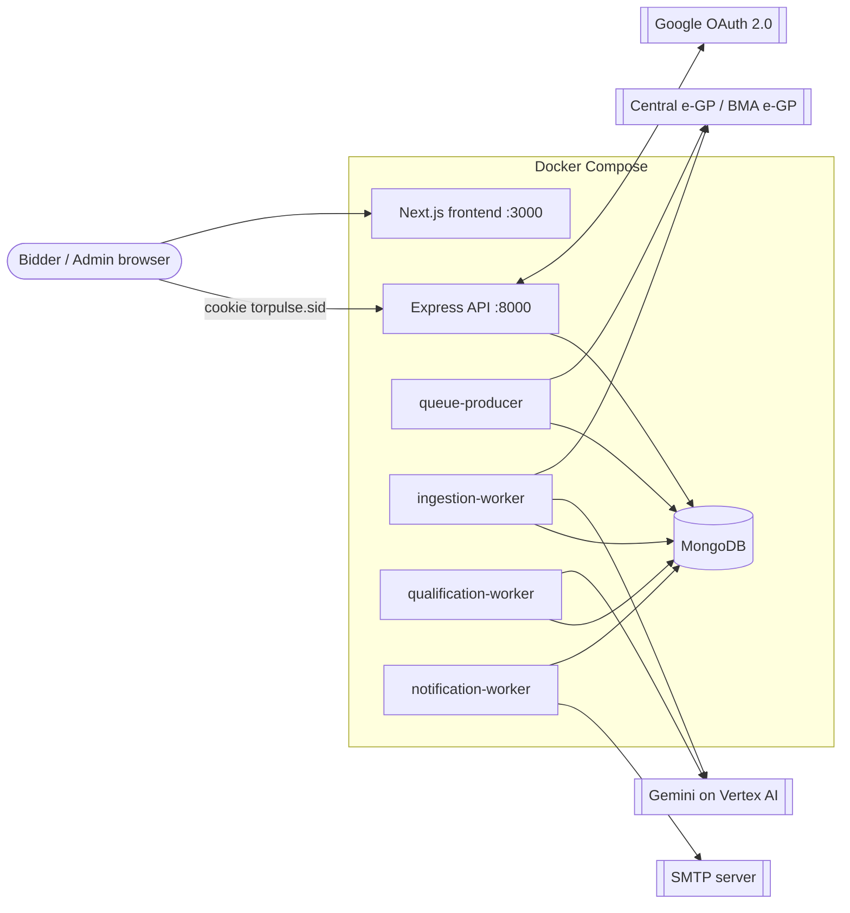
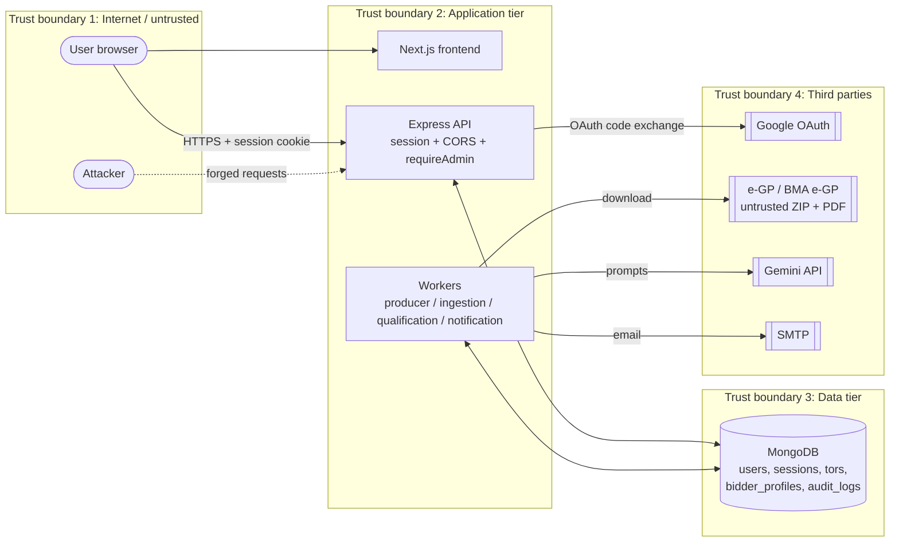
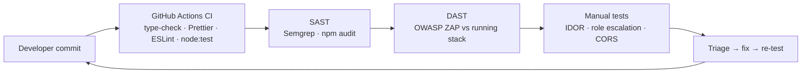

# TORPulse: Software Security Project Report

| | |
|---|---|
| **Application** | TORPulse: a platform for monitoring and analysing Thai government procurement (TOR) documents |
| **Repository** | `Doggo-CSP/TORPulse` |
| **Security standard** | OWASP ASVS v5.0 (requirement list: [`[SOFTWARE SEC] ASVS - ASVS (1).csv`](<[SOFTWARE SEC] ASVS - ASVS (1).csv>)) |
| **Report date** | 16 November 2026 |

### Team members

| Name | GitHub | Student ID |
|---|---|---|
| Chitiwat Phajan | Chitiwat Phajan | _TODO_ |
| Kantapon Hemmadhun | Kantapon Hemmadhun | _TODO_ |
| Earth | Xeei | _TODO_ |
| _TODO_ | negativeix | _TODO_ |

### How this report maps to the grading criteria

| # | Criterion | Section |
|---|---|---|
| 1 | OWASP ASVS requirements we follow | [§2](#2-security-requirements-owasp-asvs--criterion-1), [Appendix A](#appendix-a-full-asvs-requirement-list-planned-rows) |
| 2 | Threat model with priorities | [§3](#3-threat-model--criterion-2) |
| 3 | Security design principles | [§4](#4-security-design-principles--criterion-3) |
| 4–13 | Implementation controls | [§5](#5-security-implementation--criteria-413) |
| 14 | SAST report | [§7.2](#72-sast-semgrep--npm-audit--criterion-14) |
| 15 | DAST report | [§7.3](#73-dast-owasp-zap--criterion-15) |
| 16 | Threat model verification checklist | [§8](#8-threat-model-verification-checklist--criterion-16) |
| 17 | Mapping to ASVS and OWASP Top 10 | [§9](#9-mapping-to-owasp-top-10-2021-and-asvs--criterion-17) |
| 18 | Advanced security features | [§6](#6-advanced-security-features--criterion-18) |

Status legend used throughout: ✅ implemented · ⚠️ partial · ❌ not implemented. This report records what is actually in the code on the `develop` branch. Where a control is missing, we say so and list it in the [remediation roadmap](#10-known-gaps-and-remediation-roadmap).

---

## 1. Application overview and functional features

TORPulse collects procurement announcements from Central e-GP and BMA e-GP. It downloads the TOR PDF files, uses Gemini (Vertex AI) to extract and classify their contents, and shows the results to bidders. Bidders can search TORs, see recommendations and get an AI estimate of whether their company qualifies.

### 1.1 Architecture



- **Frontend:** Next.js 16 / React 19 (`app/frontend`)
- **Backend:** Node.js 22, Express 5, Mongoose 9, Zod 4, Passport (`app/backend`)
- The background workers share only MongoDB. The `ingestion_jobs`, `qualification_match_jobs` and `tor_notifications` collections act as their queues. Full diagrams: [diagrams/architecture.md](diagrams/architecture.md), [diagrams/er-diagram.md](diagrams/er-diagram.md).

### 1.2 Features for bidders (role `user`)

| Feature | API |
|---|---|
| Sign in with Google | `GET /auth/google`, `GET /auth/google/callback`, `GET /auth/me`, `POST /auth/logout` |
| Search and filter TORs (keyword, category, budget, department, status) | `GET /api/v1/tors`, `GET /api/v1/tors/filter-options` |
| TOR detail and similar finished TORs | `GET /api/v1/tors/:id`, `GET /api/v1/tors/:id/similar` |
| Personal top-5 recommendations | `GET /api/v1/tors/recommendations` |
| Onboarding wizard and interest categories | `PUT /api/v1/user/onboarding`, `PUT /api/v1/user/interests` |
| Profile and notification preferences | `GET/PUT /api/v1/user/profile` |
| Bookmarks (saved TORs) | `GET /api/v1/user/bookmarks`, `POST /api/v1/user/bookmarks/:torId` |
| Bidder profile: organisation, team, past projects, preferences | `/api/v1/user/bidder-profile/*` |
| AI qualification match ("do I qualify for this TOR?") | `GET/POST /api/v1/tors/:id/qualification`, `GET /api/v1/user/qualification-matches` |
| Email alerts for new TORs the user qualifies for | notification-worker |
| Dashboard and price reports | `/api/v1/homepage/*`, `/api/v1/reports/*` |

### 1.3 Features for administrators (role `admin`)

| Feature | API (all under `/api/v1/admin`, all behind `requireAdmin`) |
|---|---|
| System statistics | `GET /stats` |
| User management: edit, change role, suspend or reactivate | `GET /users`, `GET/PATCH /users/:userId`, `PATCH /users/:userId/role`, `PATCH /users/:userId/status` |
| TOR moderation: edit, verify, archive, delete | `GET /tors`, `GET/PATCH/DELETE /tors/:torId`, `POST /tors/:torId/verify`, `POST /tors/:torId/archive` |
| Category management | `GET/POST /categories`, `PATCH/DELETE /categories/:categoryId`, `PATCH /categories/:categoryId/status` |
| System settings, e-GP sync, data sources | `GET/PATCH /settings`, `GET /ingestion/status`, `POST /ingestion/sync`, `PATCH /ingestion/sources/:key` |
| Audit log viewer | `GET /activity` |

---

## 2. Security requirements (OWASP ASVS) · Criterion 1

We use **OWASP ASVS v5.0**. We went through all 345 requirements and marked each one as *planned* or *not related* to TORPulse. Requirements were marked not related for features we do not have, such as passwords, file uploads, GraphQL, WebSockets and self-issued JWTs. We aim for **Level 1 plus selected Level 2** requirements.

| | Count |
|---|---:|
| Total ASVS v5 requirements | 345 |
| Not related to TORPulse | 180 |
| **Planned** | **165** (L1: 47 · L2: 100 · L3: 18) |
| ✅ Done | 63 |
| ⚠️ In progress | 54 |
| ❌ To do | 48 |

### 2.1 Planned requirements by chapter

The table below is generated from the CSV, so it matches it exactly.

| Chapter | Planned | Done | In progress | To do |
|---|---:|---:|---:|---:|
| V1 Encoding and Sanitization | 13 | 9 | 4 | 0 |
| V2 Validation and Business Logic | 10 | 3 | 4 | 3 |
| V3 Web Frontend Security | 19 | 9 | 5 | 5 |
| V4 API and Web Service | 5 | 1 | 4 | 0 |
| V5 File Handling | 8 | 5 | 2 | 1 |
| V6 Authentication | 6 | 2 | 2 | 2 |
| V7 Session Management | 15 | 9 | 1 | 5 |
| V8 Authorization | 6 | 4 | 1 | 1 |
| V9 Self-contained Tokens | 1 | 1 | 0 | 0 |
| V10 OAuth and OIDC | 5 | 2 | 0 | 3 |
| V11 Cryptography | 9 | 6 | 2 | 1 |
| V12 Secure Communication | 6 | 1 | 1 | 4 |
| V13 Configuration | 16 | 4 | 8 | 4 |
| V14 Data Protection | 11 | 1 | 4 | 6 |
| V15 Secure Coding and Architecture | 18 | 4 | 9 | 5 |
| V16 Security Logging and Error Handling | 17 | 2 | 7 | 8 |
| **Total** | **165** | **63** | **54** | **48** |

[Appendix A](#appendix-a-full-asvs-requirement-list-planned-rows) lists every planned requirement with code evidence. The Status column holds the team's self-assessment from the CSV. The *Audit note* column records places where the code review for this report found something different.

### 2.2 Key requirements by area

| Area | Key ASVS requirements |
|---|---|
| Injection and encoding | V1.2.4 (parameterised DB queries), V1.2.9 (regex escaping), V1.3.2 (no `eval`), V1.5.2 (safe deserialisation) |
| Validation and business logic | V2.2.1–V2.2.3, V2.3.3 (transactions), V2.4.1 (anti-automation) |
| Browser security | V3.3.1–V3.3.4 (cookie flags), V3.4.1–V3.4.6 (security headers, CORS), V3.5.3 (safe HTTP methods) |
| Files | V5.2.3 (archive bombs), V5.3.2 (path traversal / zip slip) |
| Authentication and OAuth | V6.3.1, V6.8.4, V10.1.2 (OAuth `state`), V10.5.1 |
| Sessions | V7.2.1–V7.2.4, V7.3.1–V7.3.2, V7.4.1–V7.4.3 |
| Authorisation | V8.2.1 (function level), V8.2.2 (data level / IDOR), V8.3.1 (enforced server-side) |
| Configuration and secrets | V13.3.1, V13.4.1–V13.4.7 |
| Logging and errors | V16.3.1–V16.3.4, V16.5.1–V16.5.4 |

---

## 3. Threat model · Criterion 2

**Method:** STRIDE applied to a data-flow diagram (DFD) with trust boundaries. Each threat gets a risk score of **Likelihood (1–3) × Impact (1–3)**:

| Score | Priority | Meaning |
|---|---|---|
| 6–9 | **P1 High** | Implement first |
| 3–5 | **P2 Medium** | Implement after P1 |
| 1–2 | **P3 Low** | Best effort |

### 3.1 Data-flow diagram and trust boundaries



### 3.2 Assets

| Asset | Why it matters |
|---|---|
| User accounts and sessions (`users`, `sessions`) | Account takeover. A stolen admin session controls the whole system. |
| Bidder profiles (company, team members, past projects) | Business-confidential data and personal data of team members |
| Admin functions (role changes, TOR delete, settings) | Integrity of the whole platform |
| TOR data and AI results | Core product. Bad data misleads bidders. |
| Secrets (Google client secret, session secret, Gemini/Vertex credentials, SMTP password) | A leak leads to impersonation or cloud cost abuse |
| AI budget (Gemini calls) | Direct financial cost |
| Audit log | Non-repudiation of admin actions |

### 3.3 Threat register (STRIDE, prioritised)

| ID | STRIDE | Threat | L | I | Score | Priority | Planned mitigation |
|---|---|---|:-:|:-:|:-:|:-:|---|
| T1 | S | **OAuth login CSRF**: the attacker logs the victim into the attacker's account because no OAuth `state` is checked | 2 | 3 | 6 | **P1** | Enable `state: true` (or PKCE) in the Google strategy |
| T2 | S/D | **Account brute force and API abuse**: scripted requests flood the API or the AI endpoints | 2 | 3 | 6 | **P1** | Login is delegated to Google. Per-IP and per-user rate limits. Daily AI quota. |
| T3 | I | **IDOR**: reading or changing another user's profile, bookmarks or bidder-profile team/projects by changing ids | 3 | 3 | 9 | **P1** | All user data is scoped by `req.user._id`. No user id is accepted from the client. |
| T4 | E | **Privilege escalation**: a user sets `role: admin` through mass assignment or calls admin endpoints | 3 | 3 | 9 | **P1** | `requireAdmin` on the admin router, Zod strips unknown keys, separate role endpoint, last-admin guard |
| T5 | T | **NoSQL / regex injection**: `$` operators or regex metacharacters in query or body | 2 | 3 | 6 | **P1** | Express 5 simple query parser, Zod types, ObjectId checks, `escapeRegex`, Mongoose casting |
| T6 | S/E | **Session hijacking or fixation** | 2 | 3 | 6 | **P1** | `httpOnly`, `SameSite=Lax`, `Secure` in production, server-side store, session regenerated at login, logout destroys the session |
| T7 | I | **Secrets leakage** (committed `.env`, secrets in logs or images) | 2 | 3 | 6 | **P1** | Env vars only, `.env` gitignored and dockerignored, startup validation (`SESSION_SECRET` ≥ 32 chars) |
| T8 | T/D | **Malicious upstream archive**: zip bomb, zip slip or fake PDF from e-GP | 2 | 3 | 6 | **P1** | Size, entry-count and ratio limits, path checks, magic-byte checks, temp directory removed after use |
| T9 | I/T | **Exposed database**: MongoDB published on the host with no authentication | 2 | 3 | 6 | **P1** | Do not publish 27017. Enable Mongo authentication and TLS. |
| T10 | T/I | **XSS and clickjacking** | 1 | 3 | 3 | P2 | React auto-escaping, no `dangerouslySetInnerHTML`, CSP, `frame-ancestors` |
| T11 | I | **Information disclosure through errors** (stack traces, internal messages) | 2 | 2 | 4 | P2 | Generic error handler, no stack traces to the client |
| T12 | I | **Unauthenticated ops endpoint**: `/api/v1/ingestion/report` shows pipeline statistics | 2 | 1 | 2 | P3 | Put the endpoint behind `requireAdmin` |
| T13 | T | **SSRF** through server-side fetches | 1 | 2 | 2 | P3 | Hard-coded upstream hosts, no user-supplied URL is fetched, timeouts on every fetch |
| T14 | R | **Repudiation**: an admin denies changing a role or deleting a TOR. Login activity cannot be traced. | 2 | 2 | 4 | P2 | Transactional audit log for admin actions. Log authentication events. |
| T15 | T/E | **Vulnerable dependencies** (supply chain) | 2 | 3 | 6 | **P1** | `npm audit`, Semgrep, lockfiles, dependency updates |
| T16 | I | **Missing transport security**: HTTP in deployment, no HSTS | 2 | 2 | 4 | P2 | TLS-terminating reverse proxy, HSTS, `Secure` cookie |
| T17 | D | **AI cost exhaustion**: repeated "re-evaluate" calls run up the Gemini bill | 3 | 2 | 6 | **P1** | `QUALIFICATION_DAILY_CALL_LIMIT` (default 200 per rolling 24 h), cached results returned |

**Implementation order:** P1 (T1–T9, T15, T17) first, then P2 (T10, T11, T14, T16), then P3 (T12, T13). [§8](#8-threat-model-verification-checklist--criterion-16) shows which ones are done.

---

## 4. Security design principles · Criterion 3

We follow the eight design principles of Saltzer and Schroeder, plus four widely used additions: defense in depth, minimise attack surface, secure defaults and accountability. For each principle, this section shows:

- how the code follows it, with file and line evidence checked on `develop` at commit `24cc306`
- which **OWASP Top 10 (2021)** categories it addresses, using the same version as [§9](#9-mapping-to-owasp-top-10-2021-and-asvs--criterion-17)
- which threats from [§3.3](#33-threat-register-stride-prioritised) it mitigates
- which ASVS requirements from the team CSV it supports
- where we do not fully follow it yet, linked to the [remediation roadmap](#10-known-gaps-and-remediation-roadmap)

Backend paths are relative to `app/backend/src/`. ✅ means followed. ⚠️ means followed with known gaps.

### 4.1 Principles at a glance

| # | Principle | Status | OWASP Top 10 2021 | Threats | ASVS |
|---|---|:-:|---|---|---|
| P1 | Least privilege | ⚠️ | A01, A05, A08 | T4, T9 | V8.2.1, V13.2.2, V13.3.2 |
| P2 | Fail-safe defaults | ⚠️ | A01, A07 | T1, T4, T6, T17 | V8.3.1, V16.5.3, V10.1.2 |
| P3 | Complete mediation | ✅ | A01 | T3, T4 | V8.2.1, V8.2.2, V8.3.1 |
| P4 | Separation of privilege | ✅ | A01, A04 | T4 | V2.3.3, V8.2.1 |
| P5 | Least common mechanism | ⚠️ | A04 | T2, T17 | V2.4.1, V13.3.2 |
| P6 | Defense in depth | ⚠️ | A03, A08 | T3, T5, T8, T10 | V1.2.4, V1.2.9, V5.2.3, V5.3.2 |
| P7 | Economy of mechanism | ✅ | A02, A06, A07 | T2, T15 | V6.3.1, V15.2.4 |
| P8 | Open design | ✅ | A02 | T7 | V11.3.2, V13.3.1 |
| P9 | Minimise attack surface | ⚠️ | A05, A10 | T12, T13 | V13.4.5, V13.4.6, V15.2.3 |
| P10 | Secure defaults and failing securely | ⚠️ | A04, A05 | T6, T7, T11 | V13.2.3, V16.5.1, V16.5.3 |
| P11 | Psychological acceptability | ⚠️ | A07 | T2 | V14.3.1 |
| P12 | Accountability | ⚠️ | A09 | T14 | V16.2.1, V16.3.1, V16.4.2 |

**Summary:** 4 principles are fully followed and 8 are followed with gaps. All 8 gaps are already in the roadmap or the ASVS list. None of them is a design choice that conflicts with the principle.

### 4.2 How each principle is applied

#### P1 Least privilege ⚠️

*Every user, process and token gets only the access it needs.*

- **Users:** there are only two roles, and every new account starts as `user`. The role is set with `$setOnInsert`, so a later login cannot change it (`modules/auth/passport.ts:50-54`).
- **Admin functions:** one guard covers every admin route: `router.use(requireAdmin)` (`modules/admin/admin.routes.ts:32`).
- **Processes:** both container images run as the non-root `node` user (`app/backend/Dockerfile:30`, `app/frontend/Dockerfile:34`).
- **CI:** the GitHub Actions token is read-only, `permissions: contents: read` (`.github/workflows/ci.yml:13-14`).
- **Gaps:**
  - Every backend container gets the same `.env`, so the ingestion worker also holds `SMTP_PASS` and the Google client secret (V13.3.2).
  - All services share one database account, and the local MongoDB has no authentication (T9, R2).

#### P2 Fail-safe defaults ⚠️

*Access is denied unless it is explicitly granted. An error or missing value ends in "no".*

- `requireRole` returns 401 without a session and 403 unless the role matches **and** the account is active (`middleware/admin.middleware.ts:10-19`).
- Login fails when Google returns no email address (`modules/auth/passport.ts:37-39`). A suspended account is refused at login (`:59`) and becomes "logged out" on its next request (`:80`).
- When the daily AI quota is used up, the API returns the cached result or HTTP 429. It never calls the AI past the limit (`modules/qualification/qualification-match.controller.ts:125-135`).
- When the AI answers an item with a value we cannot read, that requirement counts as `unknown` and scores 0 points (`modules/qualification/qualification-match.service.ts:231`, `:271`). A bad answer can only lower a score, never raise it.
- **Gaps:**
  - The `Secure` cookie flag is on only when `NODE_ENV=production` (`apps/api/app.ts:60`), and docker-compose sets `development`. The safe value should be the default (T6, R6).
  - The OAuth `state` check is off by default in passport-oauth2 and we have not turned it on (T1, R1).

#### P3 Complete mediation ✅

*Every request is checked against the current permissions. Earlier decisions are not cached.*

- The session stores only the user id. Role and status are read again from MongoDB on every request (`modules/auth/passport.ts:73-83`). A role change or suspension therefore applies to the user's very next request.
- No user-data endpoint takes a user id from the client. Every query is keyed on `req.user._id` (§5.4).
- Team members and past projects are looked up inside the caller's own profile, so another user's sub-document id returns 404 (`modules/user/bidder-profile.controller.ts:287-292`).
- **Note:** `/api/v1/user/*` handlers each check `req.user` themselves instead of using one router-level guard. Every current route is protected, but a new handler could forget the check (R12).

#### P4 Separation of privilege ✅

*No single action, even by an admin, can remove the system's own safeguards.*

- An admin cannot change their own role or status (`modules/admin/admin.controller.ts:396`, `:503`).
- The last active admin cannot be demoted or suspended (`:401`, `:510`).
- Both checks run inside a MongoDB transaction (`:340-342`, `:445-447`), so two admins demoting each other at the same moment cannot remove every admin.
- **Possible improvement:** sensitive admin actions still need only one admin. A second factor for admin accounts is planned (R14).

#### P5 Least common mechanism ⚠️

*Users and components should share as little as possible, so one cannot affect another.*

- The API and the four workers run as separate processes and share only MongoDB. There are no shared in-process queues (`docs/system-architecture.md` §1).
- Each user's data lives in their own documents (`bidder_profiles` is unique on `userId`), and each login has its own server-side session.
- **Gaps:**
  - The daily AI quota is one global counter for all users (`countRecentAiCalls` in `modules/qualification/qualification-precompute.service.ts:125` has no user filter). One user who forces repeated re-evaluations can use up the quota for everyone (T2, T17). A per-user limit is planned (R4).
  - All services share one secrets file and one database account (see P1).

#### P6 Defense in depth ⚠️

*Several independent layers protect each asset, so one failure is not enough for an attack.*

- **User data:** session check → handler scoped to `req.user._id` → Zod validation → Mongoose schema casting (§5.4, §5.5).
- **Injection:** Express 5's simple query parser stops `?x[$ne]=` objects, Zod enforces types, and user search text goes through `escapeRegex` before it becomes a regex (`modules/tor/tor.controller.ts:277`, `:336`).
- **Untrusted ZIP and PDF files from e-GP**, checked in order:
  1. download size (`modules/ingestion/adapters/central-egp.adapters.ts:62-66`, `:350-354`)
  2. compression ratio (`:883`)
  3. entry path, against zip slip (`:906`)
  4. `%PDF-` magic bytes (`:891`)
  5. the temporary directory is always deleted afterwards (`modules/ingestion/extraction/opendataloader-text-extractor.ts:71-72`)
- **Gaps:**
  - There is no browser layer yet, such as CSP, HSTS or `frame-ancestors` (T10, R7).
  - Mongoose `sanitizeFilter` is not on as a last database-side layer (T5, R5).
  - There is no request rate limit (T2, R4).

#### P7 Economy of mechanism ✅

*Keep security mechanisms small, simple and few, so they can be checked.*

- We store no passwords. Login is delegated to Google OAuth through Passport, so password storage, reset and breach handling are not ours to build (§5.1).
- Sessions use proven libraries (express-session with connect-mongo) instead of a custom token scheme.
- One validation library, Zod, is used for every write endpoint.
- **Note:** `escapeRegex` is copied in three files (`modules/admin/admin.controller.ts:60`, `modules/category/category.repository.ts:8`, `modules/tor/tor.controller.ts:277`). The copies are identical today. One shared helper would make sure they stay that way.

#### P8 Open design ✅

*Security must not depend on keeping the design secret. It rests on keys and standard protocols.*

- Our security relies on secrets kept outside the code (session secret, OAuth client secret, API keys) and on standard mechanisms: OAuth 2.0, HMAC-signed session cookies and TLS.
- The full design is documented in the repository (`docs/system-architecture.md`). Publishing it gives an attacker nothing, because no security control depends on it being hidden.
- **Example of the opposite:** e-GP's public client encrypts requests with a hard-coded passphrase, `RDCrypto` (`modules/ingestion/adapters/central-egp.adapters.ts:719-755`). We have to match that protocol, but we do not rely on it to protect our own data. This is recorded as an exception (V11.3.2).

#### P9 Minimise attack surface ⚠️

*Expose as few entry points, features and details as possible.*

- Users cannot upload files. The only files we process come from fixed e-GP and BMA hosts.
- The server calls only three fixed hosts (`process5.gprocurement.go.th`, `egp2.bangkok.go.th`, `adminapiegp.bangkok.go.th`) plus Google, the AI provider and the SMTP server. No URL supplied by a user is ever fetched (T13).
- `/auth/me` returns only six fields (`modules/auth/auth.routes.ts:22-37`), and `x-powered-by` is disabled (`apps/api/app.ts:34`).
- CORS allows exactly one origin, `FRONTEND_URL`, never `*` (`apps/api/app.ts:40-47`).
- **Gaps:**
  - `/api/v1/ingestion/report` is public (T12, R12).
  - Next.js still sends `X-Powered-By` (R7).
  - The JSON body limit is 8 MB although no endpoint accepts files (`apps/api/app.ts:48-49`).
  - The build also compiles test files and dev scripts into `dist/` (V15.2.3).

#### P10 Secure defaults and failing securely ⚠️

*The system starts in a safe state, refuses unsafe configurations, and errors do not open a way in.*

- The API refuses to start without the OAuth settings or with a `SESSION_SECRET` shorter than 32 characters (`modules/auth/auth.config.ts:29-32`). `config/env.ts` has 11 more startup checks.
- The development session-token tool refuses to run when `NODE_ENV=production` (`scripts/dev-session-token.ts:21-23`).
- The production Docker image sets `NODE_ENV=production` (`app/backend/Dockerfile:22`).
- **Gaps:**
  - The 500 handler sends `error.message` to the client (`middleware/error.middleware.ts:17-21`). In a test, malformed JSON produced a 500 with the parser's message, where a 400 with a generic message is the correct response (T11, R8).
  - The placeholder `SESSION_SECRET` in `.env.example` is long enough to pass the 32-character check, so a copied example file would start without an error (V13.2.3).

#### P11 Psychological acceptability ⚠️

*Security should be easy to use correctly, or people will work around it.*

- Users sign in with one click through Google. There is no password to remember or reuse, and Google's 2-Step Verification protects TORPulse too.
- **Gap:** users expect logging out to remove their data from the browser. Logout destroys the server session but leaves unsaved profile drafts in `localStorage` and the React Query cache in memory. On a shared computer, the next person could see them (V14.3.1).

#### P12 Accountability ⚠️

*Every important action can be traced to who did it and when.*

- Every admin change writes an audit-log entry with actor, action, target, and before and after values. The entry is written **in the same transaction** as the change, so a change cannot happen without its record: 11 call sites in `modules/admin/admin.controller.ts`, plus system ingestion runs in `apps/queue-producer/queue-producer.ts:246`.
- There is no API to edit or delete audit entries. Admins can only read them through `GET /api/v1/admin/activity`.
- **Gaps:**
  - Login, logout and 401/403 denials are not logged (T14, R9).
  - Other logs go to the console with no timestamp or structure.

### 4.3 OWASP Top 10 coverage by principle

This table reads §4.1 from the other direction. [§9](#9-mapping-to-owasp-top-10-2021-and-asvs--criterion-17) lists the concrete controls for each category. This table shows which principles those controls come from.

| OWASP Top 10 2021 | Principles applied | Weakest point today |
|---|---|---|
| A01 Broken Access Control | P1, P2, P3, P4 | Per-handler `req.user` checks on `/user/*` (P3) |
| A02 Cryptographic Failures | P7, P8 | `Secure` cookie depends on `NODE_ENV` (P2) |
| A03 Injection | P6 | No `sanitizeFilter` as the last layer (P6) |
| A04 Insecure Design | P4, P5, P10 | Global AI quota shared by all users (P5) |
| A05 Security Misconfiguration | P1, P9, P10 | No security headers; shared secrets file (P1, P9) |
| A06 Vulnerable and Outdated Components | P7 | Open `npm audit` advisories (R3) |
| A07 Identification and Authentication Failures | P2, P7, P11 | OAuth `state` not enabled (P2) |
| A08 Software and Data Integrity Failures | P1, P6 | GitHub Actions not pinned to SHAs (R13) |
| A09 Security Logging and Monitoring Failures | P12 | Authentication events not logged (P12) |
| A10 Server-Side Request Forgery | P9 | No explicit allowlist check in code (P9) |

---

## 5. Security implementation · Criteria 4–13

All backend paths below are relative to `app/backend/src/`.

### 5.1 Password authentication · Criterion 4 · ❌ Not implemented (by design)

TORPulse has **no password login**. The `User` schema has no password field (`modules/auth/user.model.ts:50-82`), and `/auth/signup` redirects to the Google sign-in page. We made this choice to avoid storing credentials: password storage, password reset and breach handling become Google's responsibility (economy of mechanism).

**If password login is added**, the design is:
- argon2id hashing (memory 19 MiB, t=2, p=1), with a unique salt per hash
- Minimum length 12, maximum 128, no composition rules (ASVS V6.2)
- Check new passwords against HaveIBeenPwned using k-anonymity (only the first 5 hex characters of the SHA-1 hash are sent)
- Rate-limit and lock out failed logins (see §6)
- Generic "invalid credentials" message, so attackers cannot tell which accounts exist

### 5.2 Social SSO with OAuth / OpenID · Criterion 5 · ✅ Implemented (with gaps)

- **Library:** `passport@0.7` + `passport-google-oauth20` (`modules/auth/passport.ts:25-31`)
- **Flow:** OAuth 2.0 authorisation code with `scope: ['profile', 'email']` (`modules/auth/auth.routes.ts:12`). The callback redirects to the frontend on success or failure (`auth.routes.ts:14-20`).
- **Account provisioning:** upsert by `googleId`. A new account gets `role:'user', status:'active'` through `$setOnInsert`. Login is refused when Google gives no email (`passport.ts:35-62`).
- **Configuration validated at startup:** `GOOGLE_CLIENT_ID`, `GOOGLE_CLIENT_SECRET`, `GOOGLE_CALLBACK_URL` and `FRONTEND_URL` are all required and the URLs are parsed (`modules/auth/auth.config.ts:20-43`).
- **Gaps:** the OAuth `state` parameter is not enabled, so passport-oauth2 falls back to its `NullStore` (threat T1). `openid` and the ID-token nonce are not used. Google's `email_verified` flag is not checked.
- **Fix:** `new GoogleStrategy({ ..., state: true, pkce: true })` and check `profile._json.email_verified`.

### 5.3 Authorisation (roles) · Criterion 6 · ✅ Implemented

- Roles are stored as an enum on `User`: `role: 'admin' | 'user'`, plus `status: 'active' | 'suspended'` (`modules/auth/user.model.ts:56-57`).
- `requireRole(...roles)` middleware returns **401** with no session and **403** for a wrong role or a suspended account (`middleware/admin.middleware.ts:7-24`).
- The admin router applies the guard once to every route: `router.use(requireAdmin)` (`modules/admin/admin.routes.ts:32`).
- The frontend admin page also hides itself from non-admins, but that is only for usability. The server enforces the rule.
- **Tests:** `admin.routes.test.ts`: "rejects a guest with 401", "rejects a regular user with 403", "a regular user is rejected on every admin route group", "rejects a suspended admin with 403", "an admin cannot change their own role or status", "the last active admin cannot be demoted or suspended".

### 5.4 Access control: no access to another user's data · Criterion 7 · ✅ Implemented

- No user-data endpoint accepts a user id from the client. Every query is keyed on the session user:
  - Profile: `findUserById(req.user._id)` / `updateUserProfile(req.user._id, …)` (`modules/user/user.controller.ts`)
  - Bookmarks: `{ userId, torId }` with a unique compound index (`modules/user/user.repository.ts`, `user-bookmark.model.ts`)
  - Bidder profile: `findOne({ userId })`, unique on `userId`. Team-member and project sub-ids are looked up **inside the caller's own profile**, so another user's id returns 404 (`modules/user/bidder-profile.controller.ts:287-292`).
  - Qualification matches and recommendations are filtered by `userId: req.user._id`.
- Admin-only data (users, audit log, settings) sits behind `requireAdmin`.
- **Gap:** `/api/v1/user/*` routes check `req.user` inside each handler rather than through a router-level `requireAuth`. This works, but a new handler could forget the check (see roadmap).

### 5.5 Input validation and injection protection (SQL / NoSQL / ORM) · Criterion 8 · ⚠️ Partial

| Control | Evidence |
|---|---|
| Zod schemas with `safeParse` for every write endpoint: user profile, interests, onboarding, bidder profile (max lengths, enums, ObjectId regex), admin (`.strict()`), reports | `modules/user/user.validation.ts`, `modules/user/bidder-profile.validation.ts`, `modules/admin/admin.validation.ts`, `modules/report/report.validation.ts` |
| **NoSQL operator injection:** Express 5 uses the `simple` query parser, so `?role[$ne]=x` does not become an object. Handlers coerce query values to strings or numbers. Zod rejects non-string types in bodies. | `modules/tor/tor.controller.ts:279-287` |
| ObjectId validation before queries (`isObjectIdOrHexString`) | `tor.controller.ts:398`, `admin.controller.ts`, `qualification-match.controller.ts` |
| **Regex injection / ReDoS:** user search text goes through `escapeRegex` before `new RegExp` | `tor.controller.ts:277`, `admin.controller.ts:60,183`, `category/category.repository.ts:8,48` (test: "GET /admin/users treats regex characters in q as plain text") |
| **Mass assignment:** Zod drops unknown keys. Admin schemas are `.strict()` and reject `email`/`role`/`status`. Role and status have their own endpoints. | `admin.validation.ts:60-66` (test: "PATCH /admin/users/:userId refuses email, role, and status") |
| No SQL database. Mongoose queries are built from objects, not strings, so classic SQL injection does not apply. | — |

**Gaps:** Mongoose `sanitizeFilter` and `strictQuery` are not enabled. `tor.validation.ts` is empty (the TOR list uses hand-written parsers instead). `POST /user/bookmarks/:torId` does not check that `torId` is an ObjectId. `PUT /user/profile` string fields have no maximum length.

### 5.6 Environment variables and credentials · Criterion 9 · ✅ Implemented (deployment gaps)

- All secrets come from environment variables loaded by `dotenv` (`config/env.ts:1`). Nothing is hard-coded in source. Semgrep's secrets ruleset found only the CI test value (see §7.2).
- **Startup validation:** `MONGODB_URI`/`MONGODB_DATABASE` and the numeric limits are required (`config/env.ts:48-102`). The OAuth settings and `SESSION_SECRET` are required, and the secret must be **≥ 32 characters** (`modules/auth/auth.config.ts:28-43`). The test `auth.config.test.ts` checks this.
- `.env`, `.env.*` are gitignored (`/.gitignore:14-16`, `app/backend/.gitignore`, `app/frontend/.gitignore`) and excluded from Docker images (`app/backend/.dockerignore`). Git history contains only `.env.example`, with blank values.
- **Gaps:** docker-compose passes secrets through `env_file` rather than Docker secrets or a vault. MongoDB runs **without authentication** and is published on host port 27017 (`docker-compose.yml:22-25`, threat T9). The CI workflow contains a literal test-only `SESSION_SECRET`.

### 5.7 CORS · Criterion 10 · ✅ Implemented

`app/backend/src/apps/api/app.ts:40-47`:

```ts
cors({
  origin: (requestOrigin, callback) => {
    callback(null, !requestOrigin || requestOrigin === frontendOrigin)
  },
  credentials: true,
})
```

- Exactly one allowed origin, taken from `FRONTEND_URL` and normalised with `new URL(...).origin`. **No `*`.**
- `credentials: true`, so the session cookie is sent only for that origin.
- Requests with no `Origin` header (curl, server-to-server) pass CORS but still need a valid session cookie.
- **Test:** `auth.routes.test.ts` "GET /auth/me returns 401 for a guest and allows only the configured frontend origin" ✅ (passed in our local run, §7.1).

### 5.8 Error handling · Criterion 11 · ⚠️ Partial

- A global `notFoundHandler` and `errorHandler` are registered last (`apps/api/app.ts:74-75`, `middleware/error.middleware.ts`). Express 5 forwards rejected async handlers to them automatically.
- Stack traces are **never** sent to the client. They are only logged with `console.error` (`error.middleware.ts:15`).
- Validation errors return 400 with a structured Zod error. Authorisation errors return 401/403 with generic messages.
- The AI path fails safely: when Gemini fails or the quota is reached, the cached result is returned (`qualification-match.controller.ts:125-135`).
- **Gap:** the 500 handler returns `error.message` (`error.middleware.ts:17-21`), and some admin handlers do the same. That can leak internal details such as Mongoose CastError text. **Fix:** return `"Internal server error"` with a correlation id when `NODE_ENV=production`.

### 5.9 Logging · Criterion 12 · ⚠️ Partial

- **Audit log (implemented):** the `audit_logs` collection records `actorType`, `actorId`, `action`, `target`, `before`/`after` and `metadata` (`modules/admin/audit-log.model.ts`). Entries are written **in the same MongoDB transaction** as the change, so a change cannot happen without its log entry. Admins read the log through `GET /api/v1/admin/activity`. Events logged:
  - `user.updated`, `user.role_changed`, `user.suspended`, `user.reactivated`
  - `tor.updated`, `tor.verified`, `tor.archived`, `tor.deleted`
  - `category.created`, `category.updated`, `category.shown`, `category.hidden`, `category.deleted`
  - `settings.updated`, `ingestion.source_enabled`, `ingestion.source_disabled`, `ingestion.completed`, `ingestion.failed`
- **Error logging:** unexpected errors are written to the console (`error.middleware.ts:15`). Worker failures are logged and stored on the job document.
- **Gaps:** login success and failure, logout, and 401/403 denials are **not** logged. There is no structured logger (pino/winston) and no log redaction. Semgrep flagged string concatenation in `console.log` calls (log injection risk, INFO severity).

### 5.10 HTTP security headers · Criterion 13 · ❌ Mostly not implemented

| Header | Backend (Express) | Frontend (Next.js) |
|---|---|---|
| `X-Powered-By` removed | ✅ `app.disable('x-powered-by')` (`apps/api/app.ts:34`) | ❌ still sent (`poweredByHeader` not set) |
| `Content-Security-Policy` (incl. `frame-ancestors`) | ❌ | ❌ |
| `Strict-Transport-Security` | ❌ | ❌ |
| `X-Content-Type-Options: nosniff` | ❌ | ❌ |
| `X-Frame-Options` | ❌ | ❌ |
| `Referrer-Policy` | ❌ (external links use `rel="noreferrer"`) | ❌ |
| Cookie flags `HttpOnly`, `SameSite=Lax`, `Secure` (production) | ✅ (`apps/api/app.ts:57-62`) | n/a |

Neither framework sets these headers for us. **Planned fix:** add `helmet()` to the Express app, plus `async headers()` and `poweredByHeader: false` in `app/frontend/next.config.ts`. Screenshot placeholder for after the fix:

> 📷 _TODO: browser DevTools → Network → response headers for `GET /auth/me` and the frontend `/` page._

---

## 6. Advanced security features · Criterion 18

| Feature | Status | Details |
|---|---|---|
| Multi-factor authentication (email / OTP) | ❌ | Not in the app. Users can turn on 2-Step Verification in their Google account, which then protects TORPulse login too. |
| Authorisation with scopes | ❌ | Role-based only. OAuth scopes are just `profile` and `email`. |
| Rate limit for login attempts | ❌ | No limiter on `/auth/google*`. Brute force against credentials is handled by Google. |
| Rate limit for backend APIs | ⚠️ | **Daily AI quota**: `QUALIFICATION_DAILY_CALL_LIMIT` (default 200, validated in `config/env.ts:42,86`) counted over a rolling 24 h. On-demand `POST /tors/:id/qualification` returns the cached result with `limitReached: true`, or **HTTP 429** when there is no cached result (`modules/qualification/qualification-match.controller.ts:125-135`). The worker waits 1 h when over the limit. No per-IP or per-user limiter. |
| Login timeout | ⚠️ | Absolute session lifetime of 7 days (`maxAge` and store TTL, `apps/api/app.ts:14,31,61`). New session id at login (Passport 0.7 `session.regenerate`). Logout destroys the server-side session. No idle timeout. |
| Compromised-password check | ❌ (N/A) | There are no passwords. Design in §5.1. |
| JWT expiration checking | ❌ (N/A) | We use server-side sessions, not JWTs. |

**Honest status:** two features are partly done. **Two or more still need to be finished** to meet the requirement of four. The quickest to finish:
1. `express-rate-limit` on `/auth/*` (login attempts) and `/api/v1/*` (APIs), with a per-user key for authenticated routes
2. An idle session timeout (`rolling: true` with a 30-minute `maxAge`, keeping the 7-day absolute limit)
3. Email OTP as a second factor for admin accounts, using the existing nodemailer setup

---

## 7. Security testing process · Criteria 14, 15



### 7.1 Automated security tests (unit / integration)

- **Framework:** Node's built-in `node:test` (run with `tsx --test`) + `supertest`. The tests start the real Express app, using a memory session store and test MongoDB data.
- **CI:** `.github/workflows/ci.yml` runs on every push and PR to `main` and `develop`. It runs backend type-check, Prettier and the full test suite against a MongoDB 7 service container, then frontend ESLint and `next build`. The workflow has `permissions: contents: read`.

| Test file | Security behaviour tested |
|---|---|
| `modules/auth/auth.routes.test.ts` | Guest gets 401. CORS allows only the frontend origin. `/auth/me` returns only public fields. Logout clears the cookie. Suspended accounts are treated as logged out. New Google accounts start as `user`/`active`. Suspended accounts cannot log in. |
| `modules/auth/auth.config.test.ts` | Required env vars. `SESSION_SECRET` ≥ 32 chars. URL validation. |
| `scripts/dev-session-token.test.ts` | Dev token tool refuses to run when `NODE_ENV=production` |
| `modules/admin/admin.routes.test.ts` | `requireAdmin` (401/403/suspended admin). Every admin route group rejects regular users. Invalid ids give 400. Regex text in search is treated as plain text. Email/role/status mass assignment refused. Self role change blocked. Last-admin guard. Concurrent demotions. Audit log written. |
| `modules/user/user.routes.test.ts`, `bidder-profile.routes.test.ts` | Input validation rejects bad payloads. Company-only routes are refused for personal accounts. Unknown team members are rejected. |
| `modules/qualification/qualification-match.routes.test.ts` | Login required. Daily AI limit behaviour. |

**Local run (16 Nov 2026), auth suite:** `npx tsx --test src/modules/auth/auth.routes.test.ts src/modules/auth/auth.config.test.ts src/scripts/dev-session-token.test.ts` gave **10 tests, 10 passed, 0 failed**. The full suite needs MongoDB and runs in CI.

### 7.2 SAST (Semgrep + npm audit) · Criterion 14

#### Semgrep

```bash
uvx semgrep scan --metrics=off \
  --config p/default --config p/javascript --config p/react --config p/nextjs \
  --config p/security-audit --config p/owasp-top-ten --config p/nodejs \
  --config p/typescript --config p/secrets --config p/docker-compose \
  --config p/dockerfile --config p/github-actions \
  --exclude node_modules --exclude dist --exclude sandbox-output \
  app/backend/src app/frontend/src docker-compose.yml \
  app/backend/Dockerfile app/frontend/Dockerfile .github
```

**Result (16 Nov 2026):** 261 rules on 217 files, **24 findings**: 1 ERROR, 10 WARNING, 13 INFO. A first run using only `p/owasp-top-ten`, `p/nodejs`, `p/typescript` and `p/secrets` (114 rules, 171 files) found **0**.

| Severity | Rule | Location | Count | Triage |
|---|---|---|:-:|---|
| ERROR | `detected-generic-secret` | `.github/workflows/ci.yml:40` | 1 | **False positive.** A random `SESSION_SECRET` that only the CI test run uses. It signs nothing in production. We will move it to a GitHub Actions secret to keep the scanner clean. |
| WARNING | `github-actions-mutable-action-tag` | `ci.yml:43,44,63,64` | 4 | **Valid (low).** `actions/checkout@v4` and `setup-node@v4` are pinned by tag. Pin to commit SHAs. |
| WARNING | `detect-non-literal-regexp` | `admin.controller.ts:183`, `category.repository.ts:48` | 2 | **False positive.** The input goes through `escapeRegex` first, and a test covers this. |
| WARNING | `express-data-exfiltration` (`Object.assign` with user data) | `bidder-profile.controller.ts:202,250,294,372` | 4 | **False positive.** The data is Zod-parsed with a fixed set of fields before `Object.assign`. |
| INFO | `unsafe-formatstring` (string concat in `console.log`) | workers, ingestion, notification, qualification (13 places) | 13 | **Valid (low).** Log injection or format confusion. Fix by moving to a structured logger. |

#### npm audit (dependency scan)

```bash
cd app/backend && npm audit
cd app/frontend && npm audit
```

| Project | Critical | High | Moderate | Low | Total |
|---|:-:|:-:|:-:|:-:|:-:|
| Backend | 1 | 3 | 2 | 0 | **6** |
| Frontend | 1 | 4 | 8 | 0 | **13** |

| Package (installed) | Severity | Direct? | Advisory | Action |
|---|---|---|---|---|
| `proxy-addr` 2.0.7 (via express) | Critical | transitive | IP spoofing through an IPv4-mapped IPv6 trusted subnet | `npm audit fix`. Affects `trust proxy` in production. |
| `mongoose` 9.9.4 | High | direct | Connection-level `sanitizeFilter` not applied. Discriminator key bypasses casting. | Upgrade mongoose |
| `zod` 4.4.3 | High | direct | Memory exhaustion validating oversized constrained collections | Upgrade zod. Also lower the 8 MB body limit. |
| `body-parser` 2.3.0 | High | transitive | DoS through trailing bytes after a compressed body | `npm audit fix` |
| `nodemailer` 10.1.0 | Moderate | direct | Address-parser comment/group bugs can add recipients | Upgrade. Recipients come from the DB, not user input. |
| `qs` 6.15.3 | Moderate | transitive | arrayLimit bypass; DoS | `npm audit fix` |
| `next` 16.3.0 | **Critical** | direct | Unauthenticated RCE (Windows hosts; Image Optimisation with AVIF) | **Upgrade to next ≥ 16.4.6** (we deploy on Linux, but upgrade anyway) |
| `sharp`, `source-map-js`, `brace-expansion`, `zod` | High | transitive | librsvg CVE; DoS issues | `npm audit fix` |
| `eslint-config-next` / `typescript-eslint` / `minimatch` | Moderate | dev only | ReDoS in build tooling | Upgrade (dev only, not shipped) |

Every finding has a fix available (`fixAvailable: true`). Upgrading is roadmap item R3.

#### CodeQL (GitHub code scanning). Recommended setup.

Repository → **Settings → Code security → Code scanning → Set up → Default**, with language *JavaScript/TypeScript*. Alternatively, add `.github/workflows/codeql.yml` using `github/codeql-action/init@v3` + `analyze@v3` with `languages: javascript-typescript`. Results appear under **Security → Code scanning alerts**.

> 📷 _TODO: screenshot of the CodeQL alerts page after the first run._

### 7.3 DAST (OWASP ZAP) · Criterion 15

Step-by-step instructions: **[zap-pentest-manual.md](zap-pentest-manual.md)**.

**Test environment:** an isolated Docker Compose project ([`pentest/`](../pentest)) with its own throwaway MongoDB (`torpulse_pentest`), loaded with mock data (23 TORs, 3 test users). It never loads the real `app/backend/.env`. The Docker network is `internal`, so the stack cannot reach MongoDB Atlas, Gemini, e-GP or SMTP. We confirmed this before scanning: an outbound request from the API container fails with `EAI_AGAIN`. No workers run, AI calls are disabled (`QUALIFICATION_DAILY_CALL_LIMIT=0`) and BMA sync is off.

**Authentication:** ZAP cannot do Google login, so [`pentest/scripts/prepare.ts`](../pentest/scripts/prepare.ts) creates an admin and two users and signs a real `torpulse.sid` session cookie for each, in the same format express-session writes. ZAP sends the admin cookie on every request through a replacer rule.

**Scan:** ZAP 2.x Automation Framework plan [`pentest/zap/api-scan.yaml`](../pentest/zap/api-scan.yaml). The plan sends all 41 API endpoints (public, user and admin, including JSON bodies for PUT/PATCH/POST), runs a passive scan, then runs the default active scan policy (52 rules, medium strength). `/auth/logout` and `/auth/google*` are excluded.

```bash
docker compose -f pentest/docker-compose.yml run --rm zap zap.sh -cmd -autorun /zap/wrk/api-scan.yaml
```

**Results (16 Nov 2026, `develop`):** 52 active rules sent **5,762 attack requests**. That includes SQL injection with 508 payloads, command injection 418, path traversal 387, remote file include 220, code injection 176, XPath, XXE and persistent/DOM XSS. The API did not crash, and the mock database stayed consistent.

| Risk | Alerts |
|---|:-:|
| High | **0** |
| Medium | 2 |
| Low | 1 |
| Informational | 1 |

| ZAP alert | Risk | Where | Valid? | Fix |
|---|---|---|---|---|
| Content Security Policy (CSP) Header Not Set (10038) | Medium | `GET /api/v1/ingestion/report` (the only HTML response) | **Valid.** Also, this endpoint should not be public (T12). | `helmet()` CSP (R7). Put the endpoint behind `requireAdmin` (R12). |
| Missing Anti-clickjacking Header (10020) | Medium | `GET /api/v1/ingestion/report` | **Valid** | `helmet()` `frame-ancestors 'none'` / `X-Frame-Options: DENY` (R7) |
| X-Content-Type-Options Header Missing (10021) | Low | Systemic: every JSON endpoint | **Valid** | `helmet()` `nosniff` (R7) |
| User Agent Fuzzer (10104) | Info | Systemic | Informational. Responses do not change with User-Agent. | — |

**No injection, XSS, path-traversal or access-control alert was raised.** This matches the code review: Mongoose object queries, the Express 5 simple query parser, Zod validation, `escapeRegex` and JSON-only responses. ZAP's log contained only "check for updates" / telemetry failures, which are expected because the network has no internet.

**Limits of the automated scan:** ZAP does not detect business-logic issues such as IDOR or the missing OAuth `state`, and it does not flag error-message leaks in JSON. We covered those with the manual tests in §7.4. 

**Frontend baseline scan (16 Nov 2026):** `zap-baseline.py -t http://frontend:3000` on the same isolated stack. Result: 0 High, 56 checks passed, and these warnings:

| ZAP alert | Risk | Where | Valid? | Fix |
|---|---|---|---|---|
| Content Security Policy (CSP) Header Not Set (10038) | Medium | 4 pages | **Valid** | `headers()` in `next.config.ts` with a CSP (R7) |
| Missing Anti-clickjacking Header (10020) | Medium | 4 pages | **Valid** | CSP `frame-ancestors 'none'` / `X-Frame-Options: DENY` (R7) |
| X-Content-Type-Options Header Missing (10021) | Low | 5 responses | **Valid** | `nosniff` header (R7) |
| Server Leaks Information via `X-Powered-By` (10037) | Low | 5 responses | **Valid** | `poweredByHeader: false` (R7) |
| Big Redirect Detected (10044) | Low | `/` (307 redirect) | False positive. The redirect body is Next.js's own page shell with no user data. | — |
| Modern Web Application (10109) | Info | 4 pages | Informational. Tells ZAP to use the AJAX spider. | — |

Full reports: `pentest/zap/reports/zap-api-report.{html,md}` and `zap-frontend-baseline.{html,md}` (generated, gitignored).

> 📷 _TODO: screenshot of the ZAP HTML report summary for the presentation._

### 7.4 Manual security tests

We ran these on the same isolated pentest stack, as admin, user A, user B and guest. The exact commands are in [zap-pentest-manual.md §8](zap-pentest-manual.md#8-manual-penetration-tests).

| # | Test | Expected | Result (16 Nov 2026) | Threat |
|---|---|---|---|---|
| M1 | User A → `GET /api/v1/admin/users` | 403 | ✅ 403 | T4 |
| M2 | Guest → `GET /api/v1/admin/stats` | 401 | ✅ 401 | T4 |
| M3 | User A `PUT /user/profile {"role":"admin"}`, then `/auth/me` | role stays `user` | ✅ `user` | T4 |
| M4 | **IDOR:** user A `PATCH` and `DELETE` user B's bidder-profile team member | 404 | ✅ 404 / 404 | T3 |
| M5 | `Origin: https://evil.example` → `/auth/me` | no `Access-Control-Allow-Origin` | ✅ none (frontend origin is echoed) | A05 |
| M6 | `?q[$ne]=x`, and body `{"interests":{"$gt":""}}` | operator not executed | ✅ 200 (treated as text) / 400 | T5 |
| M7 | Admin `GET /admin/users?q=.*` | `.*` taken literally | ✅ 0 results | T5 |
| M8 | Logout, then reuse the cookie | 401 | ✅ | T6 |
| M9 | `GET /auth/google`: `state=` in the redirect | present | ❌ **missing** | T1 |
| M10 | `POST /user/bookmarks/not-an-id` | generic 400 | ❌ **500 `Cast to ObjectId failed … model "UserBookmark"`** | T11 |
| M11 | 100 rapid requests | some 429 | ❌ **0 × 429** | T2 |
| M12 | Response headers | CSP, HSTS, nosniff | ❌ **only Content-Type + CORS** | T10 |
| M13 | `POST /tors/:id/qualification` | no AI call | ✅ 409 (incomplete profile) / 429 (limit) | T17 |
| M14 | Guest → `GET /ingestion/report` | 401 | ❌ **200** | T12 |

---

## 8. Threat model verification checklist · Criterion 16

| ID | Priority | Threat | Mitigation implemented | Status | Evidence / remaining work |
|---|:-:|---|---|:-:|---|
| T3 | P1 | IDOR | Every user query scoped by `req.user._id`. Sub-documents looked up inside the caller's profile. | ✅ | `bidder-profile.controller.ts:287-292`, `user.repository.ts` |
| T4 | P1 | Privilege escalation | `requireAdmin`, Zod strip / `.strict()`, separate role endpoint, last-admin and self guards, transactions | ✅ | `admin.routes.ts:32`, `admin.controller.ts:340-362`, tests |
| T7 | P1 | Secrets leakage | Env vars, gitignore and dockerignore, startup validation | ✅ | `auth.config.ts:28-43`. Remaining: move the CI secret into GitHub Secrets. |
| T8 | P1 | Malicious ZIP/PDF | Size, entry, total and ratio limits; zip-slip guard; `%PDF-` magic bytes; temp directory cleanup | ✅ | `central-egp.adapters.ts:62-66,891,899-911` |
| T17 | P1 | AI cost exhaustion | Daily rolling quota, 429 or cached result | ✅ | `qualification-match.controller.ts:125-135` |
| T6 | P1 | Session hijack / fixation | httpOnly, SameSite, server-side store, regenerate at login, destroy at logout | ⚠️ | `Secure` only when `NODE_ENV=production`, which compose does not set. No idle timeout. |
| T5 | P1 | NoSQL / regex injection | Simple query parser, Zod, ObjectId checks, `escapeRegex` | ⚠️ | Add `mongoose.set('sanitizeFilter', true)` and `strictQuery`. Validate `torId` in bookmarks. |
| T2 | P1 | Brute force / API abuse | Login delegated to Google. AI quota. | ⚠️ | No `express-rate-limit` |
| T15 | P1 | Vulnerable dependencies | npm audit + Semgrep run, lockfiles committed | ⚠️ | 19 advisories open. Run upgrades (R3). Add Dependabot and CodeQL. |
| T1 | P1 | OAuth login CSRF | — | ❌ | Enable `state: true` / PKCE |
| T9 | P1 | Exposed MongoDB | — | ❌ | Remove the `27017` port mapping. Enable auth and TLS. |
| T11 | P2 | Error message disclosure | Global handler, no stack traces | ⚠️ | Stop returning `error.message` in production |
| T14 | P2 | Repudiation | Transactional audit log for all admin actions | ⚠️ | Log login, logout and access denials |
| T10 | P2 | XSS / clickjacking | React escaping, no `dangerouslySetInnerHTML` | ⚠️ | Add CSP and `frame-ancestors` (helmet + Next headers) |
| T16 | P2 | No transport security | Cookie `Secure` in production, `trust proxy` | ❌ | Reverse proxy with TLS, HSTS |
| T13 | P3 | SSRF | Hard-coded hosts, `AbortSignal.timeout`, no user URLs fetched | ✅ | `bma-discovery.adapter.ts`, `central-egp.adapters.ts` |
| T12 | P3 | Unauthenticated ops report | — | ❌ | Add `requireAdmin` to `/api/v1/ingestion/report` |

**Summary:** 6 ✅ done · 6 ⚠️ partial · 5 ❌ not done, out of 17 threats. Of the 11 P1 threats: 5 done, 4 partial, 2 not done.

---

## 9. Mapping to OWASP Top 10 (2021) and ASVS · Criterion 17

| OWASP Top 10 2021 | TORPulse controls | Status | ASVS v5 | Gaps |
|---|---|:-:|---|---|
| **A01 Broken Access Control** | `requireAdmin`; per-user scoping; last-admin and self guards; single-origin CORS | ✅ | V8.2.1, V8.2.2, V8.3.1, V3.4.2 | Router-level `requireAuth` on `/user`; protect `/ingestion/report` |
| **A02 Cryptographic Failures** | Sessions signed with a ≥ 32-char secret; CSPRNG session ids; no passwords stored; TLS to Google, e-GP and Gemini | ⚠️ | V11.5.1, V12.3.2, V3.3.1 | No TLS in front of the app; Mongo without TLS; `Secure` cookie depends on `NODE_ENV` |
| **A03 Injection** | Mongoose object queries; Express 5 simple parser; Zod; `escapeRegex`; ObjectId checks; React escaping; no `eval` | ⚠️ | V1.2.4, V1.2.9, V1.3.2, V2.2.1 | `sanitizeFilter`/`strictQuery` not enabled |
| **A04 Insecure Design** | Threat model (§3); SSO-only design; transactional admin changes; AI quota | ⚠️ | V2.3.3, V15.1.3 | No per-user rate limits |
| **A05 Security Misconfiguration** | `x-powered-by` off; non-root containers; production dev-token guard; env validation | ❌ | V13.4.1, V13.4.6, V3.4.1–V3.4.6 | No security headers; Mongo exposed; compose runs `NODE_ENV=development` |
| **A06 Vulnerable and Outdated Components** | Lockfiles; `npm audit`; Semgrep | ⚠️ | V15.2.1, V15.2.4 | 19 open advisories (2 critical); no Dependabot |
| **A07 Identification and Authentication Failures** | Google OAuth; session regenerated at login; logout destroys session; suspension enforced on every request | ⚠️ | V6.3.1, V7.2.4, V7.4.1, V7.4.2, V10.1.2 | No OAuth `state`; no idle timeout; no MFA |
| **A08 Software and Data Integrity Failures** | Lockfiles; CI with least-privilege token; upstream files checked (magic bytes, limits) | ⚠️ | V15.2.4, V5.2.3 | GitHub Actions not pinned to SHAs |
| **A09 Security Logging and Monitoring Failures** | Transactional audit log for admin and system actions; error logging | ⚠️ | V16.2.1, V16.3.3, V16.3.4 | Auth events not logged; no structured or central logging |
| **A10 Server-Side Request Forgery** | Fixed upstream hosts; no user URL fetched; timeouts | ✅ | V1.3.6, V15.3.2 | Explicit allowlist check |

---

## 10. Known gaps and remediation roadmap

Ordered by threat priority. Each item names the threat it closes.

| # | Priority | Action | Closes | Effort |
|---|:-:|---|---|---|
| R1 | P1 | Enable OAuth `state: true` + PKCE; check `email_verified` | T1, V10.1.2 | S |
| R2 | P1 | Remove the MongoDB host port; enable Mongo auth (`MONGO_INITDB_ROOT_*`) and use credentials in `MONGODB_URI` | T9 | S |
| R3 | P1 | Upgrade `next` (≥ 16.4.6), `mongoose`, `zod`, `nodemailer`; run `npm audit fix`; add Dependabot and CodeQL | T15 | S |
| R4 | P1 | Add `express-rate-limit`: `/auth/*` 10 per 15 min per IP; `/api/v1/*` 300 per 15 min; AI endpoints per user | T2 (advanced features) | S |
| R5 | P1 | `mongoose.set('sanitizeFilter', true)` and `strictQuery: true`; validate `torId`; add max lengths to profile strings | T5 | S |
| R6 | P1 | Production compose profile with `NODE_ENV=production` so cookies are `Secure` | T6 | S |
| R7 | P2 | `helmet()` in Express and `headers()` + `poweredByHeader:false` in Next.js (CSP, HSTS, nosniff, frame-ancestors, Referrer-Policy) | T10, T16 | M |
| R8 | P2 | Generic 500 message in production with a correlation id | T11 | S |
| R9 | P2 | Structured logger (pino) with redaction; log login success, failure, logout and 401/403 denials | T14 | M |
| R10 | P2 | Idle session timeout (`rolling: true`, 30 min) on top of the 7-day absolute lifetime | T6 (advanced features) | S |
| R11 | P2 | TLS-terminating reverse proxy (Caddy/nginx) in front of the frontend and API | T16 | M |
| R12 | P3 | `requireAdmin` on `/api/v1/ingestion/report`; router-level `requireAuth` on `/api/v1/user` | T12 | S |
| R13 | P3 | Pin GitHub Actions to commit SHAs; move the CI test secret into GitHub Secrets | T7, A08 | S |
| R14 | P3 | Email OTP second factor for admins | advanced features | M |

---

## Appendix A. Full ASVS requirement list (planned rows)

Generated from [`[SOFTWARE SEC] ASVS - ASVS (1).csv`](<[SOFTWARE SEC] ASVS - ASVS (1).csv>), showing only rows with `Plan = TRUE` (165). Descriptions are shortened; the CSV has the full text. **Status** is the team's self-assessment from the CSV. **Evidence** and **Audit note** come from the code review for this report. An audit note means the code does not fully match the CSV status.

#### V1 Encoding and Sanitization

| Req | Requirement (short) | L | Status | Evidence | Audit note |
|---|---|:-:|---|---|---|
| V1.1.1 | Input is decoded or unescaped into a canonical form only once, it is only decoded when encoded data in that form is expected,… | 2 | ✅ Done | — | — |
| V1.1.2 | The application performs output encoding and escaping either as a final step before being used by the interpreter for which it… | 2 | ✅ Done | — | — |
| V1.2.1 | Output encoding for an HTTP response, HTML document, or XML document is relevant for the context required, such as encoding… | 1 | ✅ Done | — | — |
| V1.2.2 | When dynamically building URLs, untrusted data is encoded according to its context (e.g., URL encoding or base64url encoding… | 1 | ⚠️ In progress | — | — |
| V1.2.3 | Output encoding or escaping is used when dynamically building JavaScript content (including JSON), to avoid changing the… | 1 | ✅ Done | — | — |
| V1.2.4 | Data selection or database queries (e.g., SQL, HQL, NoSQL, Cypher) use parameterized queries, ORMs, entity frameworks, or are… | 1 | ✅ Done | Mongoose queries with typed values; ObjectId checks (`app/backend/src/modules/tor/tor.controller.ts:398`) | — |
| V1.2.5 | The application protects against OS command injection and that operating system calls use parameterized OS queries or use… | 1 | ✅ Done | No shell exec of user input; PDF extraction runs on files the server downloads itself | — |
| V1.2.9 | The application escapes special characters in regular expressions (typically using a backslash) to prevent them from being… | 2 | ✅ Done | `escapeRegex` in `app/backend/src/modules/tor/tor.controller.ts:277`, `admin.controller.ts:60`, `category.repository.ts:8` | — |
| V1.3.2 | The application avoids the use of eval() or other dynamic code execution features such as Spring Expression Language (SpEL).… | 1 | ✅ Done | No `eval`/`new Function`; Semgrep found none | — |
| V1.3.3 | Data being passed to a potentially dangerous context is sanitized beforehand to enforce safety measures, such as only allowing… | 2 | ⚠️ In progress | — | — |
| V1.3.6 | The application protects against Server-side Request Forgery (SSRF) attacks, by validating untrusted data against an allowlist… | 2 | ⚠️ In progress | Outbound hosts hard-coded (e-GP, BMA); no user-supplied URL is fetched | No explicit allowlist check |
| V1.3.11 | The application sanitizes user input before passing to mail systems to protect against SMTP or IMAP injection. | 2 | ⚠️ In progress | — | — |
| V1.5.2 | Deserialization of untrusted data enforces safe input handling, such as using an allowlist of object types or restricting… | 2 | ✅ Done | JSON only, via `express.json`; Zod parses request bodies | — |

#### V2 Validation and Business Logic

| Req | Requirement (short) | L | Status | Evidence | Audit note |
|---|---|:-:|---|---|---|
| V2.1.1 | The application's documentation defines input validation rules for how to check the validity of data items against an expected… | 1 | ❌ To do | — | — |
| V2.1.2 | The application's documentation defines how to validate the logical and contextual consistency of combined data items, such as… | 2 | ❌ To do | — | — |
| V2.1.3 | Expectations for business logic limits and validations are documented, including both per-user and globally across the… | 2 | ⚠️ In progress | — | — |
| V2.2.1 | Input is validated to enforce business or functional expectations for that input. This should either use positive validation… | 1 | ⚠️ In progress | — | — |
| V2.2.2 | The application is designed to enforce input validation at a trusted service layer. While client-side validation improves… | 1 | ✅ Done | All validation runs server-side (Zod in `*.validation.ts`) | — |
| V2.2.3 | The application ensures that combinations of related data items are reasonable according to the pre-defined rules. | 2 | ⚠️ In progress | — | — |
| V2.3.1 | The application will only process business logic flows for the same user in the expected sequential step order and without… | 1 | ✅ Done | — | — |
| V2.3.2 | Business logic limits are implemented per the application's documentation to avoid business logic flaws being exploited. | 2 | ⚠️ In progress | — | — |
| V2.3.3 | Transactions are being used at the business logic level such that either a business logic operation succeeds in its entirety… | 2 | ✅ Done | Mongo transactions for role/status changes (`app/backend/src/modules/admin/admin.controller.ts:340`) | — |
| V2.4.1 | Anti-automation controls are in place to protect against excessive calls to application functions that could lead to data… | 2 | ❌ To do | — | Only a global daily AI quota exists; no per-user anti-automation |

#### V3 Web Frontend Security

| Req | Requirement (short) | L | Status | Evidence | Audit note |
|---|---|:-:|---|---|---|
| V3.2.1 | Security controls are in place to prevent browsers from rendering content or functionality in HTTP responses in an incorrect… | 1 | ⚠️ In progress | — | — |
| V3.2.2 | Content intended to be displayed as text, rather than rendered as HTML, is handled using safe rendering functions (such as… | 1 | ✅ Done | React escapes output; no `dangerouslySetInnerHTML` in frontend | — |
| V3.3.1 | Cookies have the 'Secure' attribute set, and if the '\__Host-' prefix is not used for the cookie name, the '__Secure-' prefix… | 1 | ⚠️ In progress | `secure: isProduction` (`app/backend/src/apps/api/app.ts:60`) | docker-compose forces NODE_ENV=development, so not Secure there |
| V3.3.2 | Each cookie's 'SameSite' attribute value is set according to the purpose of the cookie, to limit exposure to user interface… | 2 | ✅ Done | `sameSite: lax` (`app/backend/src/apps/api/app.ts:59`) | — |
| V3.3.3 | Cookies have the '__Host-' prefix for the cookie name unless they are explicitly designed to be shared with other hosts. | 2 | ❌ To do | — | — |
| V3.3.4 | If the value of a cookie is not meant to be accessible to client-side scripts (such as a session token), the cookie must have… | 2 | ✅ Done | `httpOnly: true` (`app/backend/src/apps/api/app.ts:58`) | — |
| V3.3.5 | When the application writes a cookie, the cookie name and value length combined are not over 4096 bytes. Overly large cookies… | 3 | ✅ Done | — | — |
| V3.4.1 | A Strict-Transport-Security header field is included on all responses to enforce an HTTP Strict Transport Security (HSTS)… | 1 | ❌ To do | — | No HSTS header |
| V3.4.2 | The Cross-Origin Resource Sharing (CORS) Access-Control-Allow-Origin header field is a fixed value by the application, or if… | 1 | ✅ Done | Single-origin CORS callback (`app/backend/src/apps/api/app.ts:40-47`) | — |
| V3.4.3 | HTTP responses include a Content-Security-Policy response header field which defines directives to ensure the browser only… | 2 | ❌ To do | — | No CSP header |
| V3.4.4 | All HTTP responses contain an 'X-Content-Type-Options: nosniff' header field. This instructs browsers not to use content… | 2 | ❌ To do | — | No `X-Content-Type-Options` header |
| V3.4.5 | The application sets a referrer policy to prevent leakage of technically sensitive data to third-party services via the… | 2 | ⚠️ In progress | — | — |
| V3.4.6 | The web application uses the frame-ancestors directive of the Content-Security-Policy header field for every HTTP response to… | 2 | ❌ To do | — | No `frame-ancestors` |
| V3.5.1 | Verify that, if the application does not rely on the CORS preflight mechanism to prevent disallowed cross-origin requests to… | 1 | ⚠️ In progress | — | — |
| V3.5.2 | Verify that, if the application relies on the CORS preflight mechanism to prevent disallowed cross-origin use of sensitive… | 1 | ⚠️ In progress | — | — |
| V3.5.3 | HTTP requests to sensitive functionality use appropriate HTTP methods such as POST, PUT, PATCH, or DELETE, and not methods… | 1 | ✅ Done | State changes use POST/PUT/PATCH/DELETE | — |
| V3.5.4 | Separate applications are hosted on different hostnames to leverage the restrictions provided by same-origin policy, including… | 2 | ✅ Done | — | — |
| V3.7.1 | The application only uses client-side technologies which are still supported and considered secure. Examples of technologies… | 2 | ✅ Done | — | — |
| V3.7.2 | The application will only automatically redirect the user to a different hostname or domain (which is not controlled by the… | 2 | ✅ Done | — | — |

#### V4 API and Web Service

| Req | Requirement (short) | L | Status | Evidence | Audit note |
|---|---|:-:|---|---|---|
| V4.1.1 | Every HTTP response with a message body contains a Content-Type header field that matches the actual content of the response,… | 1 | ✅ Done | Express `res.json` sets `Content-Type` | — |
| V4.1.2 | Only user-facing endpoints (intended for manual web-browser access) automatically redirect from HTTP to HTTPS, while other… | 2 | ⚠️ In progress | — | — |
| V4.1.3 | Any HTTP header field used by the application and set by an intermediary layer, such as a load balancer, a web proxy, or a… | 2 | ⚠️ In progress | — | — |
| V4.2.1 | All application components (including load balancers, firewalls, and application servers) determine boundaries of incoming… | 2 | ⚠️ In progress | — | — |
| V4.3.1 | A query allowlist, depth limiting, amount limiting, or query cost analysis is used to prevent GraphQL or data layer expression… | 2 | ⚠️ In progress | — | — |

#### V5 File Handling

| Req | Requirement (short) | L | Status | Evidence | Audit note |
|---|---|:-:|---|---|---|
| V5.1.1 | The documentation defines the permitted file types, expected file extensions, and maximum size (including unpacked size) for… | 2 | ❌ To do | — | — |
| V5.2.1 | The application will only accept files of a size which it can process without causing a loss of performance or a denial of… | 1 | ⚠️ In progress | — | — |
| V5.2.2 | When the application accepts a file, either on its own or within an archive such as a zip file, it checks if the file… | 1 | ⚠️ In progress | — | — |
| V5.2.3 | The application checks compressed files (e.g., zip, gz, docx, odt) against maximum allowed uncompressed size and against… | 2 | ✅ Done | ZIP limits: size, entries, ratio (`app/backend/src/modules/ingestion/adapters/central-egp.adapters.ts:62-66`) | — |
| V5.2.5 | The application does not allow uploading compressed files containing symlinks unless this is specifically required (in which… | 3 | ✅ Done | — | — |
| V5.3.1 | Files uploaded or generated by untrusted input and stored in a public folder, are not executed as server-side program code… | 1 | ✅ Done | — | — |
| V5.3.2 | When the application creates file paths for file operations, instead of user-submitted filenames, it uses internally generated… | 1 | ✅ Done | Zip-slip guard + `basename` (`app/backend/src/modules/ingestion/adapters/central-egp.adapters.ts:899-911`) | — |
| V5.3.3 | Server-side file processing, such as file decompression, ignores user-provided path information to prevent vulnerabilities… | 3 | ✅ Done | — | — |

#### V6 Authentication

| Req | Requirement (short) | L | Status | Evidence | Audit note |
|---|---|:-:|---|---|---|
| V6.1.1 | Application documentation defines how controls such as rate limiting, anti-automation, and adaptive response, are used to… | 1 | ❌ To do | — | — |
| V6.1.3 | Verify that, if the application includes multiple authentication pathways, these are all documented together with the security… | 2 | ⚠️ In progress | — | — |
| V6.3.1 | Controls to prevent attacks such as credential stuffing and password brute force are implemented according to the… | 1 | ✅ Done | Login is delegated to Google, which applies its own brute-force protection | No rate limit on the app side |
| V6.3.3 | Either a multi-factor authentication mechanism or a combination of single-factor authentication mechanisms, must be used in… | 2 | ⚠️ In progress | — | — |
| V6.3.5 | Users are notified of suspicious authentication attempts (successful or unsuccessful). This may include authentication… | 3 | ✅ Done | Delegated to Google account security alerts | Not implemented in the app |
| V6.8.4 | Verify that, if an application uses a separate Identity Provider (IdP) and expects specific authentication strength, methods,… | 2 | ❌ To do | — | — |

#### V7 Session Management

| Req | Requirement (short) | L | Status | Evidence | Audit note |
|---|---|:-:|---|---|---|
| V7.1.1 | The user's session inactivity timeout and absolute maximum session lifetime are documented, are appropriate in combination… | 2 | ❌ To do | — | — |
| V7.1.3 | All systems that create and manage user sessions as part of a federated identity management ecosystem (such as SSO systems)… | 2 | ✅ Done | — | — |
| V7.2.1 | The application performs all session token verification using a trusted, backend service. | 1 | ✅ Done | Server-side session store, MongoDB `sessions` (`app/backend/src/apps/api/app.ts:25-32`) | — |
| V7.2.2 | The application uses either self-contained or reference tokens that are dynamically generated for session management, i.e. not… | 1 | ✅ Done | — | — |
| V7.2.3 | If reference tokens are used to represent user sessions, they are unique and generated using a cryptographically secure… | 1 | ✅ Done | — | — |
| V7.2.4 | The application generates a new session token on user authentication, including re-authentication, and terminates the current… | 1 | ❌ To do | Passport 0.7 calls `session.regenerate()` on login | Library default, not app code |
| V7.3.1 | There is an inactivity timeout such that re-authentication is enforced according to risk analysis and documented security… | 2 | ✅ Done | 7-day cookie `maxAge` (`app/backend/src/apps/api/app.ts:61`) | No idle timeout; only an absolute 7-day lifetime |
| V7.3.2 | There is an absolute maximum session lifetime such that re-authentication is enforced according to risk analysis and… | 2 | ✅ Done | Store TTL 7 days (`app/backend/src/apps/api/app.ts:31`) | — |
| V7.4.1 | When session termination is triggered (such as logout or expiration), the application disallows any further use of the… | 1 | ✅ Done | `req.logout` + `session.destroy` + `clearCookie` (`app/backend/src/modules/auth/auth.routes.ts:40-62`) | — |
| V7.4.2 | The application terminates all active sessions when a user account is disabled or deleted (such as an employee leaving the… | 1 | ❌ To do | Suspended users rejected in `deserializeUser` (`app/backend/src/modules/auth/passport.ts:77-83`) | Session rows are not deleted |
| V7.4.3 | The application gives the option to terminate all other active sessions after a successful change or removal of any… | 2 | ✅ Done | — | No "log out other sessions" feature in the app |
| V7.4.4 | All pages that require authentication have easy and visible access to logout functionality. | 2 | ⚠️ In progress | — | — |
| V7.5.1 | The application requires full re-authentication before allowing modifications to sensitive account attributes which may affect… | 2 | ❌ To do | — | — |
| V7.6.1 | Session lifetime and termination between Relying Parties (RPs) and Identity Providers (IdPs) behave as documented, requiring… | 2 | ✅ Done | — | — |
| V7.6.2 | Creation of a session requires either the user's consent or an explicit action, preventing the creation of new application… | 2 | ❌ To do | — | — |

#### V8 Authorization

| Req | Requirement (short) | L | Status | Evidence | Audit note |
|---|---|:-:|---|---|---|
| V8.1.1 | Authorization documentation defines rules for restricting function-level and data-specific access based on consumer… | 1 | ❌ To do | — | — |
| V8.1.4 | Authentication and authorization documentation defines how environmental and contextual factors are used in decision-making,… | 3 | ✅ Done | — | — |
| V8.2.1 | The application ensures that function-level access is restricted to consumers with explicit permissions. | 1 | ✅ Done | `requireAdmin` on admin router (`app/backend/src/modules/admin/admin.routes.ts:32`) | — |
| V8.2.2 | The application ensures that data-specific access is restricted to consumers with explicit permissions to specific data items… | 1 | ⚠️ In progress | Queries scoped by `req.user._id` (user, bookmarks, bidder profile) | — |
| V8.2.4 | Adaptive security controls based on a consumer's environmental and contextual attributes (such as time of day, location, IP… | 3 | ✅ Done | — | — |
| V8.3.1 | The application enforces authorization rules at a trusted service layer and doesn't rely on controls that an untrusted… | 1 | ✅ Done | Checks run in Express middleware/controllers, not in the frontend | — |

#### V9 Self-contained Tokens

| Req | Requirement (short) | L | Status | Evidence | Audit note |
|---|---|:-:|---|---|---|
| V9.2.4 | Verify that, if a token issuer uses the same private key for issuing tokens to different audiences, the issued tokens contain… | 2 | ✅ Done | — | — |

#### V10 OAuth and OIDC

| Req | Requirement (short) | L | Status | Evidence | Audit note |
|---|---|:-:|---|---|---|
| V10.1.1 | Tokens are only sent to components that strictly need them. For example, when using a backend-for-frontend pattern for… | 2 | ❌ To do | — | — |
| V10.1.2 | The client only accepts values from the authorization server (such as the authorization code or ID Token) if these values… | 2 | ❌ To do | — | OAuth `state` not enabled |
| V10.2.2 | Verify that, if the OAuth client can interact with more than one authorization server, it has a defense against mix-up… | 2 | ✅ Done | — | — |
| V10.5.1 | The client (as the relying party) mitigates ID Token replay attacks. For example, by ensuring that the 'nonce' claim in the ID… | 2 | ✅ Done | — | — |
| V10.7.3 | The user can review, modify, and revoke consents which the user has granted through the authorization server. | 2 | ❌ To do | — | — |

#### V11 Cryptography

| Req | Requirement (short) | L | Status | Evidence | Audit note |
|---|---|:-:|---|---|---|
| V11.1.1 | There is a documented policy for management of cryptographic keys and a cryptographic key lifecycle that follows a key… | 2 | ❌ To do | — | — |
| V11.1.4 | A cryptographic inventory is maintained. This must include a documented plan that outlines the migration path to new… | 3 | ✅ Done | — | — |
| V11.2.1 | Industry-validated implementations (including libraries and hardware-accelerated implementations) are used for cryptographic… | 2 | ✅ Done | — | — |
| V11.2.3 | All cryptographic primitives utilize a minimum of 128-bits of security based on the algorithm, key size, and configuration.… | 2 | ✅ Done | — | — |
| V11.3.1 | Insecure block modes (e.g., ECB) and weak padding schemes (e.g., PKCS#1 v1.5) are not used. | 1 | ✅ Done | — | — |
| V11.3.2 | Only approved ciphers and modes such as AES with GCM are used. | 1 | ⚠️ In progress | — | — |
| V11.4.1 | Only approved hash functions are used for general cryptographic use cases, including digital signatures, HMAC, KDF, and random… | 1 | ⚠️ In progress | — | — |
| V11.4.3 | Hash functions used in digital signatures, as part of data authentication or data integrity are collision resistant and have… | 2 | ✅ Done | — | — |
| V11.5.1 | All random numbers and strings which are intended to be non-guessable must be generated using a cryptographically secure… | 2 | ✅ Done | Session IDs from express-session (`uid-safe`, CSPRNG) | — |

#### V12 Secure Communication

| Req | Requirement (short) | L | Status | Evidence | Audit note |
|---|---|:-:|---|---|---|
| V12.1.1 | Only the latest recommended versions of the TLS protocol are enabled, such as TLS 1.2 and TLS 1.3. The latest version of the… | 1 | ❌ To do | — | — |
| V12.1.2 | Only recommended cipher suites are enabled, with the strongest cipher suites set as preferred. L3 applications must only… | 2 | ❌ To do | — | — |
| V12.2.1 | TLS is used for all connectivity between a client and external facing, HTTP-based services, and does not fall back to insecure… | 1 | ❌ To do | — | — |
| V12.2.2 | External facing services use publicly trusted TLS certificates. | 1 | ❌ To do | — | — |
| V12.3.1 | An encrypted protocol such as TLS is used for all inbound and outbound connections to and from the application, including… | 2 | ⚠️ In progress | — | — |
| V12.3.2 | TLS clients validate certificates received before communicating with a TLS server. | 2 | ✅ Done | — | — |

#### V13 Configuration

| Req | Requirement (short) | L | Status | Evidence | Audit note |
|---|---|:-:|---|---|---|
| V13.1.1 | All communication needs for the application are documented. This must include external services which the application relies… | 2 | ⚠️ In progress | — | — |
| V13.1.4 | The application's documentation defines the secrets that are critical for the security of the application and a schedule for… | 3 | ❌ To do | — | — |
| V13.2.1 | Communications between backend application components that don't support the application's standard user session mechanism,… | 2 | ❌ To do | — | — |
| V13.2.2 | Communications between backend application components, including local or operating system services, APIs, middleware, and… | 2 | ⚠️ In progress | — | — |
| V13.2.3 | If a credential has to be used for service authentication, the credential being used by the consumer is not a default… | 2 | ⚠️ In progress | — | — |
| V13.2.4 | An allowlist is used to define the external resources or systems with which the application is permitted to communicate (e.g.,… | 2 | ⚠️ In progress | — | — |
| V13.2.5 | The web or application server is configured with an allowlist of resources or systems to which the server can send requests or… | 2 | ❌ To do | — | — |
| V13.3.1 | A secrets management solution, such as a key vault, is used to securely create, store, control access to, and destroy backend… | 2 | ⚠️ In progress | Secrets in env vars; `.env` gitignored | No vault/secret manager |
| V13.3.2 | Access to secret assets adheres to the principle of least privilege. | 2 | ❌ To do | — | — |
| V13.4.1 | The application is deployed either without any source control metadata, including the .git or .svn folders, or in a way that… | 1 | ✅ Done | `.dockerignore`; no `.git` in images | — |
| V13.4.2 | Debug modes are disabled for all components in production environments to prevent exposure of debugging features and… | 2 | ⚠️ In progress | — | — |
| V13.4.3 | Web servers do not expose directory listings to clients unless explicitly intended. | 2 | ✅ Done | — | — |
| V13.4.4 | Using the HTTP TRACE method is not supported in production environments, to avoid potential information leakage. | 2 | ⚠️ In progress | — | — |
| V13.4.5 | Documentation (such as for internal APIs) and monitoring endpoints are not exposed unless explicitly intended. | 2 | ✅ Done | — | — |
| V13.4.6 | The application does not expose detailed version information of backend components. | 3 | ⚠️ In progress | `x-powered-by` disabled (`app/backend/src/apps/api/app.ts:34`) | Next.js `X-Powered-By` still on |
| V13.4.7 | The web tier is configured to only serve files with specific file extensions to prevent unintentional information,… | 3 | ✅ Done | — | — |

#### V14 Data Protection

| Req | Requirement (short) | L | Status | Evidence | Audit note |
|---|---|:-:|---|---|---|
| V14.1.1 | All sensitive data created and processed by the application has been identified and classified into protection levels. This… | 2 | ❌ To do | — | — |
| V14.1.2 | All sensitive data protection levels have a documented set of protection requirements. This must include (but not be limited… | 2 | ❌ To do | — | — |
| V14.2.1 | Sensitive data is only sent to the server in the HTTP message body or header fields, and that the URL and query string do not… | 1 | ✅ Done | — | — |
| V14.2.2 | The application prevents sensitive data from being cached in server components, such as load balancers and application caches,… | 2 | ⚠️ In progress | — | — |
| V14.2.3 | Defined sensitive data is not sent to untrusted parties (e.g., user trackers) to prevent unwanted collection of data outside… | 2 | ⚠️ In progress | — | — |
| V14.2.4 | Controls around sensitive data related to encryption, integrity verification, retention, how the data is to be logged, access… | 2 | ❌ To do | — | — |
| V14.2.6 | The application only returns the minimum required sensitive data for the application's functionality. For example, only… | 3 | ⚠️ In progress | — | — |
| V14.2.7 | Sensitive information is subject to data retention classification, ensuring that outdated or unnecessary data is deleted… | 3 | ❌ To do | — | — |
| V14.3.1 | Authenticated data is cleared from client storage, such as the browser DOM, after the client or session is terminated. The… | 1 | ⚠️ In progress | — | — |
| V14.3.2 | The application sets sufficient anti-caching HTTP response header fields (i.e., Cache-Control: no-store) so that sensitive… | 2 | ❌ To do | — | — |
| V14.3.3 | Data stored in browser storage (such as localStorage, sessionStorage, IndexedDB, or cookies) does not contain sensitive data,… | 2 | ❌ To do | — | — |

#### V15 Secure Coding and Architecture

| Req | Requirement (short) | L | Status | Evidence | Audit note |
|---|---|:-:|---|---|---|
| V15.1.1 | Application documentation defines risk based remediation time frames for 3rd party component versions with vulnerabilities and… | 1 | ❌ To do | — | — |
| V15.1.2 | An inventory catalog, such as software bill of materials (SBOM), is maintained of all third-party libraries in use, including… | 2 | ⚠️ In progress | — | — |
| V15.1.3 | The application documentation identifies functionality which is time-consuming or resource-demanding. This must include how to… | 2 | ⚠️ In progress | — | — |
| V15.1.4 | Application documentation highlights third-party libraries which are considered to be "risky components". | 3 | ❌ To do | — | — |
| V15.1.5 | Application documentation highlights parts of the application where "dangerous functionality" is being used. | 3 | ❌ To do | — | — |
| V15.2.1 | The application only contains components which have not breached the documented update and remediation time frames. | 1 | ❌ To do | — | — |
| V15.2.2 | The application has implemented defenses against loss of availability due to functionality which is time-consuming or… | 2 | ⚠️ In progress | — | — |
| V15.2.3 | The production environment only includes functionality that is required for the application to function, and does not expose… | 2 | ⚠️ In progress | — | — |
| V15.2.4 | Third-party components and all of their transitive dependencies are included from the expected repository, whether internally… | 3 | ✅ Done | `package-lock.json` committed; `npm audit` run (see §7.2) | — |
| V15.2.5 | The application implements additional protections around parts of the application which are documented as containing… | 3 | ⚠️ In progress | — | — |
| V15.3.1 | The application only returns the required subset of fields from a data object. For example, it should not return an entire… | 1 | ⚠️ In progress | — | — |
| V15.3.2 | Where the application backend makes calls to external URLs, it is configured to not follow redirects unless it is intended… | 2 | ❌ To do | — | — |
| V15.3.3 | The application has countermeasures to protect against mass assignment attacks by limiting allowed fields per controller and… | 2 | ✅ Done | Zod strips unknown keys; admin schemas `.strict()` | — |
| V15.3.4 | All proxying and middleware components transfer the user's original IP address correctly using trusted data fields that cannot… | 2 | ⚠️ In progress | — | — |
| V15.3.5 | The application explicitly ensures that variables are of the correct type and performs strict equality and comparator… | 2 | ⚠️ In progress | — | — |
| V15.3.6 | JavaScript code is written in a way that prevents prototype pollution, for example, by using Set() or Map() instead of object… | 2 | ✅ Done | — | — |
| V15.3.7 | The application has defenses against HTTP parameter pollution attacks, particularly if the application framework makes no… | 2 | ⚠️ In progress | — | — |
| V15.4.2 | Checks on a resource's state, such as its existence or permissions, and the actions that depend on them are performed as a… | 3 | ✅ Done | — | — |

#### V16 Security Logging and Error Handling

| Req | Requirement (short) | L | Status | Evidence | Audit note |
|---|---|:-:|---|---|---|
| V16.1.1 | An inventory exists documenting the logging performed at each layer of the application's technology stack, what events are… | 2 | ❌ To do | — | — |
| V16.2.1 | Each log entry includes necessary metadata (such as when, where, who, what) that would allow for a detailed investigation of… | 2 | ⚠️ In progress | — | — |
| V16.2.2 | Time sources for all logging components are synchronized, and that timestamps in security event metadata use UTC or include an… | 2 | ⚠️ In progress | — | — |
| V16.2.3 | The application only stores or broadcasts logs to the files and services that are documented in the log inventory. | 2 | ❌ To do | — | — |
| V16.2.4 | Logs can be read and correlated by the log processor that is in use, preferably by using a common logging format. | 2 | ❌ To do | — | — |
| V16.2.5 | When logging sensitive data, the application enforces logging based on the data's protection level. For example, it may not be… | 2 | ⚠️ In progress | — | — |
| V16.3.1 | All authentication operations are logged, including successful and unsuccessful attempts. Additional metadata, such as the… | 2 | ❌ To do | — | Login success/failure not logged |
| V16.3.2 | Failed authorization attempts are logged. For L3, this must include logging all authorization decisions, including logging… | 2 | ❌ To do | — | — |
| V16.3.3 | The application logs the security events that are defined in the documentation and also logs attempts to bypass the security… | 2 | ❌ To do | — | — |
| V16.3.4 | The application logs unexpected errors and security control failures such as backend TLS failures. | 2 | ⚠️ In progress | `console.error` in `app/backend/src/middleware/error.middleware.ts:15` | No structured logger |
| V16.4.1 | All logging components appropriately encode data to prevent log injection. | 2 | ❌ To do | — | — |
| V16.4.2 | Logs are protected from unauthorized access and cannot be modified. | 2 | ⚠️ In progress | — | — |
| V16.4.3 | Logs are securely transmitted to a logically separate system for analysis, detection, alerting, and escalation. The aim is to… | 2 | ❌ To do | — | — |
| V16.5.1 | A generic message is returned to the consumer when an unexpected or security-sensitive error occurs, ensuring no exposure of… | 2 | ⚠️ In progress | — | 500 handler returns `error.message` |
| V16.5.2 | The application continues to operate securely when external resource access fails, for example, by using patterns such as… | 2 | ✅ Done | — | — |
| V16.5.3 | The application fails gracefully and securely, including when an exception occurs, preventing fail-open conditions such as… | 2 | ✅ Done | — | — |
| V16.5.4 | A "last resort" error handler is defined which will catch all unhandled exceptions. This is both to avoid losing error details… | 3 | ⚠️ In progress | Global `errorHandler` (`app/backend/src/apps/api/app.ts:75`) | — |

