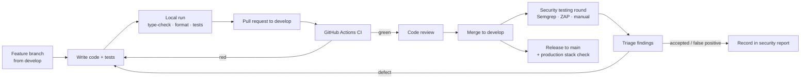

# TORPulse: Software Test Process Report

| | |
|---|---|
| **Application** | TORPulse: monitoring and analysis of Thai government procurement (TOR) documents |
| **Repository** | `Doggo-CSP/TORPulse` |
| **Build under test** | branch `security/report`, commit `5adaf3c` |
| **Test run date** | 22 November 2026 |
| **Related documents** | [security-project-report.md](security-project-report.md) (§7 security testing, §11.13 production verification) · [zap-pentest-manual.md](zap-pentest-manual.md) |

This report describes how TORPulse is tested: the test levels, tools, environments, workflow and entry/exit criteria. It also gives the results of a full test run on 22 November 2026 and lists the defects that run found in the product and in the test process itself.

**Summary**

| Item | Result |
|---|---|
| Backend tests run | **439** test cases (TAP count) in 12 groups |
| Passed / failed | **436 passed · 3 failed** (99.3 %) |
| Static checks | TypeScript ✅ · Prettier ✅ · ESLint ✅ (0 errors, 9 warnings) · `next build` ✅ |
| Dependency audit | `npm audit --omit=dev`: **0** advisories in backend and frontend |
| DAST (16 Nov, OWASP ZAP) | 5,762 attack requests, **0 High** / 2 Medium / 1 Low; all three fixed by 21 Nov |
| Manual security tests | 14 cases; 5 failed on 16 Nov, all 5 fixed and covered by regression tests by 21 Nov |
| Exit criteria met? | **No.** 3 failing tests. Also, standalone MongoDB (CI, and the self-hosted production compose) cannot run the transactions that admin actions use (TD-01). See §7. |

---

## 1. Scope

### 1.1 In scope

| Component | What is tested |
|---|---|
| Backend API (`app/backend`, Express 5 + Mongoose) | Routes, controllers, repositories, validation, auth and session middleware, role and scope checks, audit logging |
| Ingestion pipeline | e-GP and BMA adapters, Thai date parsing, submit-deadline rules, ZIP/PDF handling, TOR analysis and eligibility mapping, job repository, health checks, repair and backfill scripts |
| Notification and qualification workers | Eligibility rules, notification flow, AI qualification matching, daily AI quota, precompute |
| Frontend (`app/frontend`, Next.js 16) | Lint and production build (type-check during build). No automated UI tests (see §8). |
| Deployment | Production compose stack: TLS between services, MongoDB authentication, egress allowlist, log gateway (security report §11.13) |
| Security | SAST, dependency scanning, DAST and manual penetration tests (security report §7) |

### 1.2 Out of scope

- Live calls to Google OAuth, Gemini, e-GP, BMA and SMTP. Tests replace them with stubs; the pentest stack has no internet access.
- Load and performance testing.
- Browser compatibility and accessibility testing.

---

## 2. Test strategy

### 2.1 Test levels

| Level | Purpose | Tool | Where it runs |
|---|---|---|---|
| **Static analysis** | Catch type errors, style drift and risky patterns before running anything | `tsc --noEmit`, Prettier, ESLint (`eslint-config-next`), Semgrep | Local, CI (Semgrep is run by hand) |
| **Unit** | Check pure logic in isolation: date parsing, deadline rules, price calculations, eligibility mapping, scope tables, validation schemas | `node:test` via `tsx --test`, `node:assert` | Local, CI |
| **Integration (API)** | Send real HTTP requests through the real Express app, its middleware and a real MongoDB | `node:test` + `supertest`, MongoDB 7, in-memory session store | Local, CI |
| **System / deployment** | Check the built production stack: TLS on every hop, auth on MongoDB and Loki, egress allowlist, headers | `docker compose -f docker-compose.prod.yml`, `curl`, `mongosh`, `openssl` | Local, by hand |
| **Security** | Find vulnerabilities in code, dependencies and the running app | Semgrep, `npm audit`, CodeQL, OWASP ZAP, manual tests | CI (audit, CodeQL), isolated pentest stack (ZAP, manual) |

Most tests are API integration tests. TORPulse's main risks are in request handling (who can call what, with which input), so the tests go through the full middleware chain instead of mocking it.

### 2.2 Test design techniques

| Technique | Example in the suite |
|---|---|
| **Equivalence partitioning and boundary values** | `user.validation.test.ts`: valid and invalid email, phone and URL formats, length limits, cross-field rules. `session-timeout.test.ts`: requests just before and just after the 30-minute idle and 7-day absolute limits. `rate-limit.test.ts`: the request that crosses the limit returns 429. |
| **Negative testing** | Invalid ObjectIds return 400 instead of 500. Unknown fields are rejected by `.strict()` schemas. NoSQL operators (`{"$gt": ""}`) and regex text (`.*`) are treated as plain values. |
| **Role / permission matrix** | `admin.routes.test.ts` calls every admin route group as guest (401), user (403), suspended admin and active admin. `scopes.test.ts` checks each role's scope set. |
| **State transitions** | `auth.flow.test.ts` walks the sign-in states: OAuth redirect → callback (state, PKCE, nonce) → MFA pending → MFA verified → re-authentication. It also covers MFA lockout and session rejection when the browser family changes. |
| **Concurrency** | `admin.routes.test.ts` sends two simultaneous "demote the other admin" requests and asserts that exactly one succeeds, so at least one admin always remains. |
| **Regression tests for found defects** | Each defect from the 16 Nov manual pentest got a test when fixed. Bookmark id validation (M10), admin-only ingestion report (M14, `ingestion-report.test.ts`), OAuth `state` (M9, `auth.flow.test.ts`), rate limits (M11, `rate-limit.test.ts`), headers (M12, `security.test.ts`). |
| **Fixture-based parsing tests** | Adapter tests feed saved e-GP and BMA responses (Thai text, Buddhist-era dates) and compare the mapped output field by field. |

### 2.3 Test isolation and test doubles

- **Database:** tests read `MONGODB_URI` and `MONGODB_DATABASE` from the environment. CI and local runs use a throwaway `doggo_test` database on a local MongoDB 7. Tests must never run against the Atlas URI in `app/backend/.env`. Because `dotenv` does not override variables already set, exporting the test variables first is enough.
- **Authentication:** Google sign-in cannot run in a test. API tests use an in-memory session store. Admin tests install a test-only middleware that maps an `x-test-actor` header to a seeded user. This exists only inside the test file, not in the app. `auth.flow.test.ts` simulates Google's token endpoint and signs ID tokens with a test key, so the real OIDC checks run.
- **External services:** HTTP clients for e-GP, BMA and Gemini are replaced with stubs that return saved fixtures or errors. The mailer is replaced with a capturing transport. AI calls are disabled by setting the daily quota to 0 where needed.

---

## 3. Test process

### 3.1 Workflow



1. **Plan.** Each feature starts on a branch from `develop` (`CONTRIBUTING.md`). Test cases are planned from the use case (UC-04 … UC-16 are referenced in test names) and from the threat model (T1–T17 in the security report).
2. **Design and implement.** Tests are written in a `*.test.ts` file next to the module under test and added to the matching `test:<area>` script in `app/backend/package.json`.
3. **Run locally.** `npm run type-check`, `npm run format:check` and the relevant `npm run test:<area>` against a local MongoDB.
4. **Continuous integration.** Every push and pull request to `main` or `develop` runs `.github/workflows/ci.yml` (§4.2). A red build blocks merging.
5. **Review.** A teammate reviews the pull request, including the tests.
6. **Security testing round.** After a group of features is merged, the team runs SAST and DAST and the manual pentest list on an isolated stack (§5).
7. **Triage, fix, re-test.** Each finding is marked valid or false positive. Valid findings are fixed, get a regression test, and the original test is run again. Results are recorded in the security report.

### 3.2 Entry and exit criteria

| | Criterion | Enforced by |
|---|---|---|
| **Entry** | Code builds and type-checks | CI (`type-check`, `next build`) |
| | Test database is a local throwaway database, never Atlas | Convention; CI sets `MONGODB_URI` to its service container |
| | For DAST: pentest stack has no internet route and no `.env` baked in | Pre-flight checks in [zap-pentest-manual.md §4](zap-pentest-manual.md#4-safety-pre-flight-do-this-every-time) |
| **Exit** | All automated tests pass | CI (`npm test`) |
| | 0 Prettier differences, 0 ESLint errors | CI |
| | 0 High or Critical advisories in shipped dependencies | CI (`npm audit --omit=dev --audit-level=high`) |
| | 0 open High DAST alerts; every Medium triaged | Manual, recorded in security report §7.3 |
| | Every failed manual security test fixed and covered by an automated regression test | Manual, security report §7.4 |

---

## 4. Test environment

### 4.1 Tools and versions

| Tool | Version | Use |
|---|---|---|
| Node.js | 22 (CI), 22.23.3 (local run) | Runtime and `node:test` runner |
| tsx | 4.23 | Runs TypeScript tests (`tsx --test`) |
| supertest | 7.2 | HTTP requests against the Express app |
| TypeScript | 7.0 (backend), 5 (frontend) | Type-checking |
| Prettier / ESLint | 3.9 / 9 | Formatting and lint gates |
| MongoDB | 7 | Test database (CI service container; Docker locally) |
| OWASP ZAP | 2.x, Automation Framework | DAST |
| Semgrep | 261 rules (12 rulesets) | SAST |
| CodeQL | "CodeQL Advanced" on GitHub | SAST on push and pull request |
| Dependabot | — | Dependency update pull requests |

### 4.2 CI pipeline (`.github/workflows/ci.yml`)

| Job | Steps |
|---|---|
| **Backend** (type-check, format, test) | `npm ci` → `npm audit --omit=dev --audit-level=high` → CycloneDX SBOM (uploaded as an artifact) → `npm run type-check` → `npm run format:check` → `npm test` against a `mongo:7` service container |
| **Frontend** (lint, build) | `npm ci` → `npm audit` → SBOM → `npm run lint` → `npm run build` |

The workflow has read-only permissions (`contents: read`), and its actions are pinned to commit SHAs. A separate CodeQL workflow runs on GitHub.

### 4.3 Environments

| Environment | Database | Network | Used for |
|---|---|---|---|
| Local / CI test | Throwaway `doggo_test` (MongoDB 7) | Local only | Unit and integration tests |
| Pentest stack (`pentest/docker-compose.yml`) | Own container, `torpulse_pentest`, seeded with 23 TORs and 3 users | Docker `internal` network, no internet | ZAP scans, manual pentest |
| Production check (`docker-compose.prod.yml`, `APP_DOMAIN=localhost`) | MongoDB with TLS + auth, placeholder secrets | Egress only through the Squid allowlist | Deployment verification |

---

## 5. Security testing (summary)

Full details, commands and triage are in [security-project-report.md §7](security-project-report.md#7-security-testing-process--criteria-14-15). This is a short summary so this report covers the whole test process.

| Activity | Date | Result | Follow-up |
|---|---|---|---|
| **Semgrep** (261 rules, 217 files) | 16 Nov | 24 findings: 1 ERROR, 10 WARNING, 13 INFO. The ERROR (CI test secret) and 6 warnings were false positives. | Actions pinned to SHAs; logging moved to pino |
| **npm audit** | 16 Nov → 21 Nov | 19 advisories (2 Critical) → **0** after upgrades | CI audit gate + Dependabot |
| **npm audit** (this run) | 22 Nov | **0** in backend and frontend | — |
| **OWASP ZAP API scan** (41 endpoints, 52 active rules) | 16 Nov | 5,762 attacks; 0 High, 2 Medium, 1 Low; no injection, XSS or access-control alert | Headers added with `helmet()`; ingestion report made admin-only |
| **OWASP ZAP frontend baseline** | 16 Nov | 0 High; 2 Medium, 3 Low (missing headers, `X-Powered-By`) | CSP with nonce, `poweredByHeader: false` |
| **Manual pentest** (M1–M14) | 16 Nov | 9 passed, 5 failed (M9 OAuth state, M10 error leak, M11 no rate limit, M12 headers, M14 public report) | All 5 fixed and covered by tests by 21 Nov |
| **Production stack verification** | 21–22 Nov | All checks passed (security report §11.13) | — |

---

## 6. Test execution results (22 November 2026)

### 6.1 How the run was done

The run used the same environment variables as CI, against a throwaway MongoDB 7 container on `127.0.0.1:27099`. Each `test:<area>` script was run on its own, with the database dropped before each one. This ensures one failing group does not stop the others (see TD-04). MongoDB was started as a single-node replica set because the admin controller uses transactions (see TD-01).

```bash
docker run -d --rm --name doggo-test-mongo -p 127.0.0.1:27099:27017 mongo:7 --replSet rs0 --bind_ip_all
docker exec doggo-test-mongo mongosh --quiet --eval 'rs.initiate({_id:"rs0",members:[{_id:0,host:"127.0.0.1:27017"}]})'

cd app/backend
export NODE_ENV=test MONGODB_URI="mongodb://127.0.0.1:27099/?directConnection=true" MONGODB_DATABASE=doggo_test \
  GOOGLE_CLIENT_ID=ci-client-id GOOGLE_CLIENT_SECRET=ci-client-secret \
  GOOGLE_CALLBACK_URL=http://localhost:8000/auth/google/callback \
  SESSION_SECRET=<64 hex chars> FRONTEND_URL=http://localhost:3000
npm run type-check && npm run format:check
npm run test:auth        # repeat for each test:<area>
```

### 6.2 Static checks and build

| Check | Result |
|---|---|
| Backend `npm run type-check` | ✅ 0 errors |
| Backend `npm run format:check` | ✅ all files formatted |
| Frontend `npm run lint` | ✅ 0 errors, 9 warnings (TD-08) |
| Frontend `npm run build` | ✅ compiled; 12 routes + proxy middleware |
| `npm audit --omit=dev --audit-level=high` (both apps) | ✅ 0 vulnerabilities |

### 6.3 Automated tests by group

| Group (`npm run …`) | Area | Tests | Pass | Fail | Time |
|---|---|:-:|:-:|:-:|:-:|
| `test:central-egp` | Central e-GP adapter: details, ZIP/PDF limits, HTTP failures | 17 | 17 | 0 | 104 s |
| `test:producer` | Queue producer, ingestion health, eGP and BMA discovery | 27 | 26 | **1** | 5 s |
| `test:tor` | TOR model, repository, controller, ingestion jobs and report, Thai dates, deadlines, repair, backfills, AI extraction | 82 | 82 | 0 | 1 s |
| `test:auth` | Routes, config, scopes, full OAuth + MFA flow, rate limit, session timeout, security headers | 48 | 48 | 0 | 1 s |
| `test:user` | Validation, bookmarks, repository, profile routes, bidder profile | 51 | 51 | 0 | 1 s |
| `test:homepage` | Homepage, recommendations, TOR routes | 43 | 43 | 0 | 2 s |
| `test:report` | Procurement report calculations | 20 | 20 | 0 | <1 s |
| `test:admin` | Audit log, admin users, TORs, settings, sync, categories, legacy migration | 79 | 77 | **2** | 2 s |
| `test:category` | Category repository, routes, migration | 12 | 12 | 0 | 1 s |
| `test:notification` | Eligibility rules, notification flow | 19 | 19 | 0 | <1 s |
| `test:qualification` | AI match service, routes, daily quota, precompute | 37 | 37 | 0 | 1 s |
| *(no script)* `src/lib/outbound.test.ts` | Outbound host allowlist and redirects | 4 | 4 | 0 | 1 s |
| **Total** | 49 test files | **439** | **436** | **3** | ≈ 2 min |

Counts are the TAP totals from `node:test`, which include grouped subtests. `tor.controller.test.ts` (7 tests) runs in both `test:tor` and `test:homepage`, so the number of unique tests is 432.

### 6.4 Failed tests

| Test | File | Failure | Defect |
|---|---|---|---|
| `listAnnouncements maps eGP announcements to discovered projects` | `ingestion/adapters/egp-announcement-discovery.adapter.test.ts` | The adapter now returns `metadata.announcements: null`. The expected object in the test does not have this field. Fails every run. | TD-02 |
| `GET /admin/activity returns one item per event, newest first` | `admin/admin.routes.test.ts` | Expected `user.reactivated`, got `category.deleted`. The feed contains an event written by `admin.categories.routes.test.ts`. | TD-03 |
| parent group `transactional role changes and the audit activity feed` | `admin/admin.routes.test.ts` | Fails because its subtest failed | TD-03 |

### 6.5 Results in the CI database configuration

CI uses a plain `mongo:7` service, which is a standalone server, not a replica set. The same suites were first run that way:

| Group | Standalone MongoDB (CI setup) | Replica set |
|---|---|---|
| `test:admin` | **40 / 79 passed, 39 failed.** Every admin write that also records an audit entry fails, because MongoDB transactions need a replica set. | 77 / 79 |
| all other groups | Same as §6.3 | Same as §6.3 |

So on GitHub, `npm test` currently fails at `test:producer` (TD-02). Once that is fixed, it would fail at `test:admin` (TD-01). The production compose file also runs MongoDB standalone, so this result points to a deployment defect as well as a CI one.

The latest CI runs on GitHub (15–16 Nov, `develop` and `main`) are also red. They failed at `format:check` and `lint`. Both pass on the current commit locally, but this branch has not been through CI yet. The CodeQL workflow runs on the same pushes passed.

### 6.6 Flakiness check

`test:admin` was run six times on the replica-set database:

| Mode | Runs | Runs with failures |
|---|:-:|:-:|
| Files in parallel (default `tsx --test`) | 3 | 1 (2 failures) |
| Files one at a time (`--test-concurrency=1`) | 3 | 3 (2–3 failures) |

The failure depends on which other test files wrote to the shared `auditlogs` collection first. It is a test-isolation defect, not a product defect: the feed returns events newest first, as specified.

---

## 7. Defects

### 7.1 Found in this run

| ID | Severity | Type | Description | Suggested fix |
|---|---|---|---|---|
| **TD-01** | High | Deployment + test environment | `admin.controller.ts` uses `session.withTransaction()` in 5 places (role change, status change, profile edit, category and TOR actions, settings). MongoDB transactions need a replica set. The CI service, `docker-compose.yml`, the pentest stack and **`docker-compose.prod.yml`** all run MongoDB standalone. Only the Atlas cluster used in development is a replica set. 39 admin tests fail on standalone MongoDB, so the same admin actions are expected to fail on the self-hosted production stack. (Not yet run against that stack; §11.13 did not exercise admin writes.) | Run MongoDB as a single-node replica set everywhere: add `--replSet rs0` to the `mongo` command, run `rs.initiate()` once (init script or health check), and add `replicaSet=rs0` to the connection URI. Then add an admin write to the production verification checklist. |
| **TD-02** | Medium | Outdated test | The eGP discovery test's expected object is missing the new `metadata.announcements` field. | Add `announcements: null` to the expected object, after confirming the field is intended. |
| **TD-03** | Medium | Flaky test | The activity-feed test assumes it is the only writer to `auditlogs`, but other test files share the same database. | Clear `AuditLog` in the test's setup, or filter the feed by the actor or target created in the test. Alternatively, give each test file its own database name. |
| **TD-04** | Medium | Test process | `npm test` joins 11 groups with `&&`, so the first failing group hides the rest. In this run's CI setup, 9 groups (345 tests) never ran after `test:producer` failed. | Run all files in one `tsx --test` call (one report, no early stop), or run the groups with "continue on error". |
| **TD-05** | Low | Coverage gap | `src/lib/outbound.test.ts` (the outbound allowlist, a security control) is not in any `test:*` script, so CI never runs it. It passes when run by hand. | Add it to `test:auth` or a new `test:lib`. |
| **TD-06** | Low | Test process | `tor.controller.test.ts` runs in both `test:tor` and `test:homepage`. | Keep it in one group. |
| **TD-07** | Low | Slow test | `rejects Central eGP detail HTTP failures` takes 67 s, and three other adapter tests take 3.6 s each. They wait out real retry and back-off delays. `test:central-egp` is 87 % of the total test time. | Use `mock.timers` from `node:test`, or inject the delay function. |
| **TD-08** | Low | Code quality | 9 ESLint warnings in the frontend (unused variables, `window.location.href` navigation in `lib/reauth.ts`). Warnings do not fail CI. | Fix, then run ESLint with `--max-warnings 0`. |
| **TD-09** | Info | Deprecation | Mongoose warns that the `new` option for `findOneAndUpdate()` is deprecated. | Use `returnDocument: 'after'`. |
| **TD-10** | Info | Documentation | Security report §7.2 says CodeQL is "not set up yet", but a CodeQL Advanced workflow runs and passes on GitHub. | Update §7.2 and add the screenshot. |

### 7.2 Found by earlier test rounds (all closed)

| ID | Found by | Defect | Status |
|---|---|---|---|
| M9 / T1 | Manual pentest, 16 Nov | OAuth redirect had no `state` (login CSRF) | ✅ Fixed: `state` + PKCE + nonce; `auth.flow.test.ts` |
| M10 / T11 | Manual pentest, 16 Nov | Invalid bookmark id returned a 500 that exposed the model name | ✅ Fixed: id validated, 400; test added |
| M11 / T2 | Manual pentest, 16 Nov | No rate limit (0 × 429 after 100 requests) | ✅ Fixed: login and API limiters; `rate-limit.test.ts` |
| M12 / T10 | Manual pentest + ZAP, 16 Nov | Missing CSP, HSTS, nosniff, anti-clickjacking headers | ✅ Fixed: `helmet()`, nonce CSP; `security.test.ts` |
| M14 / T12 | Manual pentest + ZAP, 16 Nov | `/ingestion/report` was public | ✅ Fixed: admin only; `ingestion-report.test.ts` |
| npm audit | SCA, 16 Nov | 19 advisories (incl. Critical in `next` and `proxy-addr`) | ✅ Fixed by upgrades; 0 on 21 and 22 Nov |

---

## 8. Gaps in test coverage

| Gap | Risk | Recommendation |
|---|---|---|
| No code-coverage measurement | Untested code paths cannot be identified | Run with `node --test --experimental-test-coverage` (Node 22) and publish the summary in CI |
| No automated frontend tests | UI regressions (forms, auth redirects, re-auth prompt) found only by hand | Add Playwright end-to-end tests for sign-in (stubbed), onboarding, bookmarks and the admin panel |
| Workers tested through their services, not as running processes | Queue wiring and start-up errors not caught | Add a smoke test that starts each worker against the test database |
| System / deployment checks are manual | Regressions in the compose files not caught until someone re-checks | Script the §11.13 checks and run them in a scheduled CI job |
| ZAP scan run by hand | New endpoints not scanned automatically | Run the ZAP API scan in a scheduled workflow against the pentest stack |
| No load test | Rate-limit and AI-quota behaviour under load unknown | Short load test on the pentest stack |

---

## 9. Conclusion

Testing covers every backend module with 439 automated tests. Most are integration tests that go through the full Express middleware chain against a real MongoDB. Static checks, dependency audit, SAST, DAST and manual penetration tests add further layers, and every defect from the 16 November security round has been fixed and covered by a regression test.

The build does **not** meet the exit criteria yet. The most important finding is TD-01. Admin actions depend on MongoDB transactions, but every self-hosted MongoDB in the project, including the production compose file, runs standalone. The test suite caught this; the earlier manual and deployment checks did not. Two test failures (TD-02, TD-03) also stop the pipeline, and `npm test` stops at its first failing group (TD-04). Those three are problems in the tests, not the product. Each has a small, specific fix. After those fixes, the priorities are wiring in the outbound test (TD-05), measuring code coverage, and adding frontend end-to-end tests.
