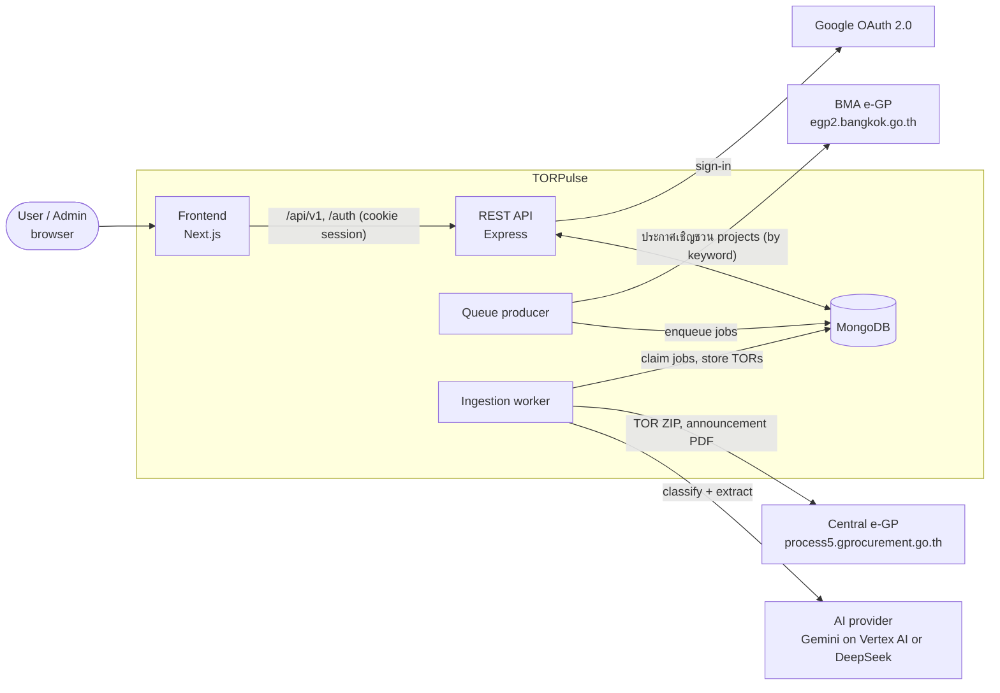
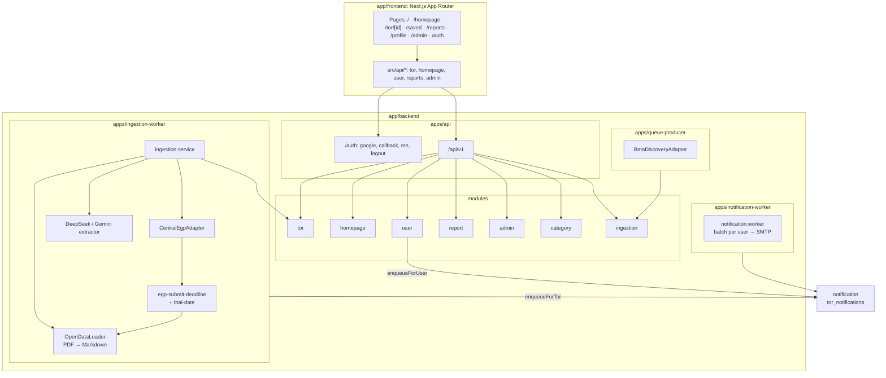
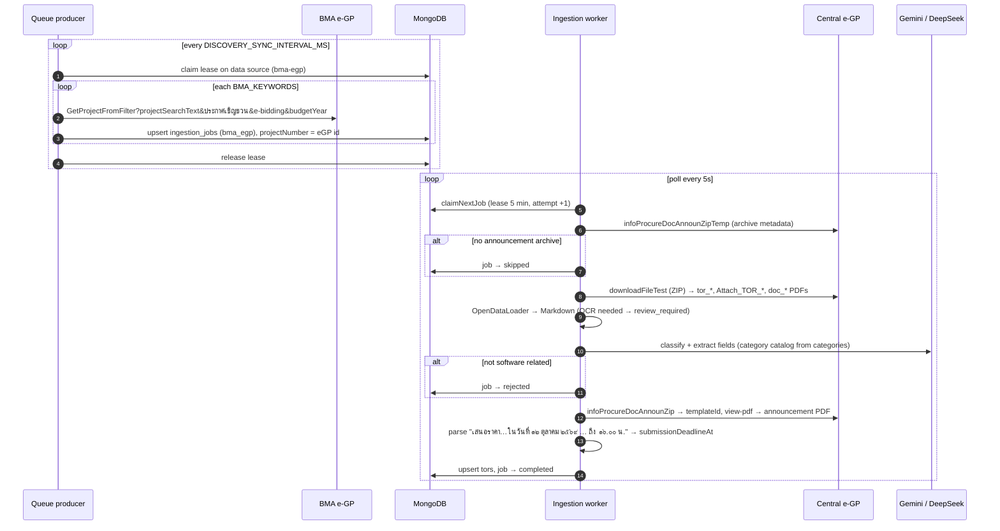
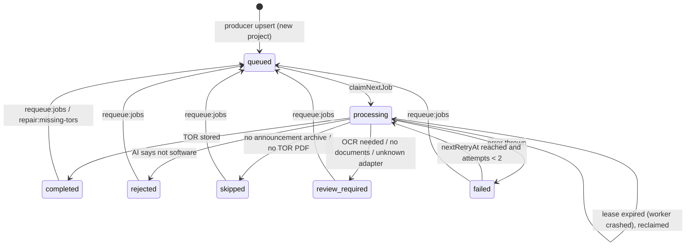
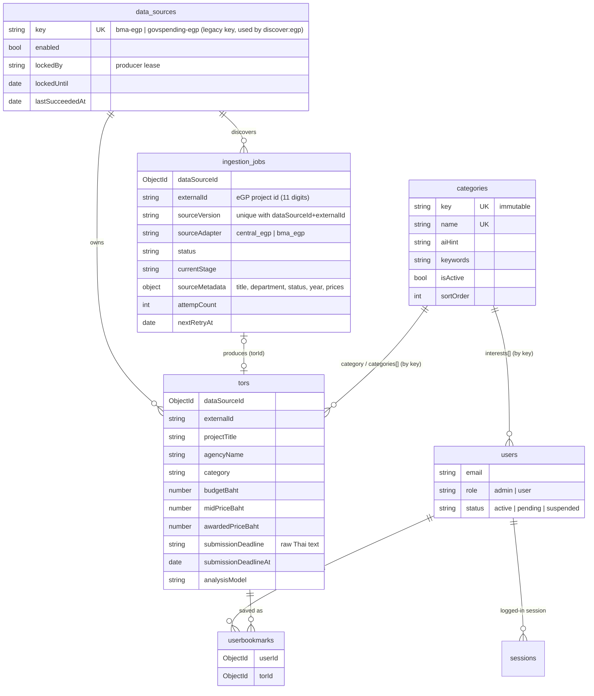

# System architecture

The diagrams below cover all of TORPulse, from the outside systems down to the job lifecycle. They are written in Mermaid, which GitHub renders. For per-field detail of the ingestion pipeline, see `tor-extractor.md`. For how to run each piece, see `commands.md`.

## 1. System context

The three backend processes run separately and share only MongoDB. There is no message broker: the `ingestion_jobs` collection is the queue.

## 2. Containers and modules

## 3. Ingestion pipeline

The deadline read from the announcement PDF takes priority over the LLM's reading; the LLM value is used only when the PDF gives no date. All Central e-GP requests in a process go through a single limiter, spaced 1.2 s apart. HTTP 429 and 5xx responses are retried with backoff.

## 4. Ingestion job lifecycle

Stages inside `processing`: `fetching_details` → `downloading` → `extracting_text` → `classifying` → `extracting_fields` → `storing`.

## 5. Data model

## 6. Discovery sources

| Source | Data source key | Job `sourceAdapter` | What it finds | Auth |
|---|---|---|---|---|
| BMA e-GP | `bma-egp` | `bma_egp` | Bangkok ประกาศเชิญชวน e-bidding projects (still open for bids), matched by keyword and budget year | none |
| eGP announcement search (manual `discover:egp`) | `govspending-egp` | `central_egp` | ร่างประกาศ / ประกาศเชิญชวน on Central e-GP | Turnstile token copied from a browser |

GovSpending discovery was removed because it only lists projects that already have a contract. Its `govspending-egp` data source key is kept for the manual eGP announcement search, so existing jobs and TORs stay linked.

Every source ends up as an 11-digit Central e-GP project id. That's why one worker, using `CentralEgpAdapter`, processes jobs from all of them.

## 7. API surface (`/api/v1`)

| Prefix | Endpoints | Used by |
|---|---|---|
| `/tors` | `GET /`, `GET /:id`, `GET /filter-options`, `GET /recommendations`, `GET /:id/similar`, `GET/POST /:id/qualification` | TOR list and detail pages (`/:id/similar` = similar TORs whose bidding has closed, UC-05; `/:id/qualification` = AI qualification match for the logged-in user, UC-08, see §10) |
| `/homepage` | `GET /summary`, `GET /analytics` | Homepage dashboard |
| `/user` | `GET/PUT /profile`, `PUT /interests`, `GET /bookmarks`, `POST /bookmarks/:torId` · `GET /bidder-profile`, `GET /bidder-profile/options`, `PUT /bidder-profile/organization`, `PUT /bidder-profile/self`, `POST /bidder-profile/team`, `PATCH/DELETE /bidder-profile/team/:memberId`, `POST /bidder-profile/projects`, `PATCH/DELETE /bidder-profile/projects/:projectId` | Profile and saved pages (bidder profile not called by the frontend yet, see §9) |
| `/reports` | `GET /price-overview`, `/savings-distribution`, `/category-comparison`, `/timeline`, `/procurement-list`, `/filters/departments` | Reports page (mock awarded price, see §8) |
| `/admin` | `GET /stats` · `GET /users`, `GET/PATCH /users/:userId`, `PATCH /users/:userId/role`, `PATCH /users/:userId/status` · `GET /activity` · `GET/PATCH /settings` · `GET /tors`, `GET/PATCH/DELETE /tors/:torId`, `POST /tors/:torId/verify`, `POST /tors/:torId/archive` · `GET /ingestion/status`, `POST /ingestion/sync` · `GET/POST /categories`, `PATCH/DELETE /categories/:categoryId`, `PATCH /categories/:categoryId/status` | Admin page (admin role only) |
| `/ingestion` | `GET /report` | Not called by the frontend yet (ops, job status report) |
| `/categories` | `GET /` | Not called by the frontend yet (active category list) |

Auth lives outside `/api/v1`: `GET /auth/google`, `GET /auth/google/callback`, `GET /auth/me` and `POST /auth/logout`. Sessions are stored in the MongoDB `sessions` collection, using the `torpulse.sid` cookie.

## 8. Price reports and the mock awarded price

Every page reads `tors`. Price reports (`/reports/*`, the homepage price chart and cards, and `/tors/:id/similar` for UC-05) need a mid price and an awarded (winning) price. BMA ingestion stores the mid price, but **not the awarded price yet**, so `modules/report/finished-tors.ts` fills in a **mock** awarded price at read time:

| TOR | Awarded price in reports |
|---|---|
| Has a real `awardedPriceBaht` | the real price (`awarded_is_mock: false`) |
| Mid price known, submission day (Bangkok) is over, not cancelled (`contractStatusCode` ≠ `S5`) | mock (`awarded_is_mock: true`) |
| Still open for bids (deadline today or later, or no deadline) | none: left out of price reports |
| Cancelled (`S5`) or no mid price | none: left out of price reports |

The mock is never written to the database and never returned by `/tors` or `/tors/:id`, so a TOR still open for bids shows no winning price anywhere. It is deterministic (an md5 hash of `externalId`) and its savings % follows the bands seen in 563 real finished software projects: 1% above the mid price, 59% saving 0–5%, 12% saving 5–10%, 7% saving 10–15%, 21% saving 15–30%. Each report response carries `source` (`collection`, `as_of`, `project_count`, `mock_awarded_count`) and every row carries `awarded_is_mock`, for developers. The pages deliberately do not show which prices are mock, so the frontend needs no change when real prices arrive; only the mock in `finished-tors.ts` goes away. Results are cached in memory for 60 seconds. Report dates use `announceDate`, then `submissionDeadlineAt`, then `analyzedAt`. The report maths is in `report.calculations.ts` and is unit tested without a database.

When ingestion starts storing real awarded prices, they replace the mock automatically, TOR by TOR.

## 9. Bidder profile and the derived qualification

The bidder profile (`bidder_profiles`, one document per user, in `modules/user`) holds what qualification matching needs in detail: the organization (juristic type, registration date, capital, SME/net worth/Bangkok office, company certifications), the individual bidder's own record (`self`) or a company's `team`, and past `projects` (name, contract value, delivery date `endDate`, …). Each person has a position, roles, years of experience, the date they joined the company (`joinedAt`), education and certifications. Roles, education levels and other enums come from fixed lists (`GET /user/bidder-profile/options`, defined in `bidder-profile.constants.ts`). Certifications are stored by name (e.g. "ISO/IEC 27001:2022", "PMP") with issuer, issue date and expiry; responses add `yearsHeld` (since `issuedAt`) and `isExpired`, and team members get `yearsAtCompany`. Certification names are judged by the AI matcher, not by keys.

`accountType` on the user picks the kind of bidder: `personal` is an individual (บุคคลธรรมดา) and edits `self`; `company` is a juristic person (นิติบุคคล) and edits `organization` and `team`. Both can add projects.

Every write to the bidder profile, and every `accountType` change, rewrites `users.qualification` from it (`deriveQualification` in `bidder-profile.qualification.ts`), then re-queues notifications for the user:

| `users.qualification` field | Derived from |
|---|---|
| `registeredCapitalBaht`, `isSme`, `hasPositiveNetWorth`, `hasBangkokOffice` | organization (company only) |
| `yearsInBusiness` | calendar years since `organization.registeredDate` |
| `maxPastContractValueBaht`, `pastContractAgeYears` | the project with the highest contract value; a project with no end date counts as current |
| `certifications` | names of company certifications that have not expired. The key-based notification matcher no longer recognizes them, so a TOR with `requiredCertifications` does not notify until notifications move to the AI matcher |
| `isThaiJuristicPerson` | `accountType === 'company'` |
| `staffRoles` | roles of the team (company) or of `self` (individual) |

So `notification/eligibility.ts` keeps reading the same flat `qualification`. Users who have no bidder profile keep the qualification they entered by hand through `PUT /user/profile`. `GET /user/bidder-profile` also returns `completeness` (UC-07): the fields still missing before matching can give a full result. Saving is never blocked by it. Required fields follow the agreed profile spec: a company needs `companyName`, `businessType`, `organization.registeredCapitalBaht` and at least one project with a contract value; an individual needs a name (`displayName`, or `firstName` and `lastName`), a contact (`contactEmail` or `phone`) and the same project. The team is optional.

## 10. AI qualification match (UC-08)

`modules/qualification` compares the logged-in user's bidder profile (§9) with one TOR and gives a percentage plus a per-requirement breakdown.

1. `POST /api/v1/tors/:id/qualification` builds two JSON snapshots and sends them to the AI provider (`AI_PROVIDER`, the same DeepSeek or Gemini settings as ingestion) in one call:
   - the TOR: title, budget, scope, `bidderQualifications`, `requirements`, `evaluationCriteria`, technologies (long text truncated);
   - the bidder: company data with years in business, every person by label (`คนที่ 1`, never by name) with position, roles, experience, years at the company, education and certifications with years held and expiry, and past projects with value, delivery date and the people who worked on them.
2. The AI lists the TOR's requirements on the bidder (skipping standard legal declarations, conditions for the other kind of bidder, bid bonds and documents to submit) and judges each one `met`, `partial`, `not_met` or `unknown`, with a Thai reason and suggestion, and whether it is a condition to bid (`mandatory`).
3. The score is computed in code, not by the AI, so the same judgments always give the same number: met = 1, partial = 0.5, not_met and unknown = 0, percentage = points / requirements × 100. `allMandatoryMet` is true when every mandatory requirement is met.
4. The result is stored in `qualification_matches` (one per user and TOR). Its `inputVersion` is the prompt version (`MATCH_PROMPT_VERSION`) plus a hash of the exact bidder and TOR snapshots the AI is shown, so edits the AI never sees (phone, interests, a person's name) do not invalidate it. A result is also stale after 30 days (`MAX_MATCH_AGE_DAYS`), because durations such as years held or certificate expiry move with time. `GET` returns the stored result and `isStale: true` when it is stale; `POST` reuses the stored result unless it is stale or `?force=true` is passed, so viewing a TOR again costs no AI call.

| Response | When |
|---|---|
| `200 { match, isStale, completeness }` | `match` is null on `GET` until the first `POST` |
| `401` | not logged in |
| `400` / `404` | invalid or unknown (or hidden) TOR id |
| `409` | agency account, or no bidder profile yet (`completeness` says what to fill in) |
| `422` | the TOR has no extracted requirement text |
| `502` | the AI call failed; the previous result is kept |

